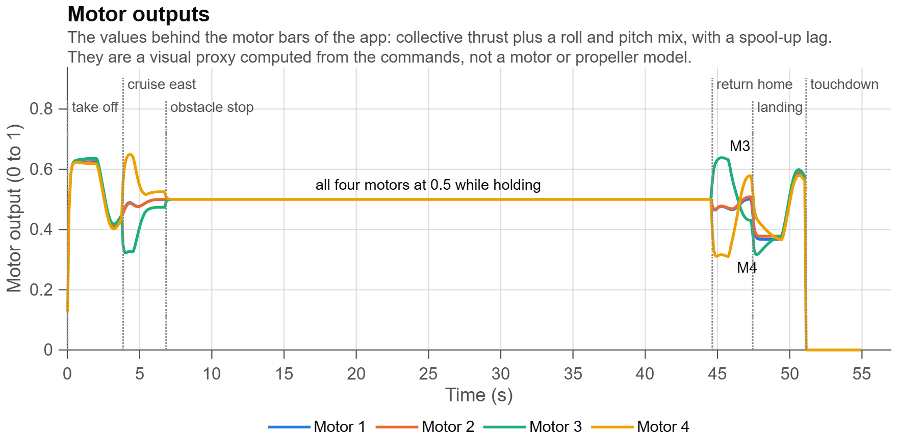
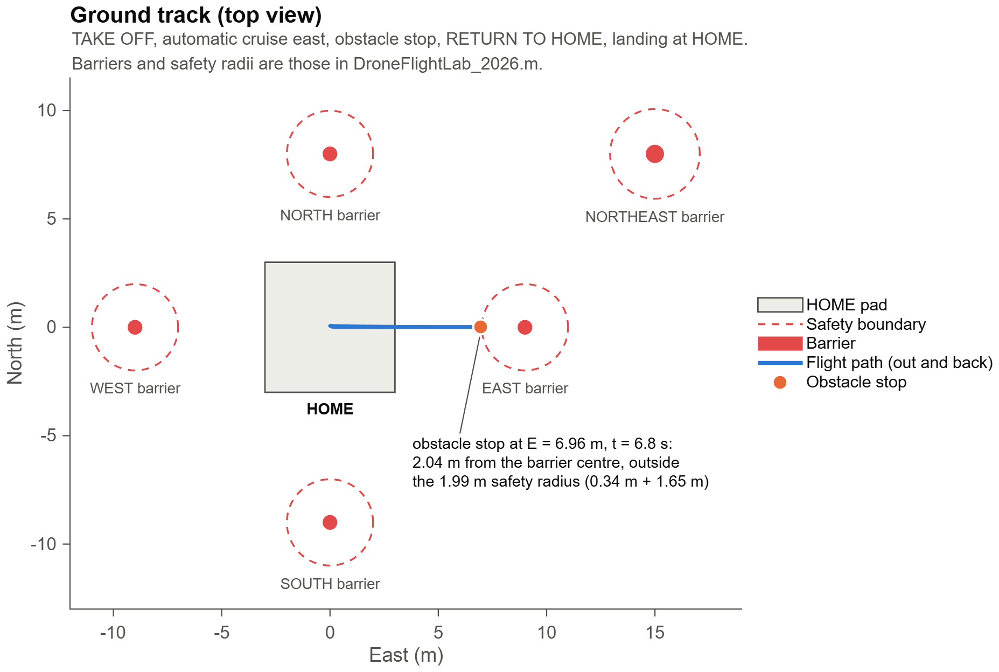
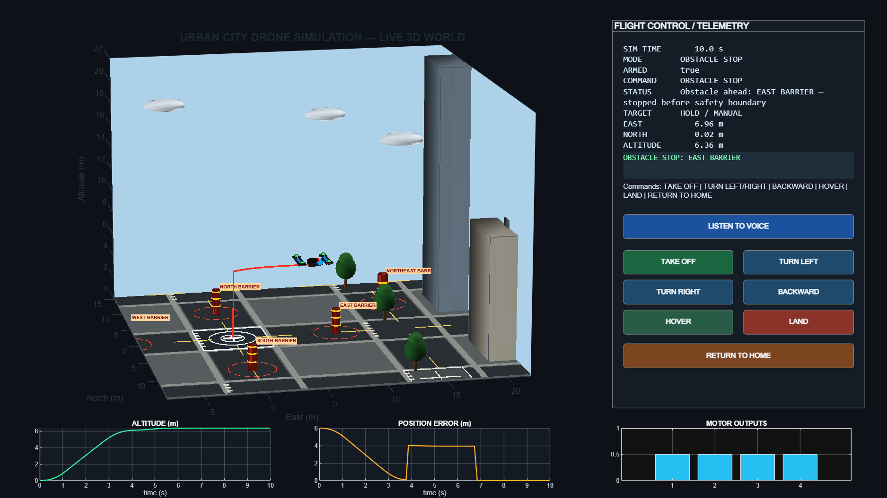

# MATLAB Drone Flight Simulation

A MATLAB-based drone flight simulation with seven flight commands, a separate voice-listening trigger, obstacle-stop behavior, and flight-analysis plots.

## Contents

- `DroneFlightLab_2026.m` — main MATLAB simulation.
- `listen_voice.ps1` — Windows voice-listener helper.
- `README_SETUP.txt` — setup instructions supplied with the project.
- `OBSTACLE_STOP_FIX.txt` — obstacle-stop notes supplied with the project.
- `outputs/` — flight plots regenerated at 200 dpi from a run of the simulation, a ground-track plot and an app screenshot.

## Requirements and installation

- MATLAB R2019b or newer (`tiledlayout` in the analysis figure); only core MATLAB functions are used.
- Windows 10 or 11 with an English speech language installed (*Settings → Time & language → Speech*) for voice input; Windows PowerShell 5.1 runs `listen_voice.ps1`.
- A microphone allowed for desktop apps. The buttons work without one.

The full write-up, with the equations of the model, is in the [branch README](../README.md).

## Flight commands

| Command | Purpose |
|---|---|
| TAKE OFF | Begin simulated takeoff |
| TURN LEFT | Turn left |
| TURN RIGHT | Turn right |
| BACKWARD | Move backward |
| HOVER | Hold position |
| LAND | Land the simulated drone |
| RETURN TO HOME | Return toward the home position |
| LISTEN TO VOICE | Separate trigger for voice-command listening; not a flight command |

## Running the project

In MATLAB, set the working directory to your extracted project folder. If you extracted the project under Downloads using the folder name below, run:

```matlab
cd(fullfile(getenv('USERPROFILE'), 'Downloads', 'DroneFlightLab_COMMANDS_7_OBSTACLE_STOP_FIXED'))
```

Then follow the instructions in `README_SETUP.txt` and run the main simulation file `DroneFlightLab_2026.m`.

If the folder has a different name or location after extraction, update the path accordingly.

## Output graphs

### East position: actual vs target


### North position: actual vs target


### Altitude: actual vs target


### Axis-wise and 3D tracking error


### Velocity components and total speed


### Drone attitude: roll, pitch, and yaw


### Motor outputs



### Ground track (top view)



### The app during the obstacle stop



> **Note:** All images come from one run of `DroneFlightLab_2026.m` on 2026-10-24 (MATLAB R2026a, 200 dpi): `TAKE OFF` at $t = 0.02$ s, an automatic cruise east, an obstacle stop at the East barrier at $t = 6.84$ s, `RETURN TO HOME` at $t = 44.6$ s and touchdown at $t = 51.1$ s. They are plotted from the telemetry the app logs. The [branch README](../README.md#3-the-mathematics-step-by-step) lists the events and results, and describes how the plots were made.

## Obstacle-stop behavior and limitations

The intended safety behavior is to stop the simulated drone before it enters a protected obstacle region rather than automatically detouring around it. The city obstacles and safety regions are simplified approximations. This is a software simulation, not a certified real-world collision-avoidance system.

## Voice listener

`listen_voice.ps1` is a Windows PowerShell helper. Review the supplied setup notes before using it, and ensure the required permissions and dependencies are available.

## Troubleshooting

- If MATLAB reports that telemetry variables are missing, follow `README_SETUP.txt` and run the simulation/export workflow before running a plotting-only script.
- If MATLAB selects the wrong copy of the main file, run:

```matlab
which DroneFlightLab_2026 -all
```

Ensure the returned path points to the extracted project folder.

- If a graph image does not render on GitHub, check that the `outputs` folder and image filenames match the relative paths above.

## Safety

This project is for simulation and educational use. Do not interpret the obstacle-stop behavior as proof of safe operation on physical drone hardware.

## References

1. The MathWorks, Inc., "MATLAB documentation." [Online]. Available: <https://www.mathworks.com/help/matlab/>
2. Microsoft, "System.Speech.Recognition namespace," .NET API documentation. [Online]. Available: <https://learn.microsoft.com/dotnet/api/system.speech.recognition>
3. R. Mahony, V. Kumar, and P. Corke, "Multirotor aerial vehicles: Modeling, estimation, and control of quadrotor," *IEEE Robot. Autom. Mag.*, vol. 19, no. 3, pp. 20–32, 2012. doi: [10.1109/MRA.2012.2206474](https://doi.org/10.1109/MRA.2012.2206474)
