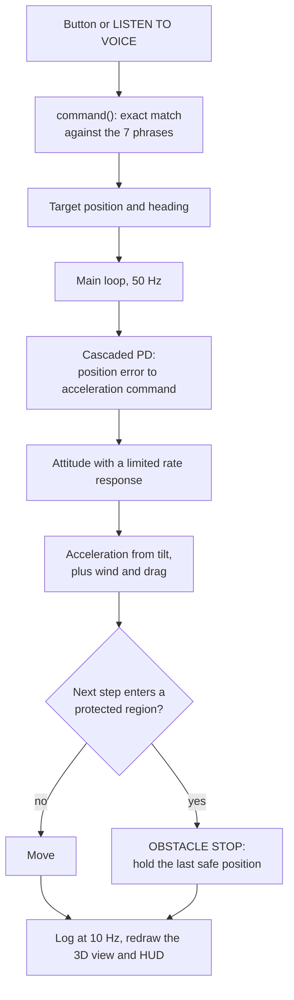
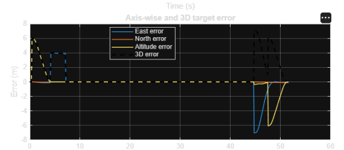
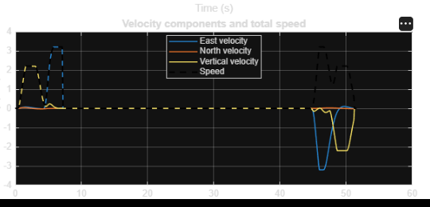
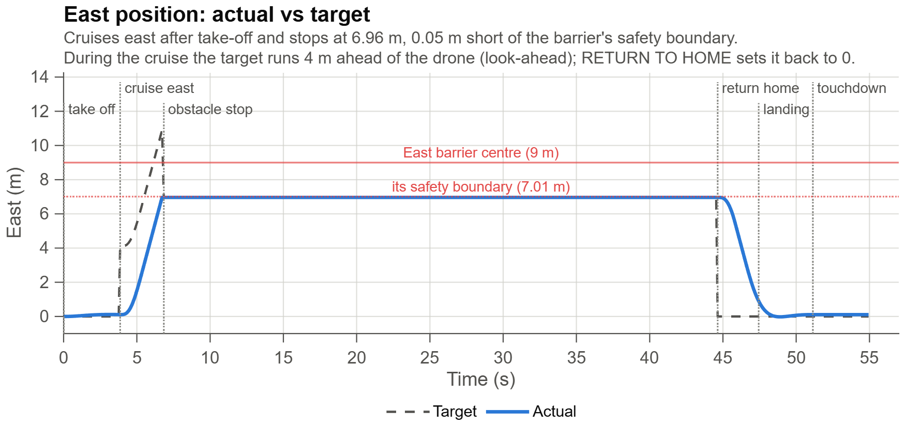
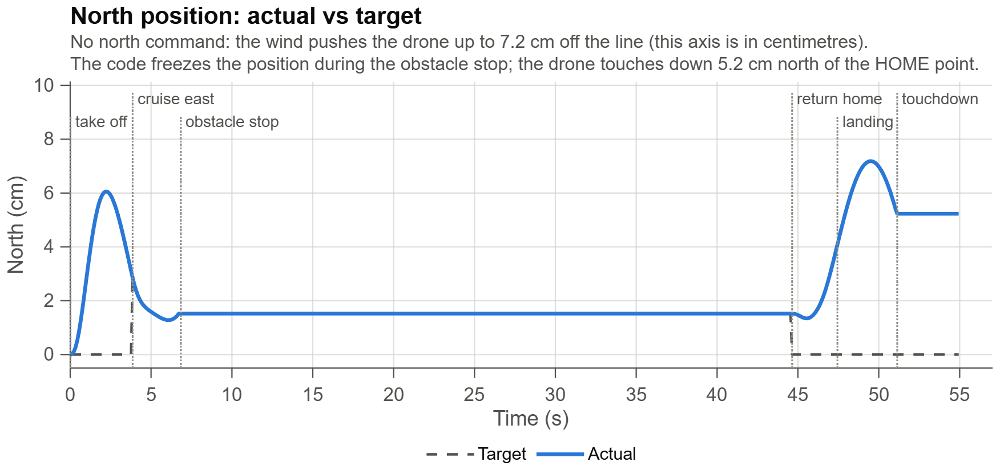
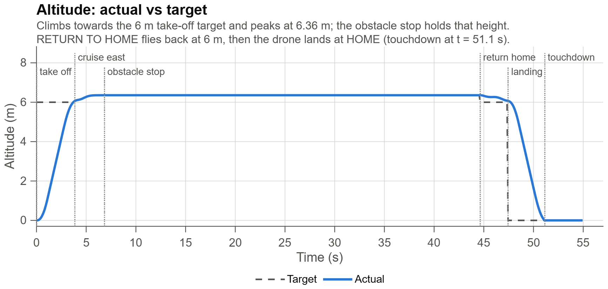
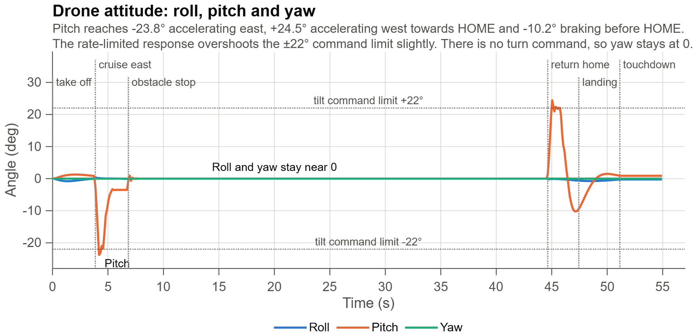

## Attempt · MATLAB Drone Flight Lab — A Voice-Controlled Drone Simulation in a 3D City

**In one sentence:** we built a MATLAB simulation in which a user can issue a small set of flight commands through buttons or voice input, watch the drone move through a city-like environment, stop movement when the configured obstacle check detects an unsafe region, and inspect the recorded flight through analysis plots.

---

### Requirements and installation

| Requirement | Details |
|---|---|
| MATLAB | R2019b or newer (the analysis figure uses `tiledlayout`, added in R2019b; `exportgraphics` for high-resolution plots needs R2020a). Only core MATLAB functions were found in the code: figures, `uicontrol` buttons, 3D plotting, `table` and `writetable` |
| Operating system | Windows 10 or 11 for voice input (the buttons work on any system that runs MATLAB) |
| Speech recogniser | An English speech language installed in Windows: *Settings → Time & language → Speech*, then add an English language with speech recognition |
| PowerShell | Windows PowerShell 5.1, included with Windows; `listen_voice.ps1` loads the .NET `System.Speech` assembly |
| Microphone | Allowed for desktop apps in *Settings → Privacy & security → Microphone* |

Install and run:

```bash
git clone --branch Drones_Matlab --single-branch https://github.com/praann07/Drones_S5_AB8_ESP32VoiceDrone.git
```

```matlab
cd('Drones_S5_AB8_ESP32VoiceDrone/DroneFlightLab_MATLAB')   % the folder with DroneFlightLab_2026.m and listen_voice.ps1
clear functions; close all force; rehash
which DroneFlightLab_2026 -all                               % must point to this folder
DroneFlightLab_2026                                          % opens the flight lab
```

To list the MATLAB products the code needs on your installation:

```matlab
[~, products] = matlab.codetools.requiredFilesAndProducts('DroneFlightLab_2026.m');
{products.Name}
```

### 1. The problem, in plain words

A quadrotor does not have a steering wheel. It changes direction and altitude by changing the forces and torques generated by its rotors. In a real drone, a flight controller repeatedly reads the state of the vehicle and changes its control inputs. In a simulation, the same broad idea can be represented by updating a virtual drone's state and visualizing its response.

A command such as **TAKE OFF** requests an increase in altitude. **TURN LEFT**, **TURN RIGHT**, and **BACKWARD** request directional movement. **HOVER** asks the drone to hold position, while **LAND** and **RETURN TO HOME** request the corresponding end-of-flight actions.

A command is only a request. It is important to distinguish the requested target from the actual simulated state: a drone can take time to respond, may be blocked by an obstacle check, or may not reach its target before the simulation ends. That difference is why logging and plots matter.

There are three practical challenges:

- **Command interpretation:** convert a button press or recognized voice command into a flight action.
- **Safe movement:** stop the simulated drone if the configured obstacle-safety check identifies that the requested movement would enter a protected obstacle region.
- **Verification:** record what happened and compare the actual flight state with the requested target instead of relying only on the visual animation.

**Our approach** is to combine the command interface, 3D visualization, a simplified obstacle-stop check, and telemetry-based analysis in one MATLAB simulation.

### 2. The idea, in five steps

| Step | What happens | In plain words |
|---|---|---|
| **A. Command** | The user selects a supported button or invokes voice input. | Tell the simulated drone what to do. |
| **B. Interpret** | The command is processed by the simulation. | Turn the request into a flight action or target. |
| **C. Check** | The requested movement is checked against configured obstacle regions. | Stop rather than continue into a detected protected region. |
| **D. Simulate** | The drone state and 3D scene are updated. | Watch the requested action play out in the virtual city. |
| **E. Analyse** | State values are logged and plotted. | Check the trajectory, tracking, errors, and motion after the run. |



*How one command flows through `DroneFlightLab_2026.m` (read from the code).*

The intended obstacle response is a **stop**, not an automatic route around the obstacle. The results depend on the source code, the configured obstacle geometry, and the telemetry that was recorded during the run.

The five steps form a single workflow: input creates a request, the simulation checks and processes the request, the virtual state changes, and recorded data helps us assess what happened. A visual animation is useful for demonstration, while the numerical data is needed for a more careful evaluation.

### 3. The mathematics, step by step

This section explains the quantities used to analyse the flight. These are standard state and error definitions; they should not be read as proof that the simulation uses a particular advanced controller or physical model.

#### 3.1 Position and target

The drone's position can be represented by a three-dimensional vector:

```math
p(t) = \begin{bmatrix} x(t) & y(t) & z(t) \end{bmatrix}^\top
```

Here:

- $x(t)$ is the East coordinate (m).
- $y(t)$ is the North coordinate (m).
- $z(t)$ is the altitude (m).

These match the CSV export columns `East_m`, `North_m` and `Altitude_m`.

The requested target position is

```math
p_{target}(t) = \begin{bmatrix} x_{target}(t) & y_{target}(t) & z_{target}(t) \end{bmatrix}^\top
```

The actual position describes where the simulated drone is at a particular sample. The target position describes where the command or target logic is asking it to go. They are not interchangeable, and plotting them separately is what makes tracking performance visible.

In the code, TURN LEFT and TURN RIGHT change the heading by $\pm 45^\circ$ and continue along it, BACKWARD moves 4 m against the heading, and TAKE OFF climbs to 6 m.

#### 3.2 Position tracking error

To see how far the drone is from its requested target, define the error as

```math
e(t) = p_{target}(t) - p_{actual}(t)
```

Per axis:

```math
e_x = x_{target} - x_{actual}, \qquad e_y = y_{target} - y_{actual}, \qquad e_z = z_{target} - z_{actual}
```

An error close to zero means that the actual position is close to the target on that axis. A positive or negative component indicates the direction of the difference under this definition.

The three-dimensional error magnitude is

```math
e_{3D} = \sqrt{e_x^2 + e_y^2 + e_z^2}
```

Because it is a magnitude, $e_{3D} \ge 0$. If a graph of 3D error dips below zero, the plotted variable is not the magnitude defined above.

A useful summary of tracking error can include:

- **Maximum error:** the largest 3D error during the run.
- **Mean error:** the average 3D error across the recorded samples.
- **Root mean square error (RMSE):** a measure that gives larger errors more influence.

For samples $e_{3D}(1), \ldots, e_{3D}(N)$, the RMSE of the 3D error magnitude is

```math
\mathrm{RMSE}_{3D} = \sqrt{\frac{1}{N}\sum_{k=1}^{N} e_{3D}(k)^2}
```

These measures should only be reported after calculating them from actual telemetry. A plot by itself does not establish a numerical RMSE.



#### 3.3 Velocity and total speed

Velocity describes the rate of change of position:

```math
v(t) = \begin{bmatrix} v_x(t) & v_y(t) & v_z(t) \end{bmatrix}^\top
```

The magnitude of the velocity is the total speed:

```math
\lVert v \rVert = \sqrt{v_x^2 + v_y^2 + v_z^2}
```

Individual velocity components may be negative when the drone moves in the negative direction along an axis. Total speed cannot be negative.

A simple discrete-time position relationship is

```math
p(k+1) \approx p(k) + v(k)\, \Delta t
```

where $\Delta t$ is the simulation time step. The code uses $\Delta t = 0.02$ s and updates the velocity first, then the position with the new velocity (Section 3.7).

Velocity helps distinguish between two situations that may look similar in a screenshot: a drone passing through a target position at speed, and a drone arriving and settling near the target. To evaluate a hover or landing action, inspect both position and velocity rather than position alone.



#### 3.4 Actual versus target plots

The position-tracking output plots actual and target values against time. It is normally split into three panels:

- East or first horizontal coordinate.
- North or second horizontal coordinate.
- Altitude.

The actual curve should respond to command changes and, when the simulated controller is functioning as intended, move toward the target. Delays and transitions may occur during takeoff, directional movement, return-to-home, or landing.

If actual and target curves overlap, that suggests small tracking error at the scale of the graph. It does not automatically prove perfect tracking: axes may hide small differences, and the logged data and calculation should still be checked.







#### 3.5 Attitude and motor outputs

If the simulation logs them, attitude plots can display roll, pitch, and yaw. These angles describe the simulated orientation according to the source's convention. Motor-output plots show the values recorded by the simulation; they should not be interpreted as calibrated physical motor speeds or thrust unless a validated relationship is implemented.

A sudden attitude change may coincide with a command transition or correction, but it should be interpreted alongside position, velocity, and the command timeline. No numerical attitude limit or motor-performance claim should be made unless it is defined and verified in the actual code.



#### 3.6 Why data alignment matters

The time vector and each telemetry array must refer to the same samples. If `logT` contains 100 samples but `logPos` contains 95, plotting them against each other will fail or produce misleading results. The position and target arrays should also have the expected number of columns, usually three for the three coordinates.

Before calculating a metric, check:

- The arrays are populated, not empty.
- The time and state arrays have compatible row counts.
- The values use the same coordinate system and units.
- The target and actual arrays are aligned in time.
- Any missing or invalid samples are handled deliberately.

#### 3.7 The simulation model inside `DroneFlightLab_2026.m`

The equations below are read directly from the code. The time step is $\Delta t = 0.02$ s (50 Hz) and $g = 9.81\ \mathrm{m/s^2}$.

**Position loop (cascaded PD to an acceleration command).** With $e = p_{target} - p$:

```math
a_{cmd,xy} = 1.55\, e_{xy} - 1.75\, v_{xy}, \qquad a_{cmd,z} = 2.35\, e_z - 2.0\, v_z
```

and the horizontal command is limited to $\lvert a_{cmd,xy} \rvert \le g \tan\theta_{max}$.

**Attitude.** The commanded tilt follows from the acceleration, and the attitude moves towards it with a rate limit of $75^\circ$/s in roll and pitch and $100^\circ$/s in yaw:

```math
\theta_{cmd} = -\operatorname{atan2}(a_{cmd,x},\ g), \qquad \phi_{cmd} = \operatorname{atan2}(a_{cmd,y},\ g)
```

**Translation.** The horizontal acceleration comes from the actual tilt, plus wind and a quadratic drag term; vertical thrust compensates for the tilt:

```math
a_x = -g\tan\theta + 0.10\, w_x - 0.055\, v_x \lvert v_x \rvert, \qquad
a_y = g\tan\phi + 0.10\, w_y - 0.055\, v_y \lvert v_y \rvert, \qquad
T_z = \frac{g + a_{cmd,z}}{\max(0.72,\ \cos\phi\cos\theta)}
```

**Integration (semi-implicit Euler).**

```math
v_{k+1} = v_k + a_k\, \Delta t, \qquad p_{k+1} = p_k + v_{k+1}\, \Delta t
```

**Obstacle stop.** For the step from $p$ to $p + s$, the point closest to an obstacle centre $c$ is $p + \tau s$ with

```math
\tau = \mathrm{clip}\!\left(\frac{(c - p)\cdot s}{s \cdot s},\ 0,\ 1\right)
```

The step is refused (the drone stops at its last safe position) if that point lies within the obstacle radius plus 1.65 m; buildings use a bounding circle of radius $\tfrac{1}{2}\sqrt{w^2 + d^2} + 1.65 + 0.25$ m. A step that increases the distance from an obstacle is always allowed.

**Failsafes.** Geofence of 75 m from home (return home), battery below 20 % (return home) and below 10 % (land). The motor bars are a visual proxy computed from the commands, not a motor model.

#### Regenerating the plots at a readable resolution

The six images in `DroneFlightLab_MATLAB/outputs/` are screenshots supplied with the project (about $550 \times 250$ pixels). To export sharper versions after a flight, press **SAVE CSV**, then plot the CSV and export each figure, for example:

```matlab
T = readtable('DroneFlightLab_Telemetry.csv');
f = figure('Color', 'w', 'Position', [100 100 1100 420]);
plot(T.Time_s, T.Altitude_m, 'LineWidth', 1.5); hold on
plot(T.Time_s, T.TargetAltitude_m, '--', 'LineWidth', 1.5)
grid on; xlabel('Time (s)'); ylabel('Altitude (m)'); legend('Actual', 'Target')
exportgraphics(f, 'outputs/altitude_actual_vs_target.png', 'Resolution', 200)
```

### 4. What it can do

| Capability | How it is used | What to verify |
|---|---|---|
| Take off | `TAKE OFF` command | Altitude increases from the initial state. |
| Turn left | `TURN LEFT` command | Position changes in the intended direction. |
| Turn right | `TURN RIGHT` command | Position changes in the intended direction. |
| Move backward | `BACKWARD` command | Movement follows the code's coordinate convention. |
| Hover | `HOVER` command | The drone attempts to hold or settle near the requested position. |
| Land | `LAND` command | Altitude decreases toward the landing level. |
| Return home | `RETURN TO HOME` command | The requested target or movement heads toward the configured home position. |
| Voice input | `LISTEN TO VOICE` listener trigger and the Windows helper | A supported spoken command is recognized and passed to the simulation. |
| Obstacle stop | Configured obstacle-safety check | The simulated movement stops when the check detects an unsafe request. |
| Flight analysis | Telemetry and plotting code | Graphs are generated from populated, correctly aligned data. |

`LISTEN TO VOICE` is a listener trigger, not an additional flight command. Voice recognition depends on the microphone, Windows permissions, speech-recognition setup, and the helper script.

#### 4.1 Command behaviour in more detail

- **TAKE OFF:** the simulation requests an increase in altitude. Check the altitude curve and the 3D scene to verify the response.
- **TURN LEFT / TURN RIGHT:** these request horizontal movement according to the source's direction convention. Do not infer compass heading from the button label alone.
- **BACKWARD:** requests movement opposite the defined forward direction. The actual coordinate change depends on how forward and backward are mapped in the source.
- **HOVER:** requests a hold at the current or configured target, depending on the implementation. Position and speed plots help determine whether the drone settles.
- **LAND:** requests descent to the landing level. Check whether the simulation stops the descent at the intended floor or ground height.
- **RETURN TO HOME:** requests movement toward the configured home point. Confirm the home coordinates and the target updates in the source.
- **LISTEN TO VOICE:** starts or invokes the voice-listening flow; the recognized speech should be one of the supported flight commands.

### 5. The world it flies in

The simulation presents a three-dimensional, city-like environment containing buildings and configured obstacle regions. This scene gives the user a visual reference for the drone's movement and helps demonstrate the obstacle-stop behavior.

The screenshot of the simulation is intentionally not embedded in this Markdown file. If you want to show it in a repository later, add the image separately and insert a relative image link at this point.

The environment and safety check should use consistent coordinates. A visual building and a numerical obstacle region are not necessarily the same thing unless both are configured and checked by the simulation code.

#### 5.1 Visual environment versus collision geometry

The scene shown on screen is a visualization. The obstacle check uses the geometry and rules implemented in the code. To interpret a stop event correctly, the visible obstacle and the checked obstacle region need to correspond to each other.

If the visual building has a different footprint from the configured safety region, the drone may appear to stop too early or too late relative to the rendered building. This should be checked by inspecting the geometry definitions rather than by relying only on the screenshot.

#### 5.2 The meaning of an obstacle stop

The obstacle-stop behavior is deliberately different from obstacle avoidance:

- **Stop behaviour:** detect a movement that violates the configured safety condition and stop the simulated motion.
- **Avoidance behaviour:** calculate a different direction or route and continue moving around the obstacle.

This project description covers the first behaviour. It should not be described as A*, LiDAR-based planning, automatic detouring, or complete 3D collision avoidance unless those functions are actually implemented in the submitted source.

### 6. What is and is not claimed

**The project is intended to demonstrate:**

- A MATLAB-based 3D drone simulation.
- A limited set of manual flight commands.
- A Windows PowerShell voice-input helper where the local setup supports it.
- Simulated movement with a configured obstacle-stop response.
- Flight telemetry and plots for examining trajectory, target tracking, error, velocity, attitude, obstacle clearance, and motor outputs when those data are available.

**The following should not be claimed without additional source code or test evidence:**

- A validated real-world drone flight controller.
- Certified or guaranteed collision avoidance.
- Automatic obstacle detouring or global path planning.
- A particular advanced control method, such as SINDy-based model discovery, quaternion backstepping, or a Kalman filter, unless it is actually implemented in the submitted MATLAB source.
- Successful physical-drone hardware tests.
- Numerical performance or safety metrics that have not been calculated from recorded data.

#### 6.1 Reading the output graphs correctly

The recommended analysis outputs are:

1. **3D trajectory:** the path through the three position coordinates.
2. **Position tracking:** actual versus target position for each axis.
3. **Axis-wise and 3D target error:** the difference between target and actual position.
4. **Velocity and total speed:** motion along each axis and the speed magnitude.
5. **Drone attitude:** roll, pitch, and yaw, if logged.
6. **Obstacle clearance:** an estimate based on the available obstacle geometry and position data.
7. **Motor outputs:** the simulated values, if logged.

These plots are useful only if they use actual data from the simulation. A blank plot or an error such as `Unrecognized function or variable 'logT'` means the plotting code cannot access the required variable. It does not mean the flight data was successfully plotted.

#### 6.2 Telemetry variables

The graph scripts discussed for this project refer to variables such as:

| Variable | Intended content |
|---|---|
| `logT` | Simulation timestamps |
| `logPos` | Actual position samples |
| `logTarget` | Target position samples |
| `logVel` | Velocity samples |
| `logAtt` | Attitude samples |
| `logMot` | Simulated motor-output samples |

Variable availability depends on the version of the main MATLAB function and where the arrays are defined. If these variables are local to `DroneFlightLab_2026`, a separate script in the base workspace will not automatically see them. The plotting code must be run in the owning function's workspace or the populated data must be exported after logging.

A workspace check can be made with:

```matlab
whos logT logPos logTarget logVel logAtt logMot
```

Do not create empty arrays merely to silence an undefined-variable error: the graphs need the real recorded samples.

#### 6.3 Suggested output interpretation table

| Output | What it helps answer | Basic correctness check |
|---|---|---|
| 3D trajectory | Where did the drone travel? | The path agrees with the executed commands and recorded positions. |
| Actual vs target | Did the simulated drone follow its target? | Time samples align and both curves use the same units. |
| 3D error | How far was the drone from the target? | Error magnitude is nonnegative and matches the position differences. |
| Velocity and speed | How fast and in which direction did it move? | Speed is nonnegative and matches the velocity components. |
| Attitude | How did the orientation change? | Values correspond to the recorded attitude convention and command timing. |
| Obstacle clearance | How close was it to configured obstacle regions? | Geometry, units, and safety margin match the source. |
| Motor outputs | What simulated motor values were recorded? | Values come from the run, not manually created placeholders. |

### 7. Where to read more

| If you want… | Open or check |
|---|---|
| Main simulation and controls | `DroneFlightLab_2026.m` (or the exact main `.m` file in the submitted version) |
| Voice-input helper | `listen_voice.ps1` |
| The analysis figures | The ANALYSIS button in the app (`analysis` function in `DroneFlightLab_2026.m`) and the SAVE CSV export |
| MATLAB function lookup | Run `which DroneFlightLab_2026 -all` in the MATLAB Command Window |
| Check whether telemetry exists | Run `whos logT logPos logTarget logVel logAtt logMot` after a simulation run |
| MATLAB plotting documentation | https://www.mathworks.com/help/matlab/creating_plots/ |
| MATLAB language documentation | https://www.mathworks.com/help/matlab/ |

**Main project reference:** the submitted MATLAB source and its associated helper files. Any implementation-specific behaviour, numerical results, or safety claims should be confirmed against those files and measured simulation output.

#### 7.1 Quick troubleshooting guide

| Symptom | Likely reason | What to check |
|---|---|---|
| MATLAB cannot find the main function | Wrong current folder or filename | Use `cd(...)` and `which DroneFlightLab_2026 -all`. |
| Old buttons appear | MATLAB resolved an older copy | Check all paths, then run `clear functions`, `close all force`, and `rehash`. |
| `logT` or `logPos` is undefined | Telemetry is local to a function or has not been recorded | Run the simulation, inspect the workspace, and export the populated arrays or plot inside the function. |
| Graph is blank | Empty arrays or no recorded samples | Check array sizes and confirm that a flight was run. |
| Plot errors due to vector lengths | Time and telemetry samples do not align | Compare `numel(logT)` and the number of rows in each data array. |
| Voice command is not recognized | Microphone, permissions, or listener setup issue | Test microphone access and inspect the PowerShell / MATLAB error output. |
| Drone stops near an obstacle | Safety check may have flagged the protected region | Inspect obstacle geometry and the configured safety margin; do not assume the stop is a bug without checking. |

---

### 8. References

Every link was checked on 2026-10-24.

1. R. Mahony, V. Kumar, and P. Corke, "Multirotor aerial vehicles: Modeling, estimation, and control of quadrotor," *IEEE Robot. Autom. Mag.*, vol. 19, no. 3, pp. 20–32, 2012. doi: [10.1109/MRA.2012.2206474](https://doi.org/10.1109/MRA.2012.2206474)
2. K. J. Åström and T. Hägglund, *PID Controllers: Theory, Design, and Tuning*, 2nd ed. Research Triangle Park, NC, USA: Instrument Society of America, 1995.
3. The MathWorks, Inc., "MATLAB documentation." [Online]. Available: <https://www.mathworks.com/help/matlab/>
4. Microsoft, "System.Speech.Recognition namespace," .NET API documentation. [Online]. Available: <https://learn.microsoft.com/dotnet/api/system.speech.recognition>
5. The MathWorks, Inc., "exportgraphics: Save plot or graphics content to file," MATLAB documentation. [Online]. Available: <https://www.mathworks.com/help/matlab/ref/exportgraphics.html>
