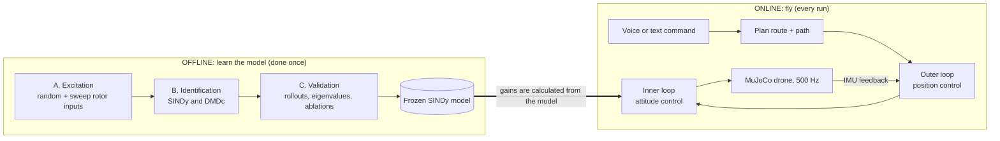
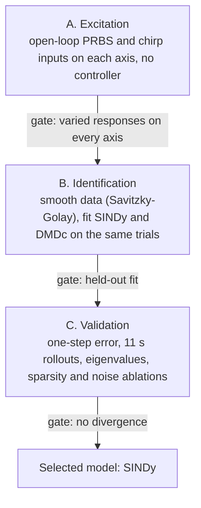
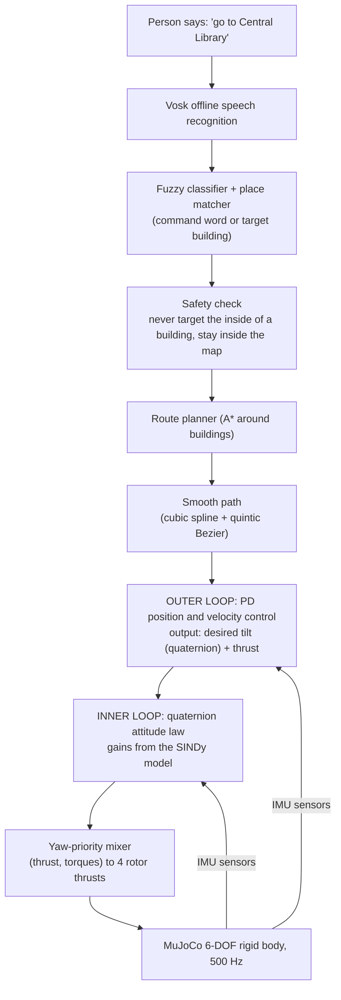
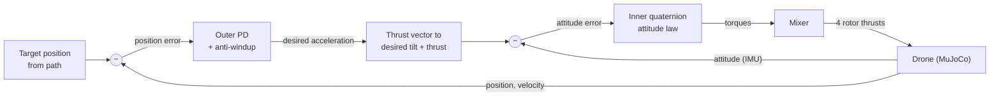

# Pipeline, Flow and Architecture

*Voice-Controlled Quadrotor with a Data-Driven Attitude Loop · MuJoCo model · branch [`drone_mujoco`](https://github.com/praann07/Drones_S5_AB8_ESP32VoiceDrone/tree/drone_mujoco)*

This document explains the whole idea in one place: what the project is, how data turns into a controller, and how a spoken word ends up as motion. Diagrams use Mermaid, which GitHub draws automatically.

---

## 1. The idea in one paragraph

A quadrotor is flown by choosing four propeller thrusts hundreds of times per second. Instead of writing the rotation physics by hand, we let the drone **fly randomly, record what happened, and have SINDy (sparse identification of nonlinear dynamics) discover the rotation equation from that data**. The inner attitude controller is then **calculated from the discovered equation**. A standard position controller sits on top of it, and a voice interface sits on top of that, so a person can say "go to the library" and the drone flies there on the campus map.

**One design decision shapes everything:** only the *inner attitude loop* is learned from data. Straight-line flight is Newton's second law (a double integrator), so there is nothing for a data-driven method to discover there. Rotation has drag, cross-axis coupling and quaternion constraints, so that is the part worth learning.

---

## 2. The big picture: two flows

The project has two separate flows that meet at the controller.



The thick arrow is the point of the project: the model learned offline is what the inner loop is built on when flying online.

---

## 3. Offline flow: from flight data to a model

Every stage had a pass/fail gate that had to be met before the next one started.



| Stage | What happens | Why it matters | Code |
|---|---|---|---|
| **A. Excitation** | Random (PRBS) and sweep (chirp) rotor inputs, with no controller active | The data must be rich, or the fit learns nothing. Trials are split into train and held-out **by whole trial**, so the test is honest | `01_simulation/` |
| **B. Identification** | Smooth the data, then fit **SINDy** and **DMDc** on the same trials | SINDy keeps 44 of 156 candidate coefficients (26 terms in each of 6 equations), held-out R² = 0.9946 | `02_identification/` |
| **C. Validation** | One-step error, 11 s open-loop rollouts, eigenvalues, sparsity and noise ablations, head-to-head | SINDy was selected, and 0 of 7 rollouts diverged | `03_validation/` |

### SINDy and DMDc in one line each

- **SINDy** searches a library of candidate terms (such as angular rate times angular rate, or rotor thrust) and keeps only the few that explain the data. The result is a short, readable equation that can handle nonlinear behaviour.
- **DMDc** (dynamic mode decomposition with control) fits a single linear model of the form *next state = A × state + B × input*. It is the linear baseline we check SINDy against. It is only valid near hover.

---

## 4. Online flow: from a spoken word to motion



### What each box does

| Step | Plain-language job | Code |
|---|---|---|
| **Voice recognition** | Offline speech-to-text (Vosk), or typed text | `05_voice_interface/` |
| **Fuzzy classifier + place matcher** | Work out what was *meant*: "forwad" becomes *forward*; "central library" becomes a building. A command is accepted only if it is close enough, otherwise it is ignored | `05_voice_interface/` |
| **Safety check** | A recognised command is only a request. A target inside a building, or outside the map, is refused | `01_simulation/models/` |
| **Route planner** | A* search over a grid of building cells to find a route that goes around buildings | `04_control/` |
| **Smooth path** | Turns the corner-to-corner route into a smooth curve the drone can actually follow | `04_control/` |
| **Outer loop** | Standard physics: PD control of position and velocity with an anti-windup integral. It decides *how much to tilt and how hard to push* | `04_control/` |
| **Inner loop** | The learned part. A quaternion attitude law whose gains come from the identified hover linearisation. It decides *which torques to ask for* | `04_control/` |
| **Mixer** | Converts (total thrust, three torques) into four rotor thrusts, with yaw given priority | `04_control/` |
| **MuJoCo** | Full 6-DOF rigid-body physics at 500 Hz (time step 0.002 s). Its simulated IMU feeds back into both loops | `01_simulation/` |

Frames are ENU for the world and FLU for the drone body, with Hamilton scalar-first quaternions, and all units are SI.

---

## 5. The control cascade, zoomed in



Two loops, two speeds: the inner loop reacts quickly to keep the drone's tilt where the outer loop wants it, and the outer loop moves the drone to where the path wants it. That separation is why the inner loop can be designed from the rotation model alone.

---

## 6. Where the learned model enters the controller


The gains are **calculated**, not hand-tuned. If the identified model were wrong, the gains would be wrong, so the quality of Stage C (validation) directly decides whether the controller can be trusted.

---

## 7. The world it flies in

- A **1:10 scale model of the Amrita Coimbatore campus**, built from OpenStreetMap building outlines and a satellite photo.
- **31 named buildings** that can be targets of a "go to" command.
- Buildings are obstacles: the planner routes around them and the safety layer keeps the drone out.
- Turns are rounded rather than exact right angles, and the drone cannot graze along an angled wall (both fixed on 2026-10-22).

---

## 8. Results at a glance

| Stage | Result |
|---|---|
| Identification | SINDy held-out R² **0.9946**, 44 of 156 coefficients kept |
| Validation | SINDy selected; **0 of 7** open-loop rollouts diverged |
| Control | Inner-loop settling 0.56 to 0.86 s; full cascade 1.87 s; final position error 0.0006 m |
| Voice demo | **24/24** voice trials, **5/5** chained commands, 36 ms processing latency |
| Braking | A "stop" brings the drone to rest in **0.92 s over 0.50 m** |
| Software | **167** automated tests passing |

Full numbers and plots are in [`results/RESULTS.md`](https://github.com/praann07/Drones_S5_AB8_ESP32VoiceDrone/blob/drone_mujoco/results/RESULTS.md).

---

## 9. Honest limits

- This is **simulation only**. There was no hardware flight.
- Only the inner attitude loop is identified from data. The outer loop is standard physics by design.
- DMDc is a linear model and is only valid near hover. Over the full flight envelope it does much worse than SINDy.
- If the drone tips over, there is no recovery logic; the demo has to be restarted.
- A "stop" said at speed toward a wall can still end inside the safety margin.
- The city world still turns at exact right angles; the rounded turns apply to the campus world.

See [`README.md`](https://github.com/praann07/Drones_S5_AB8_ESP32VoiceDrone/blob/drone_mujoco/README.md) section 7 for the full list.

---

## 10. Where to find things

```text
01_simulation/        MuJoCo quadrotor, excitation signals, campus and city scenes
02_identification/    SINDy and DMDc fits, preprocessing
03_validation/        rollouts, eigenvalues, ablations, model selection, frozen model
04_control/           quaternion controller, position loop, mixer, trajectories, route planner
05_voice_interface/   voice input, commands, flight wrapper, demo, trials, recording
tests/                automated tests
results/              plots, data and the gauntlet summary
docs/                 requirements, design, codebase guide
```

| Read this | For |
|---|---|
| [`README.md`](https://github.com/praann07/Drones_S5_AB8_ESP32VoiceDrone/blob/drone_mujoco/README.md) | The full report |
| [`PROJECT_EXPLAINED.md`](https://github.com/praann07/Drones_S5_AB8_ESP32VoiceDrone/blob/drone_mujoco/PROJECT_EXPLAINED.md) | Every idea explained from zero, in plain language |
| [`CONTROLLER_AND_IMU_EXPLAINED.md`](https://github.com/praann07/Drones_S5_AB8_ESP32VoiceDrone/blob/drone_mujoco/CONTROLLER_AND_IMU_EXPLAINED.md) | The controller and sensors in depth |
| [`docs/CODEBASE_GUIDE.md`](https://github.com/praann07/Drones_S5_AB8_ESP32VoiceDrone/blob/drone_mujoco/docs/CODEBASE_GUIDE.md) | Code map |
