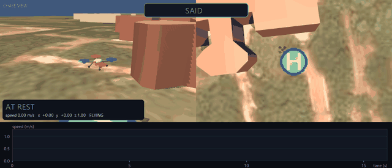
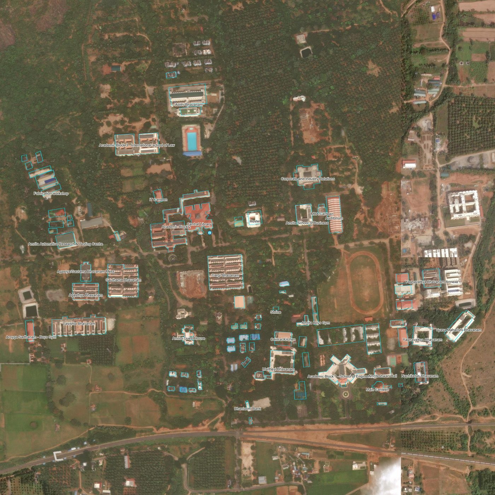
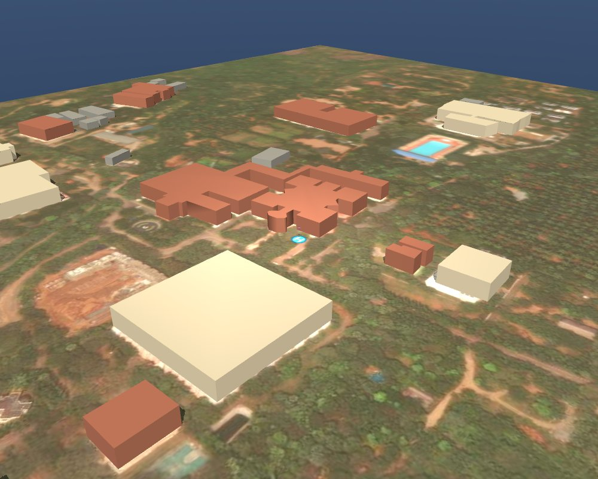
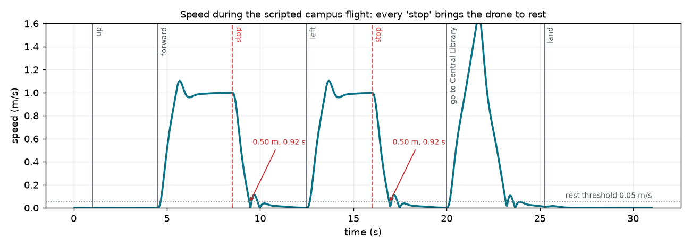
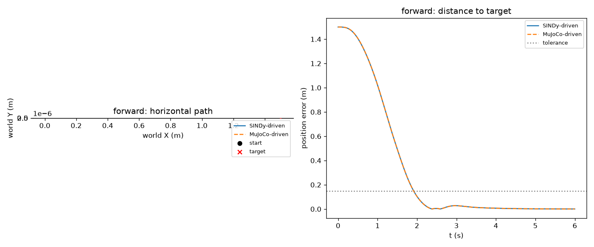
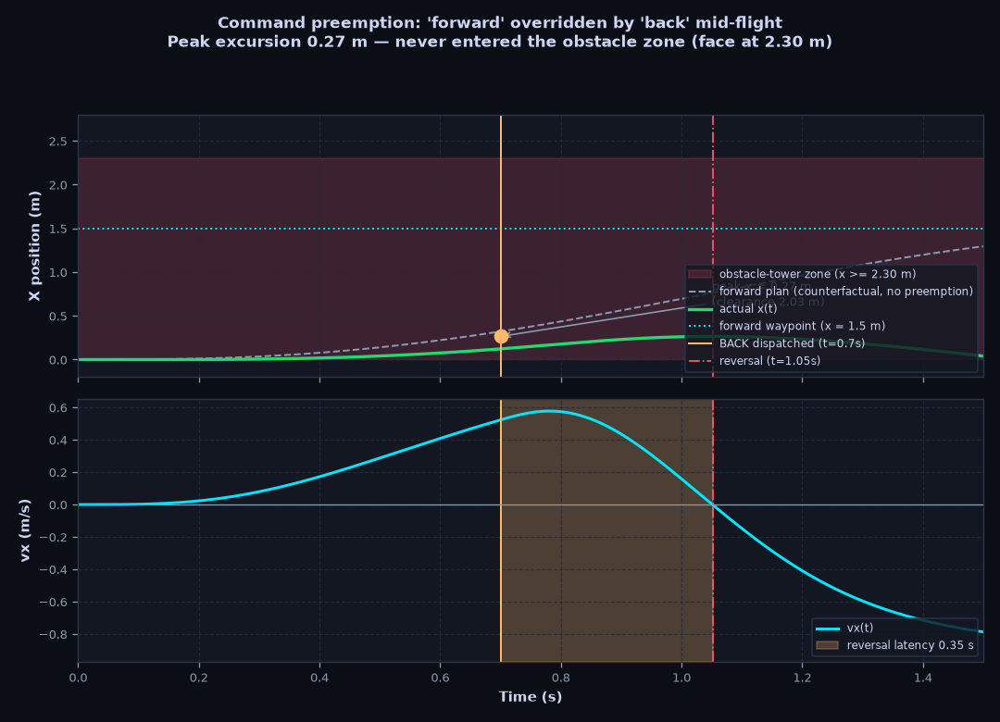
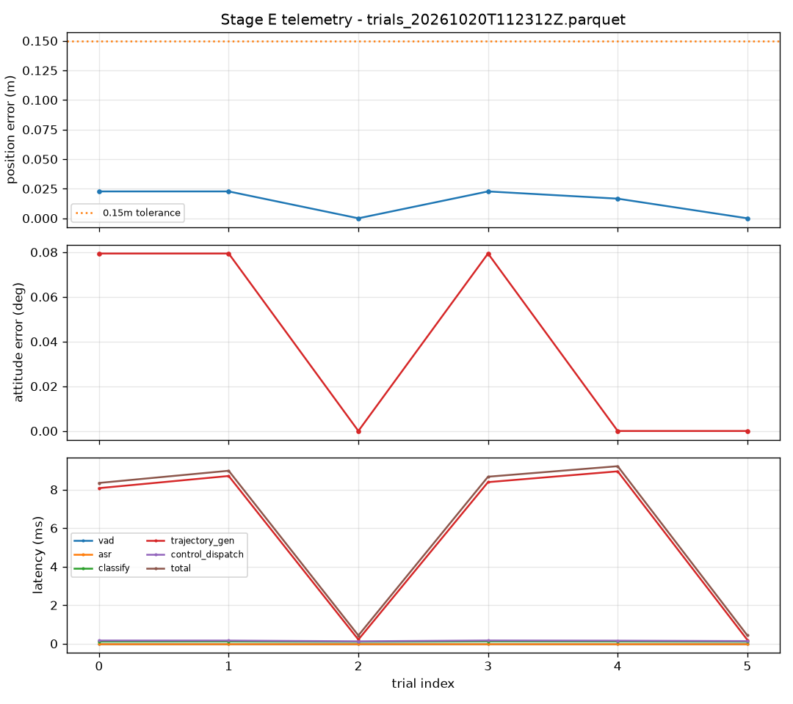
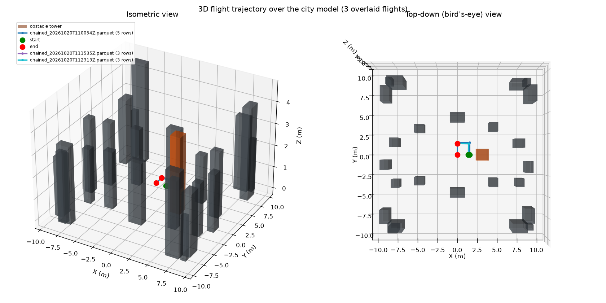
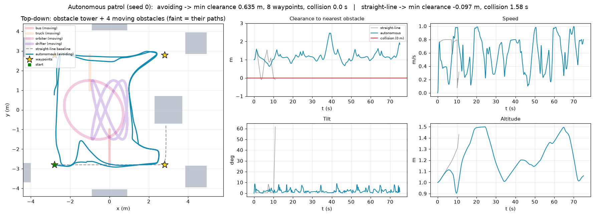
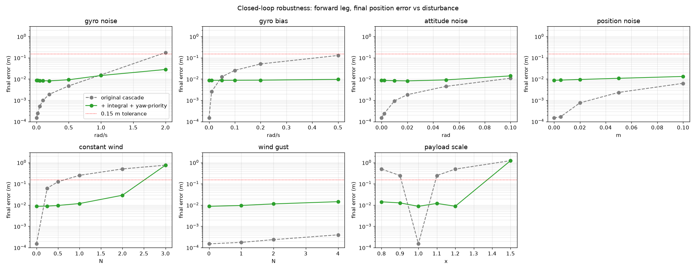

<h1 align="center">Voice-Controlled Quadrotor<br>with a Data-Driven Attitude Loop</h1>

<p align="center">
  <b>Say "forward", "stop", or "go to the library". A simulated drone flies there on a controller built from an equation it learned from its own flight data.</b><br>
  Group project · <i>Data Driven Control of Drones</i> · B.Tech AI Engineering<br>
  School of Artificial Intelligence, Amrita Vishwa Vidyapeetham, Coimbatore
</p>

<p align="center">
  
  
  
  
  
  
  
</p>

<p align="center">
  <a href="#1-objective">Objective</a> ·
  <a href="#3-the-pipeline-stage-by-stage">Pipeline</a> ·
  <a href="#4-method">Method</a> ·
  <a href="#5-the-campus-world">Campus</a> ·
  <a href="#6-results">Results</a> ·
  <a href="#7-honest-limits">Limits</a> ·
  <a href="#8-how-to-run">Run it</a> ·
  <a href="#10-team-and-branches">Team</a>
</p>

Runs in MuJoCo on a 1:10 scale model of the real campus, built from OpenStreetMap building outlines and a satellite photo.

[](docs/recordings/campus_demo.mp4)

*31-second recording of the campus demo (click for the MP4). Left: chase camera. Right: bird's-eye camera. Bottom: live speed trace. Every "stop" brings the drone to rest in 0.92 s over 0.50 m, with altitude held to within 2 cm. Recorded by [`record_demo_video.py`](05_voice_interface/record_demo_video.py).*

---

## At a glance

| | |
|---|---|
| **What was learned from data** | The drone's rotational dynamics: SINDy keeps **44 of 156** candidate coefficients (26 terms in each of 6 equations) and predicts held-out data with **R² = 0.9946** |
| **What it was checked against** | DMDc (a linear alternative), with held-out trials, 11 s rollouts, eigenvalues, sparsity and noise ablations |
| **How it flies** | Outer position loop (standard physics) feeding an inner quaternion attitude loop whose gains are **calculated from the learned model**, not hand-tuned |
| **How you command it** | Offline speech (Vosk) or typed text: 8 moves, `land`, and `go to <building>` for 31 named buildings |
| **How well it works** | 24/24 voice trials, 5/5 chained, 67/67 maneuver gauntlet, braking in 0.92 s over 0.50 m, 157 automated tests passing |
| **How it was stressed** | Sensor noise, wind, wrong payload mass, mid-flight command reversal, moving obstacles |

---

## 1. Objective

Many drone-control projects fail in one of two ways. Either a speech interface is attached to textbook physics with no identification step, or the dynamics are identified in a notebook and never flown in closed loop.

This project closes that gap. The goal is a **complete, validated chain** from raw simulated flight data to a spoken command moving a drone, where the identified model is the thing the controller is built on.

**One design decision shapes everything.** Only the **inner attitude loop** is identified from data. Flying in a straight line under a thrust vector is Newton's second law, a plain double integrator with nothing for a data-driven method to discover. Rotation is different: it has drag, cross-axis coupling and quaternion constraints, which is worth learning from data. So the outer position loop is deliberately standard physics (see [`docs/TDD.md`](docs/TDD.md) §7b).

---

## 2. System overview

```
 spoken or typed command   "forward"  "stop"  "land"  "go to Central Library"
            │
            ▼  Vosk speech recognition  ->  fuzzy classifier  ->  place matcher
   command word / target building
            │
            ▼  safety: never target the inside of a building, stay inside the map
   route planner (A* around buildings)  ->  smooth path (cubic spline + quintic Bezier)
            │
 ┌──────────┴──────────────── OUTER LOOP  (standard physics, not identified) ───────────┐
 │  PD position/velocity control with anti-windup integral                              │
 │  output: desired tilt (quaternion) + thrust                                          │
 └──────────┬───────────────────────────────────────────────────────────────────────────┘
            ▼
 ┌──────────┴──────────────── INNER LOOP  (built on the SINDy model) ───────────────────┐
 │  quaternion P² attitude law, gains derived from the identified hover linearization   │
 │  yaw-priority mixer: (thrust, torques) -> 4 rotor thrusts                            │
 └──────────┬───────────────────────────────────────────────────────────────────────────┘
            ▼
   MuJoCo 6-DOF rigid body, 500 Hz  ──►  IMU sensors  ──►  back to the controller
```

Everything runs at **500 Hz** (`dt = 0.002 s`). Frames are ENU world and FLU body, with Hamilton scalar-first quaternions. Units are SI.

---

## 3. The pipeline, stage by stage

Each stage had a pass/fail gate that had to be met before the next one started.

| Stage | What happens | Key result | Code |
|---|---|---|---|
| **A. Excitation** | Open-loop random (PRBS) and sweep (chirp) rotor inputs on each axis, with no controller active, so the data is rich | Varied, non-flat responses on every axis; trials split into train and held-out **by whole trial** | [`01_simulation/`](01_simulation) |
| **B. Identification** | Smooth the data (Savitzky-Golay), then fit **SINDy** and **DMDc** on the same trials | SINDy held-out R² **0.9946**, 44/156 coefficients. DMDc R² 0.9926 near hover only | [`02_identification/`](02_identification) |
| **C. Validation** | One-step error, then 11 s open-loop rollouts, eigenvalues, sparsity and noise ablations, head-to-head | **SINDy selected.** 0/7 rollouts diverged | [`03_validation/`](03_validation) |
| **D. Control** | Inner quaternion loop (gains from the model) and outer position loop (standard physics) | Settling 0.56-0.86 s inner, 1.87 s full cascade, final error 0.0006 m | [`04_control/`](04_control) |
| **E. Voice demo** | Speech to command to waypoint to trajectory to cascade to MuJoCo | 24/24 trials, 5/5 chained, 36 ms processing latency | [`05_voice_interface/`](05_voice_interface) |

---

## 4. Method

### 4.1 Data: the plant and the excitation
A full nonlinear 6-DOF quadrotor in MuJoCo: X configuration, four rotors, 1.0 kg, arm 0.15 m, with drag applied as a generalized force. Excitation signals are generated with seeds derived deterministically per trial (not Python's `hash()`), so results are reproducible across processes. A test enforces this.

Savitzky-Golay smoothing is applied before any differentiation. Held-out data means **separate trials**, never a slice of one trajectory.

### 4.2 SINDy: learning the rotational dynamics
SINDy (Sparse Identification of Nonlinear Dynamics) is given the four rotor thrusts and the measured angular velocity, and must find the equation connecting them. It builds a library of **26** candidate terms for each of the **6** state equations (156 coefficients in all) and runs **STLSQ** (sequentially thresholded least squares): fit, drop the weakest terms, refit, repeat.

- **44 coefficients survive.** They recover the true control effectiveness, drag, gyroscopic cross-term and kinematics to within **2-6%** of the simulator's ground truth ([`tests/test_identification_physics.py`](tests/test_identification_physics.py)). That match is the evidence that physics was learned, not just a curve.
- **Quaternions are never fitted raw.** The attitude is handled in local coordinates with a reset at segment boundaries, and fit pairs are never formed across a boundary (a fake pair there outweighed a million real ones).
- Sparsity is chosen by a parsimony rule on validation data, not by R² alone, which would pick the densest model (127 terms for +0.0002 R²).

### 4.3 DMDc: the linear comparison
DMDc (Dynamic Mode Decomposition with control) fits `x₊ = A·x + B·u` by least squares. It is SINDy with a **linear-only library**, no sparsity, and a discrete-time form.

It matches SINDy near hover (NRMSE 0.0825 vs 0.0789) but **degrades to a one-step NRMSE of about 0.70 outside hover** (where 1.0 is a model that does nothing), because a linear model cannot hold the nonlinear terms. So it is reported honestly as valid near hover only, and never used as a pass outside that regime.

### 4.4 Validation and model selection
| Check | Result |
|---|---|
| One-step prediction on held-out trials | SINDy NRMSE **0.0786**, R² **0.9946** |
| 11 s open-loop rollout, full envelope | **0/7 diverged**, mean final error 0.095 (bound 0.5) |
| Eigenvalues | 3 of 6 poles are marginal. That is expected: an uncontrolled rigid body's attitude has no restoring force. The rest are stable |
| Sparsity ablation | R² plateaus above threshold 0.2, collapses at 1.0 (0.588) |
| Noise ablation | Robust to about 1 rad/s injected gyro noise; knee at 2.0 rad/s; breakdown by 4.0 |
| Head-to-head in DMDc's own regime | SINDy 0.0789 vs DMDc 0.0825, so SINDy matches it there and also works everywhere else |

**SINDy is selected.** The chosen model is frozen to `data/processed/sindy_fitted_model.npz`, and the flight controller loads exactly that file, so what flies is provably the model that passed the gates.

### 4.4b The equations that matter
With state `x = (θ, ω)` (attitude in local coordinates, body rates) and rotor thrusts `u`:

| Piece | Equation | Where |
|---|---|---|
| SINDy model | `ω̇ = Θ(ω, u) · Ξ`, with `Θ` a 26-term library and `Ξ` a 6×26 matrix of which only 44 entries are non-zero | `02_identification/sindy_fit.py` |
| STLSQ | repeat: `Ξ ← argmin ‖ω̇ − ΘΞ‖²`, then zero every `|Ξᵢⱼ| < λ` | `sindy_fit.py` |
| DMDc | `xₖ₊₁ = A·xₖ + B·uₖ`, least squares on snapshot pairs | `02_identification/dmdc_fit.py` |
| Quaternion error | `qₑ = q_ref ⊗ q*`, use the vector part `qₑ,vec` (about half the angle error) | `04_control/controller.py` |
| Inner law | `τ = −K_q · sign(qₑ,w) · qₑ,vec − K_ω · (ω − ω_des)` | `controller.py` |
| Gains from the model | `ωₙ = 4 / (ζ·Tₛ)`, `K_q = 2ωₙ²/b`, `K_ω = (2ζωₙ + a)/b`, with `a` (negative, equal to −drag/inertia) and `b` (control effectiveness, 1/inertia) read from the SINDy hover Jacobian for each axis. `ζ = 0.7`, `Tₛ = 0.5 s` | `gains_from_identified_model()` |
| Outer law | `a_cmd = K_p·e_p + K_d·e_v + K_i·∫e_p` (integral gated, anti-windup), thrust vector `m(a_cmd + g·ẑ)` | `04_control/position_controller.py` |
| Mixer | `[T, τx, τy, τz]ᵀ = M · [f₁ … f₄]ᵀ`, solved with `M⁻¹`; yaw torque is shed first when a rotor would clip | `04_control/mixer.py` |
| Stopping distance | `d = v² / (2·a_max)`; from 1.0 m/s at 1.0 m/s² this is 0.5 m, which is what was measured | `05_voice_interface/flight.py` (`_braking_target`), `04_control/trajectory.py` |

### 4.5 The cascade controller
- **Inner loop** ([`04_control/controller.py`](04_control/controller.py)): a singularity-free quaternion P² law. Its gains come from `gains_from_identified_model()`, which reads the drag-to-inertia ratio of each axis from the SINDy hover Jacobian and applies a standard second-order design rule. Only two numbers are chosen by hand (settling time and damping). When the model changes, the gains recompute.
- **Outer loop** ([`position_controller.py`](04_control/position_controller.py)): PD position and velocity control with an anti-windup integral that acts only when the drone and trajectory are nearly at rest. It outputs the smallest tilt that gives the wanted acceleration.
- **Mixer** ([`mixer.py`](04_control/mixer.py)): inverts the real X-configuration rotor geometry. When a command would saturate a rotor, the **yaw-priority** version sheds yaw torque first so thrust is kept.
- **Bandwidth separation** between the loops is 2.86x, which justifies designing them independently.

### 4.6 Interpolation: from a few points to a flyable path
- **Cubic smoothing spline** (a B-spline fit) through the A* route waypoints rounds every corner.
- **Quintic Bezier** for each leg, with position, velocity and acceleration matched at the start, so chained commands do not stop dead between legs.
- Each curve is **checked** against the building map and against the speed and acceleration limits before it is flown.

### 4.7 IMU sensing
The controller reads state through the model's named sensors (position, attitude, a body-frame velocimeter and a gyro), and rotates the velocity into the world frame as a real flight computer would. These are idealized MuJoCo sensors, noiseless by default. Sensitivity to noise is measured separately in section 6.6.

### 4.8 Voice and navigation
Vosk (offline) produces text, a fuzzy classifier maps it to a command, and a place matcher maps names to buildings. Commands include synonyms (`halt`, `climb`, `descend`). The transcript is always shown, including misses, so a misheard word is visible, never silent. `stop` brakes the drone to rest ahead of it at the planner's deceleration limit instead of turning back.

### 4.9 Safety
Targets are clipped so the drone never flies into a building, including when several commands are chained in one direction. The geofence stops flight inside the map edge. Landing finds the surface below (ground or a roof) and shuts the motors off at touchdown.

---

## 5. The campus world

The map is a **1:10 scale model of the Amrita Coimbatore campus**: 86 buildings, 31 of them named and addressable by voice.

| Real campus footprints and heights | 3D scene with the satellite ground |
|:---:|:---:|
|  |  |

- **Footprints and names** come from OpenStreetMap. **Heights are estimated** from building type, because OSM does not carry floor counts.
- **Ground** is a real satellite photo (Esri World Imagery, zoom 18, about 0.6 m per pixel) resampled onto the floor plane.
- **Alignment.** The photo and the outlines come from different sources, so a single offset is not enough. `align_buildings.py` measures each building against its roof edges and moves it onto the photo. 51 of 80 measurable buildings were moved (median move 2 m); the other 29 stayed at their OSM position because the evidence was unclear. The mean edge match at the outlines rose from 38.8 to 62.4.
- The visual layers are physics-inert (no mass, joints or contacts), and a test enforces that.

---

## 6. Results

Every number below comes from a reproducible script. Held-out data is used wherever a model is judged.

### 6.1 Stopping: the drone brakes to rest



| Move | Speed when "stop" was said | Time to rest | Braking distance | Altitude change |
|---|---|---|---|---|
| forward | 1.00 m/s | **0.92 s** | **0.50 m** | 0.019 m |
| left | 1.00 m/s | **0.92 s** | **0.50 m** | 0.001 m |

The distance matches the physics: stopping from 1.0 m/s at the planner's 1.0 m/s² deceleration limit takes 0.5 m. Rest is defined as speed below 0.05 m/s. Speeds are in simulation units. Source: [`docs/recordings/stop_metrics.json`](docs/recordings/stop_metrics.json).

### 6.2 Identification and validation

| Metric | Value |
|---|---|
| SINDy held-out derivative R² / one-step NRMSE | **0.9946** / **0.0786** (44 of 156 coefficients) |
| DMDc held-out R² / NRMSE (near hover) | 0.9926 / 0.0825 (NRMSE about 0.70 outside hover) |
| Coefficients vs simulator truth | within **2-6%** |
| Rollouts diverged (11 s) | SINDy **0/7**, DMDc 0/16 (hover only) |

| SINDy vs DMDc near hover | Eigenvalue spectra |
|:---:|:---:|
|  |  |

| Sparsity ablation | Noise ablation |
|:---:|:---:|
|  |  |


### 6.3 Control

| Metric | Value |
|---|---|
| Inner-loop step settling (SINDy model vs MuJoCo plant) | **0.56-0.86 s**, agreeing within about 0.3% |
| Full cascade, six waypoints | settles in about **1.87 s**, final error **0.0006 m** |
| Demo flight with the curved Bezier path | about 2.95 s to settle |



### 6.4 Voice trials and the maneuver gauntlet

| Test | Result |
|---|---|
| 24 scripted voice trials, reset before each | **24/24**, tolerance 0.15 m, final error about 0.0044 m |
| 5 chained commands, no reset between legs | **5/5**, max leg error 0.022 m |
| Mid-flight reversal ("back" at 0.7 s while flying forward) | peak excursion 0.259 m, reversal in **0.42 s**, clear of the 2.3 m tower face by 2.04 m |
| Maneuver gauntlet (all commands, chains, edge cases) | **67/67** pass |
| Processing latency (classify + plan + dispatch) | **36 ms** (classify 0.42 ms, trajectory 34.8 ms, dispatch 0.86 ms) |

The 36 ms is measured on the typed-text path; live speech adds the recognizer's own decode time, measured separately per utterance. Full gauntlet tables are in [`results/RESULTS.md`](results/RESULTS.md).







### 6.5 Autonomous navigation among moving obstacles
The drone can also fly a patrol **by itself** around four moving obstacles plus the buildings, with no straight-line flight. An avoidance planner supplies only the reference; the same cascade does all the control.

| | Straight-line baseline | Autonomous |
|---|---|---|
| Development seeds 0-4 | **0/5** collision-free, 43 s inside obstacles | **5/5** collision-free, min clearance 0.284 m |
| Never-seen seeds 100-129 | n/a | **29/30** collision-free, median clearance 0.394 m |



### 6.6 Robustness to noise, wind and wrong mass
Each disturbance was swept one at a time on a `forward` leg. Two fixes were added after measuring where it failed: the yaw-priority mixer (yaw is the cheapest axis to saturate) and an anti-windup integral (a PD law has a steady offset under constant force).

| Disturbance | Original cascade fails at | With the two fixes, still within 0.15 m up to |
|---|---|---|
| Gyro noise | 0.05 rad/s | 2.0 rad/s |
| Constant wind | 1 N | 2 N (fails at 3 N) |
| Payload mass error | ±10% | ±20% (fails at +50%) |



### 6.7 What building this taught us

Each of these was a real failure that was measured and then fixed.

1. **Never pair snapshots across a segment boundary.** At an attitude reset the angle jumps about 2.6 rad against about 0.002 rad of real motion. Squared, one fake pair outweighs a million real ones. It made SINDy look broken (NRMSE 0.99) when the model was fine (0.08).
2. **Single-axis excitation is rank-deficient.** Roll-only data fills only 2 of the 6 state directions (condition number about 10⁴⁸). `pinv` hides this and `pydmd` returns garbage near 10¹¹. DMDc is cross-checked only on full-rank combined-axis trials.
3. **Error normalised by state size is meaningless at 2 ms steps.** A model that does nothing scores well. Normalising by the state's *change* makes the do-nothing baseline exactly 1.0.
4. **Marginal poles are not instability.** An uncontrolled rigid body has θ̇ = ω and no restoring force, so poles on the stability boundary are expected. A strict `< 0` test briefly flipped model selection to DMDc for the wrong reason; a tolerance fixed it.
5. **A noise ablation with no visible effect proves nothing.** The first range (0 to 0.1 rad/s) was a flat line. The real knee was at 2 to 4 rad/s, so the range was widened.
6. **Yaw is the expensive axis.** With yaw torque costing about 5x more rotor headroom than roll or pitch, gyro noise saturated rotors on about 70% of steps and thrust was lost. Shedding yaw first fixed it.
7. **An integral term must not integrate through a move.** The first version added lag and a 0.196 m overshoot. Gating it to "trajectory and drone both nearly at rest" fixed that; the speed gate was swept (0.08 to 1.0 m/s) and 0.15 m/s chosen.
8. **A design claim did not survive the real plant.** The outer loop was designed as a critically damped double integrator; the real cascade, with inner-loop lag and drag, shows about 0.07 m of ringing. It is reported as measured.
9. **Sensors lag one step.** MuJoCo computes sensor values from the state before integration, so reading right after `mj_step()` is 2 ms stale. One extra `mj_forward()` call fixed it.

### 6.8 Assumptions we chose and stated

| Quantity | Choice | Why it is stated |
|---|---|---|
| Plant | 1.0 kg, arm 0.15 m, X configuration, drag as a generalized force | Fixed in [`docs/TDD.md`](docs/TDD.md) §2 so nothing drifts mid-project |
| Excitation | PRBS and chirp per axis, deterministic seed per trial | Reproducible across processes (tested) |
| Smoothing | Savitzky-Golay before any differentiation | Differentiating raw data amplifies noise |
| Gain design | `ζ = 0.7`, `Tₛ = 0.5 s` are the only hand-chosen numbers | Everything else is computed from the model |
| Command offsets | 1.5 m lateral, 0.5 m vertical per discrete move | Hover altitude is about 1 m, so a 1.5 m "down" would pass through the floor |
| Building heights | Estimated from OSM type | OSM has no floor counts |
| Scale | 1:10 of the real campus | Keeps flight inside the sensible simulator range |
| Sensors | Ideal IMU, noise injected only in the robustness study | Honest limit, see section 7 |

---

## 7. Honest limits

- **No state estimator.** The controller reads idealized IMU sensors directly. There is no Kalman filter. Noise tolerance is measured by injecting noise, not by filtering it.
- **DMDc is valid near hover only.** It is reported that way and is never claimed beyond it.
- **Building heights are estimated** from type, not surveyed. Footprints and names are real.
- **The photo leans.** It was taken at a slight angle, so tall buildings show a pale rim around the 3D box that no outline shift can remove. 29 of 80 buildings were left at their OSM position.
- **Disturbance limits.** 3 N wind and +50% payload still fail. The integral's authority is capped at 2 m/s² by design.
- **Autonomy assumes perfect obstacle perception**, and its one failure (seed 104) is a double pinch that a planner with no lookahead cannot foresee.
- **Speech recognition makes mistakes.** The small Vosk model mishears words; the HEARD LOG shows exactly what it heard.
- **Results are from simulation** at 1:10 scale. No hardware flight was done.

### Future work
- A state estimator (Kalman or complementary filter) between noisy IMU data and the controller.
- Controllability and reachability analysis of the identified model, to bound which attitudes and accelerations it can reach.
- Extend DMDc beyond hover with a Koopman lift, so it can be compared with SINDy across the full envelope.
- Surveyed building heights, and a roof-aware photo correction for tall buildings.
- Obstacle perception from simulated sensors instead of perfect knowledge, and lookahead in the avoidance planner.
- A hardware flight on a real quadrotor with the same frozen model.

---

## 8. How to run

**Windows, PowerShell.** One-time setup:
```powershell
python -m venv .venv
.\.venv\Scripts\Activate.ps1
pip install -r requirements.txt
```
For voice control, download the small English model from the [Vosk model list](https://alphacephei.com/vosk/models) and unzip it as `vosk-model-small-en-us-0.15\` in the project root. Without it, the demo falls back to typed commands.

### The one launcher
Double-click **`RUN.bat`** and pick a number:

| | |
|---|---|
| **1** | Fly the drone: live campus demo with a commands guide that stays open |
| **2** | After flying: 2D and 3D graphs of the flight you just did |
| **3** | Drone parameters (mass, inertia, gains, identified model) |
| **4** | Run the tests |
| **5** | Browser simulator on localhost only |
| **6** | Rebuild every result and plot (several minutes) |

### What to say
`forward`, `back`, `left`, `right`, `up`, `down` keep moving until a building, the map edge or the next command. `stop` or `hover` brakes to rest. `land` descends onto the ground or a roof. `go to <building>` flies a curved route around the buildings, for example "go to central library". The window also has click buttons for every command, a live LISTENING line and a HEARD LOG. A fourth window, **Flight Status**, draws altitude, speed, distance to the nearest building, x/y position and a command timeline over the last 60 s (pause button; the data is saved as a CSV next to the flight log). Start the demo with `--no-graphs` to hide it.

### Reproduce the results
```powershell
.\.venv\Scripts\python.exe 01_simulation\run_excitation.py          # A: excitation data
.\.venv\Scripts\python.exe 02_identification\run_identification.py  # B: SINDy and DMDc
.\.venv\Scripts\python.exe 03_validation\run_validation.py          # C: validation, freezes the model
.\.venv\Scripts\python.exe 04_control\run_inner_loop.py             # D: inner loop
.\.venv\Scripts\python.exe 04_control\run_cascade.py                # D: full cascade
.\.venv\Scripts\python.exe 05_voice_interface\run_trials.py         # E: 24 + 5 voice trials
.\.venv\Scripts\python.exe 05_voice_interface\run_preemption.py     # E: mid-flight reversal
.\.venv\Scripts\python.exe run_gauntlet.py                          # 67 maneuvers
.\.venv\Scripts\python.exe 05_voice_interface\run_robustness.py     # noise, wind, payload
.\.venv\Scripts\python.exe 05_voice_interface\run_autonomous.py --render   # moving obstacles
.\.venv\Scripts\python.exe 05_voice_interface\record_demo_video.py  # the video above
.\.venv\Scripts\python.exe -m pytest                                # 157 tests
```
`REBUILD_RESULTS.bat` runs the whole chain and collects every plot into `results/`.

### What the 157 tests cover

| Test file | Tests | Checks |
|---|---|---|
| `test_autonomy.py` | 34 | Moving obstacles, scene fairness, avoidance, no stalls |
| `test_voice_interface.py` | 24 | Classifier, synonyms, end-to-end voice pipeline, live logger, safety clamp |
| `test_goto.py` | 23 | Place matching, route planning, curved paths, landing on roofs |
| `test_natural_motion.py` | 11 | Continuous moves and braking |
| `test_stability.py` | 10 | Cascade and loop stability |
| `test_mixer.py`, `test_inverse_mixer.py` | 12 | Rotor mixing, both directions |
| `test_robustness.py` | 8 | Noise, wind, payload, yaw-priority mixer, integral |
| `test_landing.py` | 7 | Touchdown on ground and roofs |
| `test_identification_physics.py` | 6 | Learned coefficients match simulator truth within 2-6% |
| `test_minimap.py`, `test_campus.py`, `test_web_sim_parity.py` | 11 | Map window, campus scene, browser simulator parity |
| `test_status_graphs.py` | 7 | Live flight-status graphs: sampling rate, values equal the controller state, events, pause, CSV |
| `test_scene_physics_inert.py`, `test_reproducibility.py` | 4 | Visual layers add no physics; seeds reproduce across processes |

### Rebuild the campus
```powershell
.\.venv\Scripts\python.exe 01_simulation\models\fetch_satellite.py   # photo (cached after first run)
.\.venv\Scripts\python.exe 01_simulation\models\align_buildings.py   # per-building alignment
.\.venv\Scripts\python.exe 01_simulation\models\make_campus.py       # scene, floor, map
```

---

## 9. Repository layout

```
.
├── RUN.bat                    the one launcher
├── 01_simulation/             MuJoCo quadrotor, excitation signals, campus and city scenes
│   └── models/                quad.xml, campus generators (OSM, satellite, alignment), obstacles
├── 02_identification/         SINDy and DMDc fits, preprocessing
├── 03_validation/             rollouts, eigenvalues, ablations, model selection, frozen model
├── 04_control/                quaternion controller, position loop, mixer, trajectories,
│                              route planner, avoidance planner
├── 05_voice_interface/        voice input, commands, flight wrapper, demo, trials, recording
├── tests/                     157 automated tests
├── results/                   plots, data and the gauntlet summary (RESULTS.md)
├── docs/                      PRD, TDD, design flow, codebase guide, images, recordings
├── web/                       browser simulator (localhost only)
├── CONTROLLER_AND_IMU_EXPLAINED.md   plain-English controller and IMU walkthrough
├── UNDERSTAND_MY_PROJECT.md          guided tour of every file
└── CLAUDE.md                  stage-gate log and decision history
```

New to the project? Start with [`PROJECT_EXPLAINED.md`](PROJECT_EXPLAINED.md), a plain-language walkthrough of the whole pipeline and every piece of maths.

More detail: [`docs/CODEBASE_GUIDE.md`](docs/CODEBASE_GUIDE.md) (code map), [`docs/TDD.md`](docs/TDD.md) (design), [`ONBOARDING.md`](ONBOARDING.md) (what is claimed and how to check it).

---

## 10. Team and branches

B.Tech (AI Engineering), School of Artificial Intelligence, Amrita School of Engineering, Coimbatore, Amrita Vishwa Vidyapeetham.

| Name | Roll no. |
|---|---|
| Mamidala Som Praneeth Babu | CB.SC.U4AIE24029 |
| C. Karthik | CB.SC.U4AIE24107 |
| Ch. Virinchi | CB.SC.U4AIE24158 |
| K. Jatin Chandra Gupta | CB.SC.U4AIE24162 |

| Branch | Contents |
|---|---|
| `drone_mujoco` | **This project**: MuJoCo, SINDy-identified attitude loop, voice demo on the campus |
| `main` | The original ESP32-based simulator attempt |
| `drone_gazebo` | Gazebo write-up |

---

## 11. Credits and references

- **Data and imagery.** Building footprints and names: © OpenStreetMap contributors (ODbL). Ground photo: Imagery © Esri, Maxar, Earthstar Geographics.
- **Software.** MuJoCo (Google DeepMind), PySINDy, PyDMD, Vosk (Alpha Cephei), NumPy, SciPy, Matplotlib.
- Brunton, Proctor, Kutz. *Discovering governing equations from data by sparse identification of nonlinear dynamical systems.* PNAS, 2016.
- Proctor, Brunton, Kutz. *Dynamic mode decomposition with control.* SIAM J. Applied Dynamical Systems, 2016.
- Fresk, Nikolakopoulos. *Full quaternion based attitude control for a quadrotor.* European Control Conference, 2013.
- Savitzky, Golay. *Smoothing and differentiation of data by simplified least squares procedures.* Analytical Chemistry, 1964.
- Hart, Nilsson, Raphael. *A formal basis for the heuristic determination of minimum cost paths* (A*). IEEE Trans. SSC, 1968.
- Todorov, Erez, Tassa. *MuJoCo: a physics engine for model-based control.* IROS, 2012.
