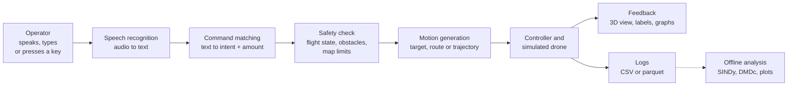
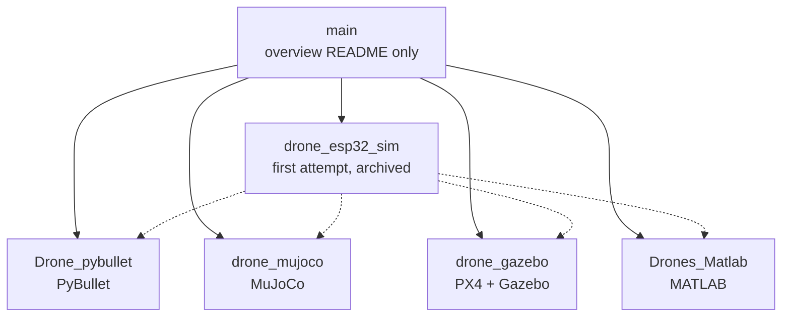
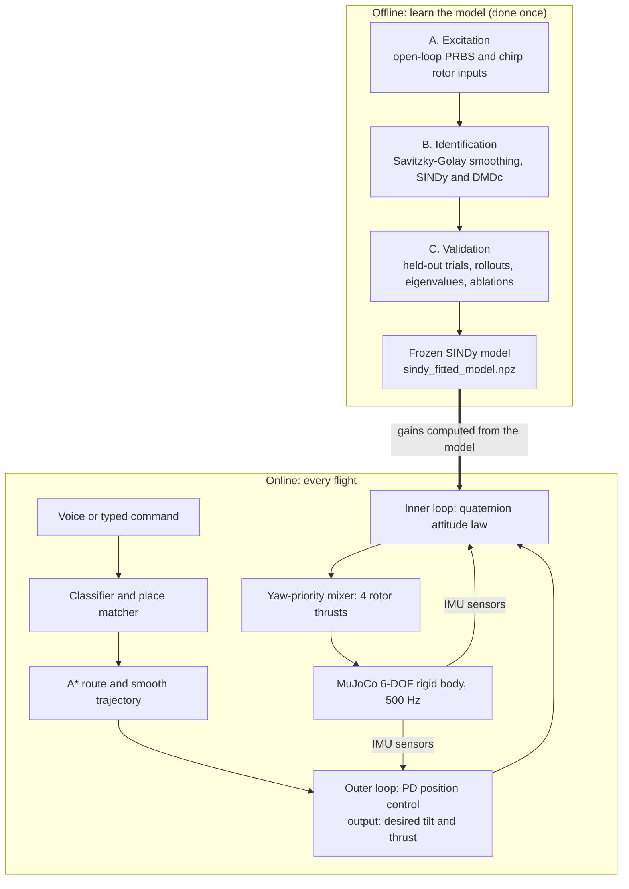
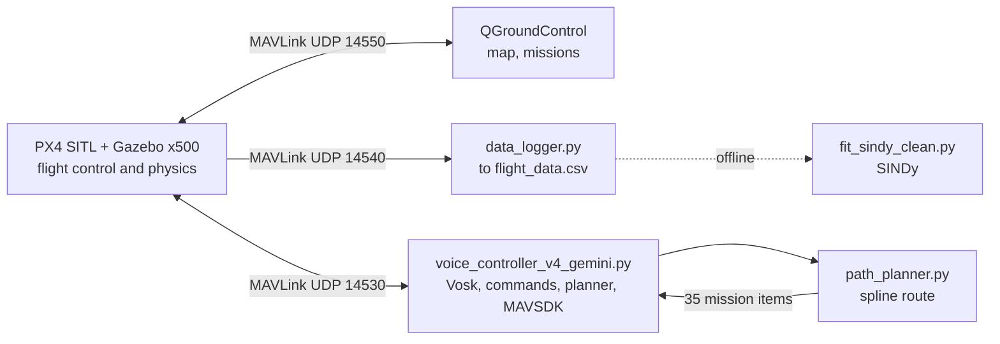
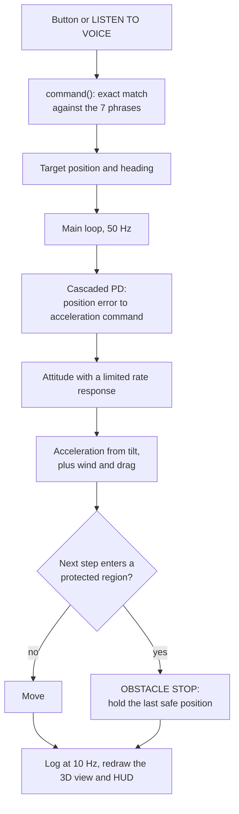

<p align="center">
  
</p>

<h1 align="center">Voice-Controlled Quadrotor Drone in Simulation</h1>

<p align="center">
  <b>One problem, five implementations: a drone that is flown by spoken commands, built and studied in a pure-Python simulator, PyBullet, MuJoCo, PX4 + Gazebo and MATLAB</b><br>
  Course: <i>Data Driven Control of Drones</i> · B.Tech Artificial Intelligence Engineering<br>
  School of Artificial Intelligence, Amrita Vishwa Vidyapeetham, Coimbatore
</p>

<p align="center">
  <a href="https://github.com/praann07/Drones_S5_AB8_ESP32VoiceDrone/tree/Drone_pybullet">PyBullet</a> ·
  <a href="https://github.com/praann07/Drones_S5_AB8_ESP32VoiceDrone/tree/drone_mujoco">MuJoCo</a> ·
  <a href="https://github.com/praann07/Drones_S5_AB8_ESP32VoiceDrone/tree/drone_gazebo">PX4 + Gazebo</a> ·
  <a href="https://github.com/praann07/Drones_S5_AB8_ESP32VoiceDrone/tree/Drones_Matlab">MATLAB</a> ·
  <a href="https://github.com/praann07/Drones_S5_AB8_ESP32VoiceDrone/tree/drone_esp32_sim">First attempt (archived)</a>
</p>

---

<a id="team"></a>
## Team

| Role | Name | Roll number | Email |
|---|---|---|---|
| Faculty Supervisor | Prof. S. Sunil Kumar | | s_sunilkumar@cb.amrita.edu |
| Student | C. Karthik | CB.SC.U4AIE24107 | cb.sc.u4aie24107@cb.students.amrita.edu |
| Student | Ch. Virinchi | CB.SC.U4AIE24158 | cb.sc.u4aie24158@cb.students.amrita.edu |
| Student | K. Jatin Chandra Gupta | CB.SC.U4AIE24162 | cb.sc.u4aie24162@cb.students.amrita.edu |
| Student | M. Som Praneeth Babu | CB.SC.U4AIE24029 | cb.sc.u4aie24029@cb.students.amrita.edu |

Who committed which part of the repository is listed in [Section 18](#18-contributors).

---

<a id="contents"></a>
## Contents

1. [Project overview](#1-project-overview)
2. [Abstract](#2-abstract)
3. [Problem statement](#3-problem-statement)
4. [Motivation and objectives](#4-motivation-and-objectives)
5. [Key contributions](#5-key-contributions)
6. [Where to find each project](#branches)
7. [Overall architecture](#7-overall-architecture)
8. [Repository structure](#8-repository-structure)
9. [Branch-by-branch documentation](#9-branch-by-branch-documentation)
    - [9.1 `Drone_pybullet`: exact moves and safe stopping in a generated city](#91-drone_pybullet)
    - [9.2 `drone_mujoco`: an attitude controller built from a learned model](#92-drone_mujoco)
    - [9.3 `drone_gazebo`: PX4 autopilot, voice missions and SINDy data logging](#93-drone_gazebo)
    - [9.4 `Drones_Matlab`: MATLAB flight lab with obstacle stop and telemetry analysis](#94-drones_matlab)
    - [9.5 `drone_esp32_sim`: the first attempt (archived)](#95-drone_esp32_sim)
10. [Technical concepts: what, how and why](#10-technical-concepts)
11. [Technology stack and why each tool was chosen](#11-technology-stack)
12. [Installation and execution](#12-installation-and-execution)
13. [Testing and validation](#13-testing-and-validation)
14. [Results and demonstrations](#14-results-and-demonstrations)
15. [Comparison and implementation status](#15-comparison-and-implementation-status)
16. [Limitations and challenges](#16-limitations-and-challenges)
17. [Future scope](#17-future-scope)
18. [Contributors](#18-contributors)
19. [References and acknowledgements](#19-references-and-acknowledgements)
20. [License](#20-license)

**How to read this page.** Sections 1 to 8 explain the project as a whole. Section 9 documents every branch in the same ten-point format. Section 10 explains the algorithms once, with the equations, and says which branch uses each one. Sections 12 to 15 say how to run and check everything, and what was measured. Every number in this README is labelled with where it comes from (see [Section 13](#13-testing-and-validation)).

---

## 1. Project overview

A quadrotor has four propellers and no steering wheel: tilting, turning, moving and hovering all come from choosing four thrust values many times per second. This project asks how a person can control such a vehicle **by speaking short commands** ("take off", "forward 3 meters", "go to the library", "land"), and how the software between the words and the motors can be made **safe, predictable and checkable**.

The team built the idea five times, in five different simulators. They are **separate implementations, not one integrated program**: they share the goal and the voice-command idea, but no code. Each one studies a different part of the problem:

| Branch | Simulator | What it studies most |
|---|---|---|
| [`Drone_pybullet`](https://github.com/praann07/Drones_S5_AB8_ESP32VoiceDrone/tree/Drone_pybullet) | PyBullet | Understanding imperfect speech, flying exact distances and angles, braking to a safe stop before obstacles, live flight graphs |
| [`drone_mujoco`](https://github.com/praann07/Drones_S5_AB8_ESP32VoiceDrone/tree/drone_mujoco) | MuJoCo | Learning the drone's rotational dynamics from data (SINDy, with DMDc as a baseline) and computing the attitude controller from the learned model |
| [`drone_gazebo`](https://github.com/praann07/Drones_S5_AB8_ESP32VoiceDrone/tree/drone_gazebo) | PX4 SITL + Gazebo | Voice commands on top of a real autopilot (PX4), building-avoiding missions, logging flight data and fitting SINDy to it |
| [`Drones_Matlab`](https://github.com/praann07/Drones_S5_AB8_ESP32VoiceDrone/tree/Drones_Matlab) | MATLAB | A button- and voice-driven flight lab in a 3D city with an obstacle-stop rule and post-flight telemetry analysis |
| [`drone_esp32_sim`](https://github.com/praann07/Drones_S5_AB8_ESP32VoiceDrone/tree/drone_esp32_sim) | Pure Python + Pygame | The first attempt: a simulator for a planned ESP32 "LiteWing" drone with GPS waypoints and SINDy/DMDc analysis. Archived, not maintained |

Everything is simulation. No hardware drone was flown.

---

## 2. Abstract

This project studies voice control of a quadrotor in simulation. In every implementation a person speaks or types a short command, the software converts the transcript into a flight intent, checks the intent against safety rules (obstacles, map limits, flight state), and a simulated drone carries it out. The five branches differ in the simulator and in the question they study. The **PyBullet** branch treats the command and safety layer as the product: a parser that repairs common mis-transcriptions, a kinematic flight model that flies measured distances to within centimetres, and a ray-cast braking law that stops the drone 0.40 m before an obstacle's safety zone (190 randomised runs, no zone entered); its 145 headless unit tests were re-run for this README. The **MuJoCo** branch identifies the drone's rotational dynamics from open-loop flight data with SINDy (sparse identification of nonlinear dynamics), keeps 44 of 156 candidate coefficients, reports a held-out R² of 0.9946, and calculates the gains of a quaternion attitude controller from the learned model; the drone then flies spoken "go to <building>" commands on a 1:10 model of the Amrita Coimbatore campus. The **PX4 + Gazebo** branch puts offline (Vosk) voice commands on top of the PX4 autopilot, plans spline missions around buildings and fits SINDy to logged telemetry, honestly reporting that the fit describes PX4's closed loop rather than the bare airframe. The **MATLAB** branch provides a seven-command flight lab with Windows speech recognition, a hard obstacle-stop rule and telemetry plots. The archived **first attempt** contains a pure-Python simulator whose identified models are shown to diverge, which motivated the more careful identification on the MuJoCo branch.

---

## 3. Problem statement

Design and evaluate, in simulation, a quadrotor that a person can fly by voice, such that:

1. **Speech becomes the right command or no command.** A speech recogniser returns its most likely transcript, not what the speaker meant ("for this" instead of "forward", "write" instead of "right"). The system must recover the intended command where it safely can and must ignore speech that is not a command.
2. **A command becomes safe, predictable motion.** "Forward 3 meters" must end 3 m away; the drone must not fly into a building or an obstacle because it was told to; a new command must take over cleanly from the previous one.
3. **The controller is justified, not guessed.** Where the drone's dynamics are simulated, the controller should be based on a model of the vehicle, and that model should be checked against data (system identification with SINDy and DMDc).
4. **The behaviour is visible and measurable.** The operator must be able to see what the drone is doing and why, and every claimed result must come from a run that can be repeated.

---

## 4. Motivation and objectives

**Motivation.** The project started from a plan to build an ESP32-based "LiteWing" drone controlled by voice from a laptop, extended with GPS waypoints (the plan and parts list are on the [`drone_esp32_sim`](https://github.com/praann07/Drones_S5_AB8_ESP32VoiceDrone/tree/drone_esp32_sim) branch). Before buying and flying hardware, the team needed a safe place to develop and test the voice interface, the navigation logic and the controller. Each simulator offers something different: PyBullet is light and easy to script, MuJoCo has accurate rigid-body physics and built-in sensors, PX4 + Gazebo is the industry-standard autopilot stack, and MATLAB is the course's standard environment for analysis. Building the same idea in several of them shows which design choices matter.

**Objectives.**

| # | Objective | Where it is addressed |
|---|---|---|
| O1 | Turn speech into flight commands robustly, including distances, angles and named places | All branches; most developed in `Drone_pybullet` and `drone_mujoco` |
| O2 | Fly commands safely: obstacle stop or avoidance, map limits, flight states | `Drone_pybullet` (braking law), `drone_mujoco` (A\* routing, target clipping), `drone_gazebo` (spline missions around buildings), `Drones_Matlab` (stop rule) |
| O3 | Identify the drone's dynamics from data with SINDy and compare with DMDc | `drone_mujoco` (identification used for control), `drone_gazebo` and `drone_esp32_sim` (identification as analysis) |
| O4 | Base the controller on the identified model | `drone_mujoco` |
| O5 | Make results visible and repeatable: logs, plots, automated tests | `Drone_pybullet` (145 tests, live graphs), `drone_mujoco` (167 tests, rebuild scripts), `Drones_Matlab` (telemetry plots) |

---

## 5. Key contributions

Each contribution below is checked against the code on its branch; the numbers are labelled in [Section 14](#14-results-and-demonstrations).

1. **A forgiving but strict speech-to-command parser** (`Drone_pybullet`). It takes the first of Google's top three guesses that is a command, joins split words ("for word" → forward), repairs one-letter slips with a similarity cutoff of 0.85, matches whole words only (so "island" never means "land"), and reads amounts in digits or words, in metres or feet, degrees or radians.
2. **Exact moves and a provably achievable stop** (`Drone_pybullet`). Measured moves end within 1.6 cm and 0.13°. A ray cast along the direction of travel and a braking law $v_{allowed} = \sqrt{2 a_b (t_{hit} - d_{stop})}$ stop the drone exactly 0.40 m before an obstacle's safety zone; the computed and measured stop positions agree (x = 0.83 m).
3. **A controller computed from a learned model** (`drone_mujoco`). SINDy identifies the rotational dynamics from open-loop excitation data with a 26-term physics-motivated library; the attitude gains are computed from the identified hover linearisation ($K_q = 2\omega_n^2/b$, $K_\omega = (2\zeta\omega_n + a)/b$) with only the settling time and damping chosen by hand.
4. **Voice navigation on a real campus map** (`drone_mujoco`). 31 named buildings of the Amrita Coimbatore campus (from OpenStreetMap) are addressable by voice; A\* on a 0.25 m occupancy grid with a 0.45 m hard wall clearance plans the route, and a smooth curve is flown through it.
5. **Voice commands on a real autopilot** (`drone_gazebo`). Vosk speech drives PX4 through MAVSDK (take-off, offboard velocity pulses, saved points, B-spline missions), with a documented port layout that lets the logger, the voice controller and QGroundControl run together.
6. **Honest identification results.** The Gazebo branch shows that SINDy on logged PX4 telemetry recovers the kinematic relations (roll rate ≈ p, coefficient 1.015) but describes the closed loop, not the airframe; the archived first attempt shows identified models that diverge when run forward. Both are stated as limits rather than hidden.
7. **Visible, repeatable evidence.** Live browser graphs and CSV logs (`Drone_pybullet`), a results folder with the scripts that produced it, telemetry export and analysis plots (`Drones_Matlab`), and a scripted rebuild of every MuJoCo result.

---

<a id="branches"></a>
## 6. Where to find each project

Every project lives on its own branch. This page (`main`) is the overview only; it holds no code.

| Project | Branch | What it is | Read first |
|---|---|---|---|
| **Model 1 · PyBullet** | [`Drone_pybullet`](https://github.com/praann07/Drones_S5_AB8_ESP32VoiceDrone/tree/Drone_pybullet) | A voice-controlled drone in a generated city: understands messy speech, flies exact moves, stops before obstacles and draws live graphs. | [README](https://github.com/praann07/Drones_S5_AB8_ESP32VoiceDrone/blob/Drone_pybullet/README.md) |
| **Model 2 · MuJoCo** | [`drone_mujoco`](https://github.com/praann07/Drones_S5_AB8_ESP32VoiceDrone/tree/drone_mujoco) | A voice-controlled drone whose attitude controller is built from a SINDy-learned equation, flying a 1:10 model of the Amrita Coimbatore campus. | [README](https://github.com/praann07/Drones_S5_AB8_ESP32VoiceDrone/blob/drone_mujoco/README.md) |
| **Model 3 · PX4 + Gazebo** | [`drone_gazebo`](https://github.com/praann07/Drones_S5_AB8_ESP32VoiceDrone/tree/drone_gazebo) | Vosk voice commands driving the PX4 autopilot in Gazebo, with spline missions around buildings and SINDy fitted to logged telemetry. | [README](https://github.com/praann07/Drones_S5_AB8_ESP32VoiceDrone/blob/drone_gazebo/README.md) |
| **Model 4 · MATLAB** | [`Drones_Matlab`](https://github.com/praann07/Drones_S5_AB8_ESP32VoiceDrone/tree/Drones_Matlab) | A MATLAB flight lab: seven commands by button or Windows speech recognition, an obstacle-stop rule and telemetry analysis in a 3D city. | [README](https://github.com/praann07/Drones_S5_AB8_ESP32VoiceDrone/blob/Drones_Matlab/README.md) |
| **First attempt (archived)** | [`drone_esp32_sim`](https://github.com/praann07/Drones_S5_AB8_ESP32VoiceDrone/tree/drone_esp32_sim) | The pure-Python simulator for the planned ESP32 drone, with GPS waypoints and SINDy/DMDc analysis. Not maintained. | [README (lists the known issues)](https://github.com/praann07/Drones_S5_AB8_ESP32VoiceDrone/blob/drone_esp32_sim/README.md) |
| **Overview** | [`main`](https://github.com/praann07/Drones_S5_AB8_ESP32VoiceDrone/tree/main) | This page. | You are here |

To open a branch on GitHub, use the links above or the branch selector at the top left of the repository page. To get one branch on your computer:

```bash
git clone --branch <branch-name> --single-branch https://github.com/praann07/Drones_S5_AB8_ESP32VoiceDrone.git
```

---

## 7. Overall architecture

### 7.1 The common idea

All five implementations follow the same conceptual pipeline, but each one implements every stage itself, with different tools. The diagram is the shared idea, not shared code.



How each branch fills in the stages:

| Stage | `Drone_pybullet` | `drone_mujoco` | `drone_gazebo` | `Drones_Matlab` | `drone_esp32_sim` |
|---|---|---|---|---|---|
| Speech recognition | Google Web Speech (online), top 3 guesses | Vosk (offline), grammar restricted to the command words | Vosk (offline) | Windows `System.Speech` (offline), grammar of 7 phrases | Vosk (offline) |
| Command matching | Whole words, split-word joining, `difflib` repair ≥ 0.85, amounts and units | Synonyms, then `difflib` ≥ 0.7 (≥ 0.8 for short words); fuzzy place matcher | Substring and prefix tests | Exact phrase | Keyword substring tests |
| Safety | Flight states, ray cast + braking law, geofence, axis-wise collision net | Target clipping, map edge, A\* clearance 0.45 m | PX4 failsafes, inflated building boxes | Segment-to-circle stop rule, geofence, battery | Geofence, battery, link loss |
| Motion | Kinematic velocity model, measured moves | Trapezoidal, quintic Bézier and cruise trajectories | PX4 missions and offboard velocity | Cascaded PD to acceleration | Cascaded PID |
| Dynamics | Kinematic (no thrust) | Full 6-DOF rigid body, 500 Hz | PX4 SITL + Gazebo x500 | Simplified tilt-to-acceleration model, 50 Hz | Euler-angle 6-DOF model, 250 Hz |
| Identification | Not used | SINDy and DMDc, used to compute gains | SINDy on logged telemetry (analysis) | Not used | SINDy and DMDc (analysis) |

### 7.2 How the branches relate



Solid arrows: `main` links to every branch. Dotted arrows: the first attempt's goal was rebuilt, from scratch, in each of the four simulators.

- The four model branches are **independent**: none imports code from another, and they cannot be run as one system.
- `Drone_pybullet` and `Drones_Matlab` were branched from the old `main`, so they still contain a copy of the first attempt's files (`drone_sim/`, notes, results) next to their own project folder. Those copies are not used by the PyBullet or MATLAB code.
- `drone_mujoco` and `drone_gazebo` start from their own folders and do not contain the first attempt.
- The first attempt was moved from `main` to `drone_esp32_sim` on 2026-10-23; its full history is kept there.

---

## 8. Repository structure

```text
main                        this overview: README.md, amrita_logo.png, PIPELINE_FLOW_ARCHITECTURE.md
│
├── Drone_pybullet          pybullet_voice_drone/
│                             drone_core.py        parser, flight model, obstacle logic, voice, HUD, main loop
│                             scene_city.py        generated city: plaza, roads, traffic, kiosk towers
│                             scene_assets.py      textures and meshes generated in Python
│                             dashboard.py/.html   live browser graphs (127.0.0.1 only)
│                             test_drone_core.py   145 headless unit tests
│                             obstacles.py, main.py, Voice_Drone_PyBullet.py   launchers
│                             output/              results table, screenshots, logs, measurement scripts
│
├── drone_mujoco            01_simulation/       MuJoCo quadrotor, excitation, campus and city scenes
│                           02_identification/   SINDy and DMDc fits, preprocessing
│                           03_validation/       rollouts, eigenvalues, ablations, frozen model
│                           04_control/          quaternion controller, position loop, mixer, trajectories, A*
│                           05_voice_interface/  Vosk input, classifier, places, flight wrapper, demo
│                           tests/               167 automated tests
│                           RUN.bat              menu launcher (fly, plots, tests, rebuild)
│
├── drone_gazebo            Drones_gazebo/drones_project/
│                             voice_controller_v4_gemini.py   main program (Vosk -> MAVSDK -> PX4)
│                             path_planner.py, path_planner_v3.py   spline planners (v3 uses A*)
│                             data_logger.py, flight_data.csv       telemetry logging, 47,035 rows
│                             fit_sindy.py, fit_sindy_clean.py      SINDy fits
│                           live_test_images/    screenshots of planning and QGroundControl
│
├── Drones_Matlab           DroneFlightLab_MATLAB/
│                             DroneFlightLab_2026.m   the whole simulation (GUI, model, rules, plots)
│                             listen_voice.ps1        Windows speech recognition helper
│                             outputs/                six analysis plots
│
└── drone_esp32_sim         drone_sim/           physics, PID controller, navigation, Vosk voice, Pygame GCS,
                                                 250 Hz logger, SINDy and DMDc models
                            data_driven_results/, telemetry_logs/, PROJECT_PLAN.md, EXPENDITURE.txt, notes.txt
```

`PIPELINE_FLOW_ARCHITECTURE.md` on `main` is a flow-diagram description of the MuJoCo branch (its links point into `drone_mujoco`).

---
## 9. Branch-by-branch documentation

Every branch is documented in the same order: purpose and problem, features, implementation, important files, algorithms, tools, how to run and test, relationship to the other branches, and status. The algorithms are explained in full once, in [Section 10](#10-technical-concepts); the branch sections link there.

<a id="91-drone_pybullet"></a>
### 9.1 `Drone_pybullet`: exact moves and safe stopping in a generated city

**Branch:** [`Drone_pybullet`](https://github.com/praann07/Drones_S5_AB8_ESP32VoiceDrone/tree/Drone_pybullet) · **Code:** [`pybullet_voice_drone/`](https://github.com/praann07/Drones_S5_AB8_ESP32VoiceDrone/tree/Drone_pybullet/pybullet_voice_drone) · **Full report:** [README](https://github.com/praann07/Drones_S5_AB8_ESP32VoiceDrone/blob/Drone_pybullet/README.md) · **Status:** complete; 145 tests re-run on 2026-10-23

<p align="center">
  <br>
  <sub>The simulation window: a generated city plaza with a helipad, three kiosk towers (the obstacles), a ring road with traffic, pedestrians and a skyline. Everything, including the textures, is generated in Python.</sub>
</p>

#### Purpose and problem

This branch treats the **command and safety layer** as the product. The flight model is deliberately simple (kinematic: commanded velocities with limited acceleration, no rotor thrust), so the work goes into what a voice operator actually meets: understanding imperfect speech, flying exactly the distance or angle that was asked for, stopping safely in front of obstacles, and showing clearly what the drone is doing and why.

#### Features

| Feature | What it does |
|---|---|
| Voice, typed and keyboard input | Google Web Speech in Indian English (`en-IN`, changeable), a typed console (`--console`) and held-key steering. A running voice command continues while no key is pressed |
| Robust parsing | First command among the top 3 transcripts, whole-word matching, split-word joining, spelling repair, amounts in digits or words, metres or feet, degrees or radians |
| Measured moves | "forward 3 meters", "rotate left 90 degrees", "up ten feet": the drone flies exactly that far, then hovers |
| Flight states | `LANDED → TAKEOFF → FLYING → LANDING`; on the ground only "take off" or "up" is accepted |
| Return home | Flies back over the pad and lands; stops short if an obstacle is in the way |
| Obstacle handling | Default: look ahead, brake, hold 0.40 m before the safety zone. Option `--on-obstacle steer`: go around (left, right or over) |
| Scene and views | Generated city with traffic and pedestrians, four cameras (follow, chase, top, fixed), labels on the drone, sensor ray, speed-coloured trail, safety-zone display |
| Logging and graphs | CSV telemetry; a live dashboard in the browser (altitude, speed, distance to obstacles, position, map, command timeline) |

#### Implementation

- **Main loop** (`drone_core.run`): reads queued voice, typed and keyboard intents; applies them to the `DroneController`; steps the kinematic model; updates the PyBullet bodies, camera, labels and overlays; records telemetry and dashboard samples. Target frame time 1/120 s.
- **Flight model** (`DroneController`): position, velocity and heading. Horizontal speed 1.5 m/s, vertical 1.0 m/s, acceleration limit 3 m/s², yaw rate 45°/s, take-off height 2.0 m, ceiling 8.0 m, world limit ±12 m.
- **Obstacle logic** (`ObstacleAvoider`): each obstacle box is grown by the drone's footprint (radius 1.32 m incl. propeller tips) plus 0.25 m clearance; a ray along the direction of travel (2.0 m range) is tested against every grown box; a braking law limits the speed; a per-axis collision check is the last safety net.
- **Voice** (`VoiceListener`): one thread only records (phrase ends after 0.6 s of silence); a worker thread sends each recording to Google and asks for ranked alternatives, so a command spoken during transcription is queued (up to 6), not lost.
- **Live graphs** (`dashboard.py`): stores at most 10 samples per second in memory and serves `dashboard.html` and a JSON endpoint on `127.0.0.1` only; the page redraws five times a second.

#### Important files

| File | Role |
|---|---|
| [`drone_core.py`](https://github.com/praann07/Drones_S5_AB8_ESP32VoiceDrone/blob/Drone_pybullet/pybullet_voice_drone/drone_core.py) | Parser, flight model, obstacle logic, drone model, cameras, labels, voice thread, telemetry, main loop |
| [`scene_city.py`](https://github.com/praann07/Drones_S5_AB8_ESP32VoiceDrone/blob/Drone_pybullet/pybullet_voice_drone/scene_city.py), [`scene_assets.py`](https://github.com/praann07/Drones_S5_AB8_ESP32VoiceDrone/blob/Drone_pybullet/pybullet_voice_drone/scene_assets.py) | The generated city and the textures and meshes it uses |
| [`dashboard.py`](https://github.com/praann07/Drones_S5_AB8_ESP32VoiceDrone/blob/Drone_pybullet/pybullet_voice_drone/dashboard.py), [`dashboard.html`](https://github.com/praann07/Drones_S5_AB8_ESP32VoiceDrone/blob/Drone_pybullet/pybullet_voice_drone/dashboard.html) | Live graphs server and page |
| [`drone.urdf`](https://github.com/praann07/Drones_S5_AB8_ESP32VoiceDrone/blob/Drone_pybullet/pybullet_voice_drone/drone.urdf) | The drone as one multibody with four counter-rotating propellers |
| [`obstacles.py`](https://github.com/praann07/Drones_S5_AB8_ESP32VoiceDrone/blob/Drone_pybullet/pybullet_voice_drone/obstacles.py), [`main.py`](https://github.com/praann07/Drones_S5_AB8_ESP32VoiceDrone/blob/Drone_pybullet/pybullet_voice_drone/main.py), [`Voice_Drone_PyBullet.py`](https://github.com/praann07/Drones_S5_AB8_ESP32VoiceDrone/blob/Drone_pybullet/pybullet_voice_drone/Voice_Drone_PyBullet.py) | Launchers: full demo, keyboard mode, voice without obstacles |
| [`test_drone_core.py`](https://github.com/praann07/Drones_S5_AB8_ESP32VoiceDrone/blob/Drone_pybullet/pybullet_voice_drone/test_drone_core.py) | 145 headless unit tests |
| [`output/`](https://github.com/praann07/Drones_S5_AB8_ESP32VoiceDrone/tree/Drone_pybullet/pybullet_voice_drone/output) | Results table, screenshots, logs and the scripts that produced them |

#### Algorithms and mathematics

| Algorithm | Equation or rule | Details |
|---|---|---|
| Spelling repair | $r(a,b) = \dfrac{2M}{\lvert a\rvert + \lvert b\rvert}$, repair a word of ≥ 5 letters if $r \ge 0.85$ | [10.2](#102-command-matching) |
| Kinematic flight model | $v \leftarrow v + \mathrm{clip}(v_{want} - v,\ \pm a \Delta t)$, $\ p \leftarrow p + v \Delta t$ | [10.3](#103-flight-models) |
| Measured move | speed $= \mathrm{clip}(2r,\ 0.15,\ v_{max})$, finished when $r \le 0.02$ m | [10.3](#103-flight-models) |
| Ray against a box | slab method: $t_{near} = \max_i \min(t_{1i}, t_{2i})$, $t_{far} = \min_i \max(t_{1i}, t_{2i})$ | [10.4](#104-obstacle-detection-and-braking) |
| Braking law | $v_{allowed} = \sqrt{2 a_b (t_{hit} - d_{stop})}$, $a_b = 2$ m/s², $d_{stop} = 0.4$ m | [10.4](#104-obstacle-detection-and-braking) |

#### Tools

Python 3.9 to 3.12, PyBullet, SpeechRecognition with the Google Web Speech API, PyAudio, and the Python standard library (`difflib`, `threading`, `http.server`, `unittest`). No other packages; textures and meshes are generated in Python.

#### How to run and test

```powershell
git clone --branch Drone_pybullet --single-branch https://github.com/praann07/Drones_S5_AB8_ESP32VoiceDrone.git
cd Drones_S5_AB8_ESP32VoiceDrone\pybullet_voice_drone
python -m venv venv
.\venv\Scripts\Activate.ps1          # Linux/macOS: source venv/bin/activate
pip install -r requirements.txt
python obstacles.py --console        # full demo; type or say: take off, forward, back 3 meters, go home, exit
python -m unittest -v                # 145 tests, no window, microphone or internet needed
```

The branch README has a step-by-step first flight and a troubleshooting table.

#### Relationship to the other branches

Independent. It does not use code from any other branch. Because it was branched from the old `main`, it also carries a copy of the first attempt's files (`drone_sim/`, `README_ESP32_SIMULATOR.md`), which the PyBullet code does not use.

#### Status, limitations and future work

- **Complete:** every feature above is implemented and covered by tests; measured results are in [Section 14](#14-results-and-demonstrations).
- **Limitations:** kinematic model (no thrust, attitude dynamics, drag or wind); speech needs internet and sends everything the microphone hears to Google; three fixed obstacles known exactly (no sensing or mapping).
- **Future work:** a thrust-and-attitude model under the same command layer; offline speech; named waypoints and failsafes.

---

<a id="92-drone_mujoco"></a>
### 9.2 `drone_mujoco`: an attitude controller built from a learned model

**Branch:** [`drone_mujoco`](https://github.com/praann07/Drones_S5_AB8_ESP32VoiceDrone/tree/drone_mujoco) · **Full report:** [README](https://github.com/praann07/Drones_S5_AB8_ESP32VoiceDrone/blob/drone_mujoco/README.md) · **Flow diagrams:** [`PIPELINE_FLOW_ARCHITECTURE.md`](PIPELINE_FLOW_ARCHITECTURE.md) · **Status:** complete; 166 of 167 tests pass when re-run, 1 skipped (needs the Vosk model)

<p align="center">
  <a href="https://github.com/praann07/Drones_S5_AB8_ESP32VoiceDrone/blob/drone_mujoco/docs/recordings/campus_demo.mp4">
    
  </a><br>
  <sub>The campus demo (click for the MP4). Left: chase camera. Right: bird's-eye view. Bottom: live speed.</sub>
</p>

#### Purpose and problem

A controller is only as good as the model it is designed on. Textbook parameters (mass, inertia, drag) are never exactly right, so this branch **learns the rotational dynamics from the drone's own flight data**, checks that model hard, and **computes the attitude controller from it**. A voice interface and a campus map sit on top, so a spoken "go to the central library" ends with the drone landing next to that building.

One design decision shapes the branch: only the **inner attitude loop** is identified from data. Translation under a thrust vector is Newton's second law, $m\ddot{p} = R(q) [0,0,T]^\top - mg \hat{z}$, a double integrator with nothing to discover, so the outer position loop is standard physics by design.

#### Features

| Feature | What it does |
|---|---|
| Five-stage pipeline with pass/fail gates | A. excitation → B. identification → C. validation → D. control → E. voice demo |
| Identification | SINDy with a 26-term physics-motivated library (156 coefficients for 6 equations) and DMDc as a linear baseline |
| Model-based control | Quaternion attitude law whose gains are computed from the identified hover linearisation; PD position loop with a gated integral; yaw-priority mixer |
| Voice | Vosk offline speech with a grammar restricted to the command words, synonyms, a fuzzy classifier and a place matcher |
| Campus world | 1:10 model of the Amrita Coimbatore campus from OpenStreetMap outlines over a satellite photo: 86 buildings, 31 named and addressable |
| Navigation | A\* route around buildings, smooth trajectories, braking to rest on "stop", landing on ground or roofs |
| Evaluation | Held-out trials, 11 s rollouts, eigenvalues, sparsity and noise ablations, voice trials, a manoeuvre gauntlet, robustness sweeps, autonomous patrol among moving obstacles |

#### Implementation



- **Plant:** a 6-DOF MuJoCo quadrotor, 1.0 kg, arm 0.15 m, X configuration, drag as a generalised force, rotor thrust limited to 6 N, simulated at 500 Hz ($\Delta t = 0.002$ s). Frames are ENU (world) and FLU (body); quaternions are Hamilton, scalar first.
- **Sensing:** the controller reads the model's declared IMU sensors (position, attitude, body velocity rotated to the world, gyro), not the simulator's internal state. The sensors are ideal unless noise is injected for the robustness study.
- **Selection rule:** sparsity is chosen by a parsimony rule on validation data, not by R² alone; the chosen model is frozen to a file, and the flight controller loads exactly that file.

#### Important files

| File | Role |
|---|---|
| [`01_simulation/run_excitation.py`](https://github.com/praann07/Drones_S5_AB8_ESP32VoiceDrone/blob/drone_mujoco/01_simulation/run_excitation.py) | Stage A: PRBS and chirp excitation trials |
| [`02_identification/sindy_fit.py`](https://github.com/praann07/Drones_S5_AB8_ESP32VoiceDrone/blob/drone_mujoco/02_identification/sindy_fit.py), [`dmdc_fit.py`](https://github.com/praann07/Drones_S5_AB8_ESP32VoiceDrone/blob/drone_mujoco/02_identification/dmdc_fit.py) | Stage B: the 26-term library with STLSQ, and DMDc |
| [`03_validation/run_validation.py`](https://github.com/praann07/Drones_S5_AB8_ESP32VoiceDrone/blob/drone_mujoco/03_validation/run_validation.py) | Stage C: rollouts, eigenvalues, ablations, model selection |
| [`04_control/controller.py`](https://github.com/praann07/Drones_S5_AB8_ESP32VoiceDrone/blob/drone_mujoco/04_control/controller.py) | Quaternion attitude law and `gains_from_identified_model()` |
| [`04_control/position_controller.py`](https://github.com/praann07/Drones_S5_AB8_ESP32VoiceDrone/blob/drone_mujoco/04_control/position_controller.py), [`mixer.py`](https://github.com/praann07/Drones_S5_AB8_ESP32VoiceDrone/blob/drone_mujoco/04_control/mixer.py) | Outer loop and yaw-priority mixer |
| [`04_control/route_planner.py`](https://github.com/praann07/Drones_S5_AB8_ESP32VoiceDrone/blob/drone_mujoco/04_control/route_planner.py), [`trajectory.py`](https://github.com/praann07/Drones_S5_AB8_ESP32VoiceDrone/blob/drone_mujoco/04_control/trajectory.py) | A\* routing and trajectories (trapezoidal, quintic Bézier, cruise with rounded turns) |
| [`05_voice_interface/commands.py`](https://github.com/praann07/Drones_S5_AB8_ESP32VoiceDrone/blob/drone_mujoco/05_voice_interface/commands.py), [`places.py`](https://github.com/praann07/Drones_S5_AB8_ESP32VoiceDrone/blob/drone_mujoco/05_voice_interface/places.py), [`voice_input.py`](https://github.com/praann07/Drones_S5_AB8_ESP32VoiceDrone/blob/drone_mujoco/05_voice_interface/voice_input.py) | Classifier, place matcher, Vosk input |
| [`05_voice_interface/flight.py`](https://github.com/praann07/Drones_S5_AB8_ESP32VoiceDrone/blob/drone_mujoco/05_voice_interface/flight.py), [`demo.py`](https://github.com/praann07/Drones_S5_AB8_ESP32VoiceDrone/blob/drone_mujoco/05_voice_interface/demo.py) | Flight wrapper (dispatch, braking, landing) and the live demo |
| [`RUN.bat`](https://github.com/praann07/Drones_S5_AB8_ESP32VoiceDrone/blob/drone_mujoco/RUN.bat), [`tests/`](https://github.com/praann07/Drones_S5_AB8_ESP32VoiceDrone/tree/drone_mujoco/tests) | Menu launcher and the automated tests |

#### Algorithms and mathematics

| Algorithm | Equation or rule | Details |
|---|---|---|
| SINDy with STLSQ | $\dot X \approx \Theta(X,U) \Xi$; repeat: least squares, then zero every $\lvert\Xi_{ij}\rvert < \lambda$ | [10.6](#106-sindy) |
| DMDc | $x_{k+1} = A x_k + B u_k$, $[A\ B] = X' [X; U]^{\dagger}$ | [10.7](#107-dmdc) |
| Gains from the model | per axis $\dot\omega = a \omega + b \tau$; $\omega_n = \dfrac{4}{\zeta T_s}$, $K_q = \dfrac{2\omega_n^2}{b}$, $K_\omega = \dfrac{2\zeta\omega_n + a}{b}$, with $\zeta = 0.7$, $T_s = 0.5$ s | [10.8](#108-cascaded-control) |
| Quaternion attitude law | $q_e = q_{ref} \otimes q^{*}$, $\ \tau = -K_q \mathrm{sign}(q_{e,w}) q_{e,vec} - K_\omega(\omega - \omega_{des})$ | [10.8](#108-cascaded-control) |
| A\* on an occupancy grid | $f(n) = g(n) + h(n)$, 0.25 m cells, wall-distance penalty, 0.45 m hard clearance | [10.9](#109-path-planning) |
| Stopping distance | $d = v^2 / (2a_{max})$: from 1.0 m/s at 1.0 m/s² this is 0.50 m, as measured | [10.4](#104-obstacle-detection-and-braking) |

#### Tools

Python 3.11 or newer (developed on 3.13), MuJoCo 3.12, PySINDy, PyDMD, NumPy, SciPy, pandas and pyarrow (parquet logs), Matplotlib, Vosk with `vosk-model-small-en-us-0.15` (downloaded separately), sounddevice, pytest. Campus data from OpenStreetMap and Esri World Imagery.

#### How to run and test

```powershell
git clone --branch drone_mujoco --single-branch https://github.com/praann07/Drones_S5_AB8_ESP32VoiceDrone.git
cd Drones_S5_AB8_ESP32VoiceDrone
python -m venv .venv
.\.venv\Scripts\Activate.ps1
pip install -r requirements.txt
RUN.bat                                  # 1 fly the campus demo, 2 plots, 3 parameters, 4 tests, 5 browser simulator, 6 rebuild results
.\.venv\Scripts\python.exe -m pytest     # the automated tests
```

For voice, unzip the Vosk small English model as `vosk-model-small-en-us-0.15\` in the project root; without it the demo uses typed commands and buttons. The branch README lists one script per result for full reproduction.

#### Relationship to the other branches

Independent code. It shares the voice-command idea with the other branches and is the only branch where the identified model is used to build the controller. The `PIPELINE_FLOW_ARCHITECTURE.md` file on `main` describes this branch.

#### Status, limitations and future work

- **Complete** according to the branch's stage gates; the open issues it lists itself are: no recovery after a tip-over, a "stop" said at speed toward a wall can end inside the 0.3 m margin, the city world (not the campus) still turns at right angles, and the stored near-hover DMDc score (0.0825) did not reproduce on its last run (0.0747).
- **Limitations:** no state estimator (ideal sensors), DMDc valid near hover only, estimated building heights, 3 N wind and +50 % payload still fail, autonomy assumes perfect obstacle knowledge, simulation at 1:10 scale only.
- **Future work:** a Kalman or complementary filter, obstacle sensing, a Koopman lift for DMDc beyond hover, a hardware flight with the same frozen model.

---
<a id="93-drone_gazebo"></a>
### 9.3 `drone_gazebo`: PX4 autopilot, voice missions and SINDy data logging

**Branch:** [`drone_gazebo`](https://github.com/praann07/Drones_S5_AB8_ESP32VoiceDrone/tree/drone_gazebo) · **Code:** [`Drones_gazebo/drones_project/`](https://github.com/praann07/Drones_S5_AB8_ESP32VoiceDrone/tree/drone_gazebo/Drones_gazebo/drones_project) · **Full report:** [README](https://github.com/praann07/Drones_S5_AB8_ESP32VoiceDrone/blob/drone_gazebo/README.md) · **Status:** working in PX4 SITL according to the branch; parts are unfinished (see below)

<p align="center">
  <br>
  <sub>A voice-planned spline mission around buildings, shown in QGroundControl.</sub>
</p>

#### Purpose and problem

The other branches write their own flight controller. This branch asks how voice control fits on top of a **real autopilot**: PX4 running in software-in-the-loop (SITL) with a Gazebo x500 quadcopter, the same stack used on real drones. PX4 does all low-level flight control; the team's code is the layer above it: speech commands, saved places, building-avoiding missions, telemetry logging and system identification of the logged data.

#### Features

| Feature | What it does |
|---|---|
| Voice control | Vosk offline speech; "start" and "stop" switch listening on and off; every recognised command is appended to `operation_log.csv` |
| Basic flight | arm, disarm, take off, land, hold, return home |
| Saved places | "point `<name>`" stores the current position under a name |
| Missions around buildings | "fly to `<name>`" plans a route around the boxes in `obstacles.json`, uploads it to PX4 as a 35-item mission and starts it |
| Offboard moves | Velocity pulses (2 m/s for 2 s), altitude steps of 2 m, a 10 m orbit, and ±10° roll or pitch sweeps at 0.5 Hz used to excite the drone for identification |
| Ground station | QGroundControl shows the drone and the mission |
| Data logging and SINDy | `data_logger.py` records attitude, NED velocity, accelerometer and gyro at about 48 Hz; `fit_sindy_clean.py` fits SINDy with a time-ordered train/test split |

#### Implementation



- PX4 normally offers one MAVLink stream for QGroundControl (14550) and one for onboard programs (14540). The voice controller needs its own, added at the PX4 prompt with `mavlink start -u 14535 -o 14530 -r 4000 -t 127.0.0.1`. Each MAVSDK program also starts its own `mavsdk_server` on its own gRPC port (50051, 50052).
- Missions are sent with speed set to NaN, and the cruise speed is set once with the PX4 parameter `MPC_XY_CRUISE`; otherwise MAVSDK inserts a speed item before every waypoint.
- **Planner status (checked in the code):** the committed main program, `voice_controller_v4_gemini.py`, imports `path_planner.py`, the first planner: one sidestep waypoint per building near the straight line, then a spline. The A\* planner, `path_planner_v3.py`, is written as a drop-in replacement with the same class and method, but it is used only if it is copied over `path_planner.py`. The fixes in `voice_fixes_patch.py` (persistent saved points, home-anchored coordinates, robust mission start) are snippets that its own header marks as not yet tested against PX4.

#### Important files

| File | Role |
|---|---|
| [`voice_controller_v4_gemini.py`](https://github.com/praann07/Drones_S5_AB8_ESP32VoiceDrone/blob/drone_gazebo/Drones_gazebo/drones_project/voice_controller_v4_gemini.py) | Main program: Vosk, command dispatch, saved points, missions, offboard moves |
| [`path_planner.py`](https://github.com/praann07/Drones_S5_AB8_ESP32VoiceDrone/blob/drone_gazebo/Drones_gazebo/drones_project/path_planner.py), [`path_planner_v3.py`](https://github.com/praann07/Drones_S5_AB8_ESP32VoiceDrone/blob/drone_gazebo/Drones_gazebo/drones_project/path_planner_v3.py) | First planner (in use) and the A\* + B-spline planner (drop-in replacement) |
| [`obstacles.json`](https://github.com/praann07/Drones_S5_AB8_ESP32VoiceDrone/blob/drone_gazebo/Drones_gazebo/drones_project/obstacles.json) | Buildings as boxes in metres from home (hand-written) |
| [`data_logger.py`](https://github.com/praann07/Drones_S5_AB8_ESP32VoiceDrone/blob/drone_gazebo/Drones_gazebo/drones_project/data_logger.py), `flight_data.csv` | Telemetry logger and the recorded flight (47,035 rows, about 17 minutes) |
| [`fit_sindy.py`](https://github.com/praann07/Drones_S5_AB8_ESP32VoiceDrone/blob/drone_gazebo/Drones_gazebo/drones_project/fit_sindy.py), [`fit_sindy_clean.py`](https://github.com/praann07/Drones_S5_AB8_ESP32VoiceDrone/blob/drone_gazebo/Drones_gazebo/drones_project/fit_sindy_clean.py) | First SINDy attempt and the recommended one |
| `voice_control.py`, `voice_control_v2.py`, `voice_control_2.py`, `voice_controller_v3_newlogic.py` | Earlier voice-controller versions, kept for history |
| `foxglove_bridge.py`, `live_hub.py`, `live_dashboard.py` | Live-view experiments, abandoned |

#### Algorithms and mathematics

| Algorithm | Equation or rule | Details |
|---|---|---|
| Local frame from GPS | $x = (\lambda - \lambda_0)\cdot 111320\cos\phi_0$, $\ y = (\phi - \phi_0)\cdot 111320$ (metres east and north of home) | [10.9](#109-path-planning) |
| Inflated buildings | point $(x,y)$ collides if $x_{min} - m \le x \le x_{max} + m$ and $y_{min} - m \le y \le y_{max} + m$, $m = 5$ m | [10.9](#109-path-planning) |
| A\* (in `path_planner_v3.py`) | 1 m grid, 8 neighbours (cost 1 or 1.414), no corner cutting, then line-of-sight pruning | [10.9](#109-path-planning) |
| Cubic B-spline | $C(u) = \sum_i N_{i,3}(u) P_i$ via SciPy `splprep(s=0, k=3)`; sampled at 400 points and checked, margin grown by 2 m on failure | [10.9](#109-path-planning) |
| SINDy | degree-1 polynomial library on roll, pitch, p, q; STLSQ threshold 0.2; first 70 % of the log to train, last 30 % to test | [10.6](#106-sindy) |

#### Tools

Linux (Ubuntu, or WSL2 on Windows), PX4-Autopilot built for SITL with Gazebo (`make px4_sitl gz_x500`), QGroundControl, Python 3.10 or newer, MAVSDK-Python, Vosk, sounddevice, NumPy, SciPy, pandas, PySINDy, Matplotlib.

#### How to run and test

Start order matters (from the branch README):

```bash
# Terminal 1: simulation
cd ~/PX4-Autopilot && HEADLESS=1 make px4_sitl gz_x500
# at the pxh> prompt, add the extra MAVLink stream for the voice controller:
mavlink start -u 14535 -o 14530 -r 4000 -t 127.0.0.1

# Terminal 2: telemetry logger (start it before the voice controller)
python3 data_logger.py

# Terminal 3: voice controller, then say "start", "take off", "point library", "fly to library"
python3 voice_controller_v4_gemini.py

# After a flight: fit SINDy to the recording
python3 fit_sindy_clean.py flight_data.csv
```

There are no automated tests; the branch was tested by flying in SITL and by checking planner output offline.

#### Relationship to the other branches

Independent code. It is the only branch on a real autopilot, so it shows the integration problems the self-written controllers never meet (MAVLink ports, stale missions and geofences in PX4, mission start being denied before the position estimate is ready). Its SINDy work is analysis only; the MuJoCo branch is where an identified model is used for control.

#### Status, limitations and future work

- **Works in SITL according to the branch:** take-off, landing, saved points, spline missions, offboard pulses and sweeps, logging, SINDy fits.
- **Open problems the branch documents:** command matching is exact-string, so "ascend" and "descend" pause listening (both contain "end", and the stop test is `"end" in text`); misheard point names are not matched fuzzily; `data_logger.py` overwrites `flight_data.csv` on every run and kills every `mavsdk_server` process at start; `obstacles.json` holds hand-written boxes, not the real Gazebo buildings; attitude sweeps use a fixed hover-thrust guess and drift in altitude.
- **Identification limits:** SINDy recovers the kinematic relations but only about a quarter of the angular acceleration, because motor commands were not logged and PX4's controller was running; the result describes the closed loop, not the airframe.
- **Future work:** log actuator outputs, use whole-word and fuzzy matching, measure the real building coordinates, wire in the A\* planner and test the patch in SITL.

---

<a id="94-drones_matlab"></a>
### 9.4 `Drones_Matlab`: MATLAB flight lab with obstacle stop and telemetry analysis

**Branch:** [`Drones_Matlab`](https://github.com/praann07/Drones_S5_AB8_ESP32VoiceDrone/tree/Drones_Matlab) · **Code:** [`DroneFlightLab_MATLAB/`](https://github.com/praann07/Drones_S5_AB8_ESP32VoiceDrone/tree/Drones_Matlab/DroneFlightLab_MATLAB) · **Full report:** [README](https://github.com/praann07/Drones_S5_AB8_ESP32VoiceDrone/blob/Drones_Matlab/README.md) · **Status:** complete as a demonstration; not re-run here (needs MATLAB)

#### Purpose and problem

A single-file MATLAB application in which a user flies a simulated quadrotor through a 3D city with seven commands, by button or by voice, and then analyses the recorded flight. It addresses three things: turning a button press or a spoken phrase into a flight action, stopping before a protected obstacle region instead of flying into it, and checking the flight afterwards from logged data rather than from the animation alone.

#### Features

| Feature | What it does |
|---|---|
| Seven flight commands | TAKE OFF (climb to 6 m), TURN LEFT and TURN RIGHT (change heading by 45° and cruise along it), BACKWARD, HOVER, LAND, RETURN TO HOME |
| Voice input | A LISTEN TO VOICE button runs `listen_voice.ps1`, which uses the Windows speech recogniser with a grammar of exactly the seven phrases and a 10 s timeout |
| Obstacle stop | Five barriers and the city buildings are protected regions; the drone stops at the last safe position and waits for a new command. It never detours |
| Failsafes | Geofence (75 m from home), return home below 20 % battery, landing below 10 % |
| Disturbances | Wind at three levels with a time-varying part, and an 8 s gust |
| Telemetry and analysis | Position, velocity, attitude, target, motor outputs, wind and battery logged at 10 Hz; CSV export; analysis figures and an RMS 3D position error |

#### Implementation



- **Model:** a simplified quadrotor, not a rotor-thrust simulation. The position loop commands an acceleration, $a_{cmd,xy} = 1.55 e_{xy} - 1.75 v_{xy}$ and $a_{cmd,z} = 2.35 e_z - 2.0 v_z$, limited by the tilt limit. The commanded tilt is $\theta_{cmd} = -\operatorname{atan2}(a_x, g)$, $\phi_{cmd} = \operatorname{atan2}(a_y, g)$; the attitude follows with a rate limit (75°/s in roll and pitch, 100°/s in yaw). The horizontal acceleration then comes from the actual tilt, $a_x = -g\tan\theta$, $a_y = g\tan\phi$, plus wind and a quadratic drag term $-0.055 v\lvert v\rvert$.
- **Obstacle rule:** for each step, the closest point of the segment from the current to the next position is found; if it comes within the safety radius (obstacle radius + 1.65 m) of a barrier, or of a building's bounding circle, the step is refused. Movement that increases the distance from an obstacle is always allowed.
- **Motor bars** are a visual proxy for control effort, computed from the commands; they are not a motor model.

#### Important files

| File | Role |
|---|---|
| [`DroneFlightLab_2026.m`](https://github.com/praann07/Drones_S5_AB8_ESP32VoiceDrone/blob/Drones_Matlab/DroneFlightLab_MATLAB/DroneFlightLab_2026.m) | The whole application: GUI, city, model, rules, logging, analysis |
| [`listen_voice.ps1`](https://github.com/praann07/Drones_S5_AB8_ESP32VoiceDrone/blob/Drones_Matlab/DroneFlightLab_MATLAB/listen_voice.ps1) | Windows speech recognition with the seven-phrase grammar |
| [`README_SETUP.txt`](https://github.com/praann07/Drones_S5_AB8_ESP32VoiceDrone/blob/Drones_Matlab/DroneFlightLab_MATLAB/README_SETUP.txt), [`OBSTACLE_STOP_FIX.txt`](https://github.com/praann07/Drones_S5_AB8_ESP32VoiceDrone/blob/Drones_Matlab/DroneFlightLab_MATLAB/OBSTACLE_STOP_FIX.txt) | Setup steps and the obstacle-rule change |
| [`outputs/`](https://github.com/praann07/Drones_S5_AB8_ESP32VoiceDrone/tree/Drones_Matlab/DroneFlightLab_MATLAB/outputs) | Six analysis plots supplied with the project |

#### Algorithms and mathematics

| Algorithm | Equation or rule | Details |
|---|---|---|
| Cascaded PD to acceleration | $a_{cmd} = K_p e - K_d v$, clipped to $g\tan\theta_{max}$ | [10.8](#108-cascaded-control) |
| Tilt and acceleration | $\theta_{cmd} = -\operatorname{atan2}(a_x, g)$; $a_x = -g\tan\theta$ | [10.3](#103-flight-models) |
| Segment-to-circle stop | closest point $p + \tau s$, $\tau = \mathrm{clip}\left(\dfrac{(c - p)\cdot s}{s\cdot s}, 0, 1\right)$; stop if within $r + 1.65$ m | [10.4](#104-obstacle-detection-and-braking) |
| Tracking error | $e_{3D} = \lVert p_{target} - p\rVert$, $\ \mathrm{RMSE} = \sqrt{\tfrac{1}{N}\sum e_{3D}^2}$ | [Section 14](#14-results-and-demonstrations) |

#### Tools

MATLAB (figures, `uicontrol` buttons, 3D plotting, tables and `writetable` for the CSV export), Windows PowerShell with `System.Speech`, and an installed English speech language in Windows.

#### How to run and test

```matlab
% In MATLAB, from the folder that contains DroneFlightLab_2026.m and listen_voice.ps1:
clear functions; close all force; rehash
which DroneFlightLab_2026 -all     % must point to this folder
DroneFlightLab_2026
```

The supplied setup notes assume the files were unzipped into `Downloads\DroneFlightLab_COMMANDS_7_OBSTACLE_STOP_FIXED`; any folder works if MATLAB's current folder is set to it. There are no automated tests; checking is manual (fly, then use the analysis button and the CSV export).

#### Relationship to the other branches

Independent code. Like `Drone_pybullet` it stops before obstacles instead of planning around them, but with a segment-to-circle rule in the horizontal plane instead of a ray cast and braking law. It carries a copy of the first attempt's files from the old `main`, which the MATLAB code does not use.

#### Status, limitations and future work

- **Complete as a demonstration:** the seven commands, voice input, obstacle stop, failsafes, logging and analysis are all in the code.
- **Limitations:** simplified dynamics (acceleration follows tilt directly, no rotor or motor model), obstacles and buildings hard-coded, no detour, Windows-only voice, no automated tests. The six plots in `outputs/` are screenshots supplied with the project, not regenerated data. `DroneFlightLab_README_Expanded.md` on the branch links its plots to a folder that does not exist; the branch `README.md` uses the correct paths.
- **Future work:** a rotor-thrust model, configurable obstacle maps, route planning around obstacles.

---

<a id="95-drone_esp32_sim"></a>
### 9.5 `drone_esp32_sim`: the first attempt (archived)

**Branch:** [`drone_esp32_sim`](https://github.com/praann07/Drones_S5_AB8_ESP32VoiceDrone/tree/drone_esp32_sim) · **Code:** [`drone_sim/`](https://github.com/praann07/Drones_S5_AB8_ESP32VoiceDrone/tree/drone_esp32_sim/drone_sim) · **README:** [with the known issues](https://github.com/praann07/Drones_S5_AB8_ESP32VoiceDrone/blob/drone_esp32_sim/README.md) · **Status:** archived, not maintained; moved here from `main` on 2026-10-23

#### Purpose and problem

The project began as a plan for a real ESP32-S3 "LiteWing" drone flown by voice from a laptop, extended with GPS waypoint missions, a geofence and return-home failsafes ([`PROJECT_PLAN.md`](https://github.com/praann07/Drones_S5_AB8_ESP32VoiceDrone/blob/drone_esp32_sim/PROJECT_PLAN.md), parts list in [`EXPENDITURE.txt`](https://github.com/praann07/Drones_S5_AB8_ESP32VoiceDrone/blob/drone_esp32_sim/EXPENDITURE.txt)). This branch holds the pure-Python simulator built to develop that idea before buying hardware, and the first SINDy/DMDc analysis.

#### Features and implementation

- **Physics** (`physics.py`): Euler-angle 6-DOF model at 250 Hz ($\Delta t = 0.004$ s), 1.0 kg, 0.2 m arms, 4 N per motor, linear drag, wind with turbulence and gusts, simulated GPS, barometer, magnetometer and gyro noise with low-pass filters, battery drain.
- **Control** (`controller.py`): cascaded loops: position P (0.9) → desired velocity (≤ 3 m/s) → tilt (≤ 0.35 rad) → attitude P (7.0) → rate P (0.20) → motor mixing; altitude PID (2.4, 0.18, 1.5).
- **Ground station** (`main.py`, `dashboard.py`): missions A → B → C → D → HOME, go-to point, latitude/longitude targets, orbit, geofence (160 m), battery and link-loss failsafes, Pygame map with tiles, text-to-speech announcements.
- **Voice** (`voice.py`, `commands.py`): Vosk offline speech and a keyword parser with hand-listed mishearings ("you cough" → take off).
- **Identification** (`data_logger.py`, `sindy_model.py`, `dmdc_model.py`, `data_driven_analysis.py`): 250 Hz telemetry, a 38-term SINDy library with STLSQ, DMDc with SVD truncation, and comparison plots.

#### Known issues (verified in the code and results)

| Issue | Evidence |
|---|---|
| The identified models diverge when run forward | In `data_driven_results/`, SINDy's rates reach the ±15 rad/s clamp within about 4 s and DMDc's altitude drifts to about 2000 m; DMDc has an eigenvalue of 1.0006 (outside the unit circle) |
| Yaw is not unwrapped before fitting | `yaw_deg` is logged in 0 to 360°; the yaw equation's R² is 0.0016 |
| The sonification tests cannot pass | The 17 tests import four functions that `sonification.py` does not define |
| Wind acts in the wrong direction | With noise switched off, a wind vector pointing north pushes the drone east |
| Missing dependencies | `requirements.txt` lacks pandas, matplotlib and scipy |

These results are why the MuJoCo branch identifies only the attitude dynamics, smooths before differentiating, tests on held-out trials and checks open-loop rollouts before using a model.

#### How to run

```bash
pip install numpy pygame-ce vosk sounddevice pandas matplotlib scipy
python drone_sim/main.py --headless       # scripted mission without a window
python drone_sim/main.py                  # Pygame ground station
python drone_sim/data_driven_analysis.py  # SINDy and DMDc on the logged flight
```

---
<a id="10-technical-concepts"></a>
## 10. Technical concepts: what, how and why

Each concept is explained once: **what** it is, **how** it works in this repository, and **why** it was used. The "Used in" line names the branch and file.

<a id="101-speech-recognition"></a>
### 10.1 Speech recognition

**What.** Automatic speech recognition (ASR) turns microphone audio into text. It returns the most likely transcript, which is not always what the speaker meant.

**How.** Four recognisers are used:

| Branch | Recogniser | Online? | Vocabulary |
|---|---|---|---|
| `Drone_pybullet` | Google Web Speech API via the `SpeechRecognition` library, language `en-IN`, up to 3 ranked alternatives | Online | Open; the parser decides |
| `drone_mujoco` | Vosk `vosk-model-small-en-us-0.15` (a Kaldi model) | Offline | Restricted grammar: command words, synonyms and place names only |
| `drone_gazebo`, `drone_esp32_sim` | Vosk small English model, 16 kHz mono | Offline | Open |
| `Drones_Matlab` | Windows `System.Speech` recogniser through PowerShell | Offline | Grammar of exactly seven phrases |

In `Drone_pybullet` one thread only records while a second thread transcribes, so a command spoken during transcription is queued instead of lost.

**Why.** Speech is the project's input. A restricted grammar (MuJoCo, MATLAB) makes recognition reliable but limits what can be said; an open recogniser (PyBullet) accepts natural phrases and amounts but needs a careful parser and, for Google, an internet connection.

<a id="102-command-matching"></a>
### 10.2 Command matching

**What.** The step that turns a transcript into an intent (forward, land, go to X) and an amount (3 m, 90°), or rejects it.

**How.** The fuzzy branches use the similarity ratio of Python's `difflib`:

```math
r(a,b) = \frac{2M}{\lvert a\rvert + \lvert b\rvert}
```

where $M$ is the number of characters in matching blocks and $\lvert a\rvert$, $\lvert b\rvert$ are the lengths of the two words. "forwad" against "forward" gives $M = 6$, total length 13, $r = 0.923$.

- **`Drone_pybullet`** (`drone_core.parse_command`):

```text
for guess in top_3_transcripts:                 # best guess first
    words = whole words and numbers of guess
    join split command words ("for word" -> forward, "take off" -> takeoff)
    for each word with >= 5 letters that is not already known:
        replace it by the closest command word if r >= 0.85
    intent = first command word ("home" wins; a rotate verb looks for a side later in the phrase)
    amount = first number (digits or words), converted to metres or degrees
    if intent found: return (intent, amount)
return not recognised                           # nothing is guessed
```

- **`drone_mujoco`** (`commands.classify`): exact synonym lookup first; then `difflib` on the whole transcript and on every token, keeping the globally best score, with cutoff 0.7 (0.8 for tokens shorter than 4 letters). Place names are matched word by word with the same ratio, averaged (`places.py`).
- **`drone_gazebo`** and **`drone_esp32_sim`**: substring and prefix tests (`"land" in text`). Simple, but a word inside another word also matches.
- **`Drones_Matlab`**: exact equality with one of seven phrases (the grammar already guarantees this).

**Why.** Exact matching fails on the most common recognition errors; matching anywhere in the text triggers commands from unrelated words. Whole-word matching with a strict cutoff repairs genuine slips while letting ordinary speech pass as "not recognised".

<a id="103-flight-models"></a>
### 10.3 Flight models

**What.** The equations that move the simulated drone. They range from kinematic (velocities only) to full rigid-body dynamics.

**How.**

| Branch | Model | Equations |
|---|---|---|
| `Drone_pybullet` | Kinematic, per axis | $v \leftarrow v + \mathrm{clip}(v_{want} - v,\ -a\Delta t,\ a\Delta t)$, $\ p \leftarrow p + v\Delta t$, with $a = 3$ m/s²; wanted velocity rotated from the body frame by the heading $\psi$: $v_x = f\cos\psi - l\sin\psi$, $v_y = f\sin\psi + l\cos\psi$ |
| `drone_mujoco` | Full 6-DOF rigid body in MuJoCo | $m\ddot p = R(q)[0,0,T]^\top - mg\hat z$; $\ I\dot\omega = M u - \omega \times (I\omega) - c \omega$ |
| `drone_gazebo` | PX4 SITL with the Gazebo x500 model | Provided by Gazebo and PX4 |
| `Drones_Matlab` | Simplified: acceleration follows tilt | $a_x = -g\tan\theta$, $a_y = g\tan\phi$, plus wind and $-0.055 v\lvert v\rvert$ drag |
| `drone_esp32_sim` | Euler-angle 6-DOF | $\dot\phi = p + q\sin\phi\tan\theta + r\cos\phi\tan\theta$, $\dot\theta = q\cos\phi - r\sin\phi$, $\dot\psi = (q\sin\phi + r\cos\phi)/\cos\theta$; $\alpha = \tau/I$ |

A **measured move** in `Drone_pybullet` stores the remaining distance $r$ and flies at $\mathrm{clip}(2r,\ 0.15,\ v_{max})$, so once the speed fades $\dot r = -2r$: the remaining distance shrinks exponentially with a 0.5 s time constant and the move ends when $r \le 0.02$ m.

**Why.** A kinematic model makes the command layer deterministic and testable ("3 m" really ends 3 m away), which is what `Drone_pybullet` studies. Identification and control need real dynamics, which is why `drone_mujoco` uses a full rigid body and `drone_gazebo` uses PX4.

<a id="104-obstacle-detection-and-braking"></a>
### 10.4 Obstacle detection and braking

**What.** Rules that keep the drone out of protected regions around obstacles.

**How.**

- **Safety zone** (`Drone_pybullet`): each obstacle box (centre $c$, half-sizes $h$) is grown by the drone's footprint and a clearance: $[c - h - g,\ c + h + g]$ with $g = (1.32 + 0.25,\ 1.32 + 0.25,\ 0.30 + 0.25)$ m.
- **Ray test, slab method:** a ray from the drone along its direction of travel $d$ is tested against every zone. Per axis, $t_1 = (a - o)/d$, $t_2 = (b - o)/d$; the ray enters at $t_{near} = \max_i \min(t_{1i}, t_{2i})$ and leaves at $t_{far} = \min_i \max(t_{1i}, t_{2i})$. It hits if $t_{near} < t_{far}$ and $t_{near}$ is within the 2 m detection range.
- **Braking law:** stopping from speed $v$ at deceleration $a_b$ takes $v^2/(2a_b)$. To stop $d_{stop} = 0.4$ m before the zone, the largest allowed speed is

```math
v_{allowed} = \sqrt{2\,a_b\,(t_{hit} - d_{stop})}, \qquad a_b = 2\ \text{m/s}^2 < a = 3\ \text{m/s}^2
```

so the planned stop is always achievable. Below 0.1 m/s the drone is held and its command is dropped.

```text
every frame:
    if moving:
        t_hit = nearest ray hit among all safety zones (or none)
        if t_hit is not none:
            v_allowed = sqrt(2 * a_b * max(t_hit - 0.4, 0))
            if v_allowed < 0.1: hold; cancel the command; show OBSTACLE STOP
            else: scale the commanded velocity down to v_allowed
    move one axis at a time; refuse any step that would enter an obstacle   # safety net
```

Worked check: the first tower's face is at x = 2.8 m, its zone face at 2.8 − 1.57 = 1.23 m, so the drone should stop at 1.23 − 0.40 = 0.83 m. The measured stop position is 0.83 m.

- **Segment-to-circle rule** (`Drones_Matlab`): for a step from $p$ to $p + s$, the closest point to an obstacle centre $c$ is $p + \tau s$ with $\tau = \mathrm{clip}\big((c - p)\cdot s / (s\cdot s), 0, 1\big)$; the step is refused if that point is within the obstacle radius + 1.65 m.
- **Stopping on command** (`drone_mujoco`): "stop" plans a braking trajectory at the planner's 1.0 m/s² limit, so from 1.0 m/s the drone rests after $1.0^2/(2\cdot 1.0) = 0.5$ m.

**Why.** A recognised command is only a request. Planning the stop from the braking distance, instead of reacting at contact, lets the drone slow down exactly when it must and never enter the zone.

<a id="105-system-identification"></a>
### 10.5 System identification

**What.** Building a mathematical model of a system from measured input and output data instead of from first principles.

**How.** Record states $x(t)$ and inputs $u(t)$, estimate the derivatives $\dot x$, and fit a model $\dot x = f(x, u)$ (SINDy) or $x_{k+1} = A x_k + B u_k$ (DMDc). Judge it on data that was not used for fitting.

**Why.** Textbook parameters are never exactly right for a real vehicle; a controller designed on an identified, validated model rests on evidence. The repository shows three levels of this: analysis that fails (`drone_esp32_sim`), analysis that is honest about closed-loop data (`drone_gazebo`), and identification that is validated and then used to build the controller (`drone_mujoco`).

<a id="106-sindy"></a>
### 10.6 SINDy (Sparse Identification of Nonlinear Dynamics)

**What.** A method that finds a short equation for $\dot x$ by choosing a few terms from a large library of candidates (Brunton, Proctor and Kutz, 2016).

**How.** Stack the measured derivatives $\dot X$ (one row per sample) and evaluate a library $\Theta(X, U)$ of candidate terms at every sample; then solve

```math
\dot X \approx \Theta(X, U)\,\Xi
```

for a sparse coefficient matrix $\Xi$ with sequentially thresholded least squares (STLSQ):

```text
Xi = least_squares(Theta, Xdot)
repeat until no coefficient changes:
    set every |Xi[i, j]| < lambda to 0
    for each state j: refit Xi[:, j] by least squares using only its non-zero terms
```

In `drone_mujoco` the state is $x = (\theta, \omega)$ (attitude in local coordinates and body rates) and $u$ the four rotor thrusts. The library is chosen from rigid-body physics: a constant, $\theta$, $\omega$, $u$, the products $\omega_i\omega_j$ (gyroscopic term) and $\theta_i\omega_j$ (kinematic correction), which is 26 terms per equation and 156 coefficients for the 6 equations. Terms with no physical mechanism ($\theta\theta$, $uu$, $\theta u$, $\omega u$) are left out; a blind degree-2 polynomial would have 66 terms. The data is smoothed with a Savitzky-Golay filter before differentiation, and sample pairs are never formed across a reset of the local attitude coordinates.

**Why.** SINDy returns a readable equation that can be linearised for controller design and whose coefficients can be compared with the simulator's true parameters (the branch reports agreement within 2 to 6 %). A dense regression would fit noise.

Used in: `drone_mujoco/02_identification/sindy_fit.py` (for control), `drone_gazebo/.../fit_sindy_clean.py` and `drone_esp32_sim/drone_sim/sindy_model.py` (analysis).

<a id="107-dmdc"></a>
### 10.7 DMDc (Dynamic Mode Decomposition with control)

**What.** A linear, discrete-time model $x_{k+1} = A x_k + B u_k$ fitted to snapshot data (Proctor, Brunton and Kutz, 2016).

**How.** With $X = [x_0 \dots x_{N-1}]$, $X' = [x_1 \dots x_N]$ and $U = [u_0 \dots u_{N-1}]$, the least-squares solution is

```math
[A\ \ B] = X'\begin{bmatrix} X \\ U \end{bmatrix}^{\dagger}
```

computed with a (truncated) singular value decomposition. The eigenvalues of $A$ give stability: $\lvert z\rvert < 1$ is stable in discrete time, and $s = \ln z / \Delta t$ gives the continuous-time poles.

**Why.** It is the standard linear data-driven baseline: fast, with exactly computable stability. In `drone_mujoco` it matches SINDy near hover but degrades away from it (one-step NRMSE about 0.70), because a linear model cannot hold products of states; it is therefore reported as valid near hover only.

<a id="108-cascaded-control"></a>
### 10.8 Cascaded control

**What.** Controllers stacked in loops: an outer loop turns position error into a desired attitude and thrust, an inner loop turns attitude error into torques, a mixer turns thrust and torques into rotor commands.

**How.**

- **PID** (`drone_esp32_sim`): $u = K_p e + K_i \int e dt + K_d \dot e$; position P → velocity → tilt → attitude P → rate P → mixer; altitude has its own PID.
- **PD to acceleration** (`Drones_Matlab`, and the outer loop of `drone_mujoco`): $a_{cmd} = K_p e_p + K_d e_v\ (+ K_i \int e_p)$; the thrust vector is $m(a_{cmd} + g\hat z)$, its length is the thrust and its direction the desired tilt. In `drone_mujoco` the integral acts only when the drone and the trajectory are nearly at rest (below 0.15 m/s), which removes steady offsets without adding lag during a move.
- **Quaternion attitude law** (`drone_mujoco/04_control/controller.py`): the error quaternion $q_e = q_{ref} \otimes q^{*}$ has a vector part of about half the angle error, and

```math
\tau = -K_q\,\mathrm{sign}(q_{e,w})\,q_{e,vec} - K_\omega(\omega - \omega_{des})
```

- **Gains from the identified model:** near hover each axis of the SINDy model reads $\dot\omega = a \omega + b \tau$ ($a < 0$ is $-$drag/inertia, $b$ is 1/inertia). With $\tau = -K_p e - K_d \dot e$ the closed loop is $\ddot e + (bK_d - a)\dot e + bK_p e = 0$; matching $s^2 + 2\zeta\omega_n s + \omega_n^2$ and converting to the quaternion convention ($K_q = 2K_p$) gives

```math
\omega_n = \frac{4}{\zeta T_s}, \qquad K_q = \frac{2\omega_n^2}{b}, \qquad K_\omega = \frac{2\zeta\omega_n + a}{b}
```

with only $\zeta = 0.7$ and $T_s = 0.5$ s chosen by hand (`gains_from_identified_model()`).
- **Mixer** (`drone_mujoco/04_control/mixer.py`): inverts the X-configuration geometry, $[T,\tau_x,\tau_y,\tau_z]^\top = M f$; when a rotor would leave 0 to 6 N, yaw torque is reduced first, because yaw costs about five times more rotor headroom than roll or pitch.

**Why.** Each loop solves a simpler problem at its own speed, and the inner loop can be designed from the rotation model alone. Computing the gains from the model makes the controller follow the identified physics: if the model changes, the gains change with it.

<a id="109-path-planning"></a>
### 10.9 Path planning and smoothing

**What.** Finding a collision-free route to a target, then turning it into a smooth curve the drone can fly.

**How.**

- **Local frame** (`drone_gazebo`): GPS to metres east and north of home, $x = (\lambda - \lambda_0) 111320\cos\phi_0$, $y = (\phi - \phi_0) 111320$.
- **A\*** (`drone_mujoco/04_control/route_planner.py`, `drone_gazebo/.../path_planner_v3.py`): search a grid of free cells by the smallest $f(n) = g(n) + h(n)$, where $g$ is the cost so far and $h$ the straight-line distance to the goal; because $h$ never overestimates, the first path found to the goal is the shortest on the grid.

```text
open = {start}; g[start] = 0
while open is not empty:
    n = cell in open with the smallest g[n] + h(n)
    if n is the goal: return the path back through parent[]
    for each free neighbour m of n (8 directions; no squeezing between blocked cells):
        if g[n] + cost(n, m) < g[m]: g[m] = g[n] + cost(n, m); parent[m] = n; add m to open
```

   MuJoCo uses 0.25 m cells, forbids cells closer than 0.45 m to a wall and adds a penalty near walls, so routes keep to the middle of open space; buildings lower than the flight altitude can be flown over. The Gazebo v3 planner uses 1 m cells around buildings inflated by 5 m and keeps only the corners where line of sight is lost.
- **Cubic B-spline** (`drone_gazebo`): $C(u) = \sum_i N_{i,3}(u) P_i$ through the route points (SciPy `splprep`, `s=0`, `k=3`), giving continuous position, direction and curvature; the curve is sampled and checked against the buildings.
- **Quintic Bézier** (`drone_mujoco/04_control/trajectory.py`): a degree-5 curve per leg whose position, velocity and acceleration match at the joins, so chained commands flow into each other; turns slow down to keep the sideways acceleration below 0.8 m/s².

**Why.** A straight line to a building flies through other buildings; A\* finds a route around them, and smoothing removes the stop-and-turn corners that a multirotor cannot follow at speed.

<a id="1010-autopilot-integration"></a>
### 10.10 Autopilot integration: PX4, MAVLink and MAVSDK

**What.** PX4 is an open-source flight-control stack; in SITL it runs on a PC against a simulated vehicle in Gazebo. MAVLink is the message protocol between the autopilot and ground software; MAVSDK is a library that sends MAVLink commands from Python.

**How.** `drone_gazebo` connects one MAVSDK client per program on its own UDP port, uses `action` (arm, take off, land), `offboard` (velocity and attitude set-points for pulses and sweeps) and `mission` (upload and start the planned route), and reads `telemetry` (attitude, velocity, IMU) for logging.

**Why.** It is how real drones are commanded. It also shows problems a self-written controller hides: stored missions and geofences, failsafe rules and mode changes.

<a id="1011-evaluation-metrics"></a>
### 10.11 Evaluation metrics

| Metric | Definition | Meaning | Used in |
|---|---|---|---|
| R² | $1 - \dfrac{\sum (y - \hat y)^2}{\sum (y - \bar y)^2}$ | Fraction of the variation explained; 1 is perfect, 0 is no better than the mean | `drone_mujoco`, `drone_gazebo`, `drone_esp32_sim` |
| NRMSE | $\dfrac{\mathrm{RMS}(\hat y - y)}{\mathrm{RMS}(\Delta y)}$ | One-step error relative to the change per step; a model that predicts no change scores exactly 1.0 | `drone_mujoco` |
| RMSE of the 3D error | $\sqrt{\tfrac{1}{N}\sum \lVert p_{target} - p\rVert^2}$ | Tracking accuracy over a flight | `Drones_Matlab` |
| Settling time | Time until the error stays inside a band | Controller speed | `drone_mujoco` |

---

<a id="11-technology-stack"></a>
## 11. Technology stack and why each tool was chosen

| Tool | Used in | Purpose | Why this one |
|---|---|---|---|
| Python 3 | All Python branches | Main language | Fast to write, rich scientific libraries, used throughout the course |
| PyBullet | `Drone_pybullet` | 3D world, rendering, cameras | Light, easy to script, runs on laptop graphics |
| MuJoCo 3.12 | `drone_mujoco` | Rigid-body physics at 500 Hz with built-in IMU sensors | Accurate dynamics and sensors for identification and control |
| PX4 SITL + Gazebo | `drone_gazebo` | Real autopilot and vehicle physics | The industry-standard stack used on real drones |
| QGroundControl | `drone_gazebo` | Ground station: map, missions | Standard companion to PX4 |
| MAVSDK-Python | `drone_gazebo` | Commands and telemetry over MAVLink | Official high-level API for PX4 |
| MATLAB | `Drones_Matlab` | Simulation, GUI and plots in one file | The course's standard analysis environment |
| SpeechRecognition + Google Web Speech | `Drone_pybullet` | Speech to text with ranked alternatives | Has an Indian-English setting and returns several ranked guesses |
| Vosk | `drone_mujoco`, `drone_gazebo`, `drone_esp32_sim` | Offline speech to text | No internet; grammar can be restricted |
| Windows `System.Speech` | `Drones_Matlab` | Offline speech with a fixed grammar | Built into Windows, callable from MATLAB through PowerShell |
| PySINDy, PyDMD | `drone_mujoco`, `drone_gazebo` | SINDy and DMDc | Reference implementations of both methods |
| NumPy, SciPy | All Python branches | Linear algebra, splines, filters, distance transforms | Standard scientific stack |
| pandas, pyarrow | `drone_mujoco`, `drone_gazebo` | Logs (CSV, parquet) | Convenient tabular data |
| Matplotlib, Pygame | `drone_mujoco`, `drone_esp32_sim` | Plots, HUD, ground-station window | Standard plotting and simple 2D UI |
| `unittest`, pytest | `Drone_pybullet`, `drone_mujoco` | Automated tests | Repeatable checks without a window or microphone |
| OpenStreetMap, Esri World Imagery | `drone_mujoco` | Campus outlines, names and ground photo | Real data at no cost |

---
## 12. Installation and execution

### 12.1 Prerequisites and environment

| Branch | Operating system | Language and packages | Also needed |
|---|---|---|---|
| `Drone_pybullet` | Windows, Linux or macOS | Python 3.9 to 3.12; `pip install -r pybullet_voice_drone/requirements.txt` (pybullet, SpeechRecognition, PyAudio) | Microphone and internet for voice; keyboard mode and `--console` work offline. On Linux install PortAudio first (`sudo apt install portaudio19-dev`) |
| `drone_mujoco` | Windows (launchers are `.bat` files) | Python 3.11 or newer; `pip install -r requirements.txt` (pinned versions, including mujoco 3.12, pysindy, PyDMD) | For voice: unzip `vosk-model-small-en-us-0.15` into the project root; without it the demo uses typed commands and buttons |
| `drone_gazebo` | Linux (Ubuntu), or WSL2 on Windows | Python 3.10 or newer; `pip install mavsdk vosk sounddevice numpy scipy pandas pysindy matplotlib` | PX4-Autopilot built for SITL with Gazebo, QGroundControl, a microphone visible to Linux (WSLg if PX4 runs in WSL); internet once to download the Vosk model |
| `Drones_Matlab` | Windows | MATLAB | An English speech language installed in Windows (Settings → Time & language → Speech) |
| `drone_esp32_sim` | Windows (text-to-speech uses PowerShell), Linux for the headless test | Python 3; `numpy pygame-ce vosk sounddevice pandas matplotlib scipy` | Internet only for the optional map tiles; the Vosk model is included in the branch |

### 12.2 Step-by-step

1. Clone only the branch you want to run (Section 6): `git clone --branch <branch> --single-branch https://github.com/praann07/Drones_S5_AB8_ESP32VoiceDrone.git`.
2. Create a virtual environment and install that branch's requirements (12.1).
3. Run it with the commands in its section: [9.1](#91-drone_pybullet), [9.2](#92-drone_mujoco), [9.3](#93-drone_gazebo), [9.4](#94-drones_matlab), [9.5](#95-drone_esp32_sim).

| Branch | Start | First thing to say or press |
|---|---|---|
| `Drone_pybullet` | `python obstacles.py` (add `--console` to type) | "take off", then "forward" (it stops before the first tower) |
| `drone_mujoco` | `RUN.bat`, option 1 | "forward", "stop", "go to central library", "land" |
| `drone_gazebo` | PX4 → `data_logger.py` → `voice_controller_v4_gemini.py` | "start", "take off", "point forward", "move forward", "fly to forward" |
| `Drones_Matlab` | `DroneFlightLab_2026` in MATLAB | TAKE OFF button, then LISTEN TO VOICE and say "turn left" |
| `drone_esp32_sim` | `python drone_sim/main.py` | T (take off), M (start mission) |

---

## 13. Testing and validation

### 13.1 Where each number comes from

| Label | Meaning |
|---|---|
| **Re-run** | Run again while writing this README, on 2026-10-23, on Windows 11 |
| **Branch measurement** | Produced by the branch's own scripts or logs, which are in the repository; not re-run here |
| **Not reproducible here** | Needs software that was not available for this review (PX4 on Linux, MATLAB) |

### 13.2 Test suites and validation methods

| Branch | Method | Size | Result | Label |
|---|---|---|---|---|
| `Drone_pybullet` | `unittest`, headless (no window, microphone or internet) | 145 tests | All pass (about 12 s) | **Re-run** |
| `Drone_pybullet` | Randomised safety check: random start, heading and direction, 20 s each | 190 runs | 0 safety-zone entries, 27 runs held at an obstacle | Branch measurement |
| `drone_mujoco` | pytest | 167 tests | 166 passed, 1 skipped (the live-microphone test, because the Vosk model is not stored in the repository), 3 min 15 s | **Re-run** (Python 3.13, the branch's pinned requirements, MuJoCo 3.12.0) |
| `drone_mujoco` | Held-out validation of SINDy and DMDc, 11 s rollouts, sparsity and noise ablations | 7 long rollouts | 0 of 7 diverged | Branch measurement |
| `drone_mujoco` | Voice trials, chained commands, manoeuvre gauntlet, robustness sweeps | 24 + 5 + 67 | 24/24, 5/5, 67/67 | Branch measurement |
| `drone_gazebo` | Flights in PX4 SITL; offline planner check on two layouts | — | Planner: all 35 points outside the buildings (path lengths 296 m and 222 m) | Not reproducible here |
| `drone_gazebo` | SINDy on `flight_data.csv` | 47,035 rows | Reproduced exactly: same 6 terms and coefficients, held-out R² 0.964, 0.974, 0.262, 0.273 (roll, pitch, p, q) | **Re-run** (`fit_sindy_clean.py`, PySINDy 2.1.0) |
| `Drones_Matlab` | Manual flights, CSV export, analysis figures | — | Six analysis plots supplied | Not reproducible here |
| `drone_esp32_sim` | Headless scripted mission (`main.py --headless`) | 7 phases | All 7 phases pass (take-off, four waypoints, return home, landing; 56 s simulated) | **Re-run** |
| `drone_esp32_sim` | pytest (`drone_sim/tests/test_sonification.py`) | 17 tests | Cannot pass: they import four functions that do not exist | Checked in the code |

Evidence in the repository: [`Drone_pybullet` test output](https://github.com/praann07/Drones_S5_AB8_ESP32VoiceDrone/blob/Drone_pybullet/pybullet_voice_drone/output/results/unit_tests.txt), [`Drone_pybullet` results table](https://github.com/praann07/Drones_S5_AB8_ESP32VoiceDrone/blob/Drone_pybullet/pybullet_voice_drone/output/results/results_table.md), [`drone_mujoco` results](https://github.com/praann07/Drones_S5_AB8_ESP32VoiceDrone/blob/drone_mujoco/results/RESULTS.md) and [run logs](https://github.com/praann07/Drones_S5_AB8_ESP32VoiceDrone/tree/drone_mujoco/results/logs), [`drone_gazebo` flight data and operation log](https://github.com/praann07/Drones_S5_AB8_ESP32VoiceDrone/tree/drone_gazebo/Drones_gazebo/drones_project).

### 13.3 What the tests cover

- **`Drone_pybullet`:** parser (distances, angles, mishearings), flight states, measured moves and return home, braking and holding before obstacles (no creeping, no restart after turning), steer-around mode, labels and cameras, the generated city (traffic stays on the road, no shadow on the plaza, kiosks keep their collision boxes), voice thread with a stand-in recogniser, CSV logger, live-graph server (only new data is sent, only `127.0.0.1` is served).
- **`drone_mujoco`:** autonomy among moving obstacles (34), voice interface (24), go-to and route planning (23), continuous moves and braking (11), stability (10), mixers (12), robustness (8), landing (7), identified coefficients against simulator truth (6), map, campus and browser-simulator parity (11), live status graphs (7), wall grazing (4), rounded turns (6), physics-inert visuals and reproducibility (4).

---

## 14. Results and demonstrations

### 14.1 `Drone_pybullet` (branch measurement, headless, fixed random seeds; the tests were re-run)

| Behaviour | Result |
|---|---|
| Take-off to 2 m | 2.78 s |
| "forward 3 meters" | 3.25 s, final error 1.6 cm |
| "rotate 90 degrees" | 2.9 s, final error 0.13° |
| Stop before an obstacle | Holds at x = 0.83 m, 0.40 m from the safety zone, as the braking law predicts; peak deceleration 3.0 m/s²; safety net used 0 times |
| Randomised safety check | 190 runs, 0 safety-zone entries |
| Return home and land | Open ground 10.05 s, 9.6 cm from the pad centre; through the towers 13.1 s, 9.5 cm |
| Main loop | About 110 frames per second, 2.6 ms of work per frame |
| Live-graph recording cost | 0.4 to 0.5 ms per second of flight (branch); 0.36 to 0.37 ms in two re-runs |

<table align="center">
  <tr>
    <td align="center"><br><sub>Held 0.40 m before the first tower's safety zone</sub></td>
    <td align="center"><br><sub>Live graphs after a scripted flight</sub></td>
  </tr>
</table>

### 14.2 `drone_mujoco` (branch measurement; the test suite was re-run)

| Stage | Result |
|---|---|
| Identification | SINDy held-out derivative R² 0.9946, one-step NRMSE 0.0786, 44 of 156 coefficients; DMDc R² 0.9926 near hover only |
| Physics check | Learned coefficients within 2 to 6 % of the simulator's true values |
| Validation | 0 of 7 SINDy rollouts (11 s) diverged; 3 of 6 poles marginal, as expected for a free rigid body |
| Control | Inner-loop settling 0.56 to 0.86 s (SINDy model and MuJoCo agree within about 0.3 %); full cascade about 1.87 s, final error 0.0006 m |
| Voice | 24/24 trials (tolerance 0.15 m), 5/5 chained (max leg error 0.022 m), reversal in 0.42 s, 36 ms processing latency (typed path) |
| Stopping | From 1.0 m/s to rest in 0.92 s over 0.50 m, matching $v^2/(2a)$ |
| Robustness | Within 0.15 m up to 2 rad/s gyro noise, 2 N wind and ±20 % mass error |
| Autonomy | 5/5 development seeds and 29/30 unseen seeds collision-free among moving obstacles |

<table align="center">
  <tr>
    <td align="center"><br><sub>The campus: OpenStreetMap outlines and names</sub></td>
    <td align="center"><br><sub>Speed during the scripted flight: rest after each "stop"</sub></td>
  </tr>
</table>

### 14.3 `drone_gazebo` (branch measurement; the SINDy fit was re-run and reproduced)

| Item | Result |
|---|---|
| Recording | `flight_data.csv`: 47,035 rows (re-counted), median step 0.0208 s (about 48 Hz), about 17 minutes |
| SINDy, attitude (degree 1, λ = 0.2, last 30 % held out) | $\dot\phi = 1.015 p$, $\dot\theta = 0.997 q$, $\dot p = -4.039 \phi$, $\dot q = 0.676 \phi - 2.734 \theta + 0.227 p$; held-out one-step R² 0.964 (roll), 0.974 (pitch), 0.26 (p), 0.27 (q) |
| Reading | The kinematic relations (angle rate = body rate) are recovered; the rate equations explain about a quarter of the angular acceleration, because motor commands were not logged and PX4's controller was in the loop |
| Planner check (offline) | All 35 mission points outside every building on two layouts |

<p align="center">
  <br>
  <sub>Why a planner was needed: an early straight-line "go to" crossed the buildings.</sub>
</p>

### 14.4 `Drones_Matlab` (screenshots supplied with the project)

<table align="center">
  <tr>
    <td align="center"><br><sub>Axis-wise and 3D tracking error</sub></td>
    <td align="center"><br><sub>Altitude: actual against target</sub></td>
  </tr>
</table>

No numerical results are claimed for this branch beyond what the plots show; the application computes the RMS 3D error for each flight when its analysis button is used.

### 14.5 `drone_esp32_sim`

The identified models diverge when run forward (Section 9.5). This negative result is kept because it explains the more careful method on `drone_mujoco`.

---

## 15. Comparison and implementation status

| | `Drone_pybullet` | `drone_mujoco` | `drone_gazebo` | `Drones_Matlab` | `drone_esp32_sim` |
|---|---|---|---|---|---|
| Simulator | PyBullet | MuJoCo 3.12 | PX4 SITL + Gazebo | MATLAB | Python + Pygame |
| Vehicle model | Kinematic | Full 6-DOF, 500 Hz | PX4 + Gazebo x500 | Tilt-to-acceleration, 50 Hz | Euler 6-DOF, 250 Hz |
| Controller | Velocity tracking with acceleration limit | Quaternion law with gains from SINDy, PD outer loop | PX4 (not team code) | Cascaded PD | Cascaded PID |
| Identification | — | SINDy + DMDc, used for control | SINDy, analysis only | — | SINDy + DMDc, analysis (diverges) |
| Speech | Google, online | Vosk, restricted grammar | Vosk | Windows, 7-phrase grammar | Vosk |
| Matching | Whole words, repair ≥ 0.85, amounts | Synonyms + `difflib` ≥ 0.7 | Substring | Exact phrase | Substring |
| Obstacles | Ray cast + braking law, stop or steer | A\* routes, target clipping | Spline missions around boxes | Stop rule | Geofence only |
| World | Generated city plaza | 1:10 Amrita campus (OSM) | Irchel map, hand-written boxes | 3D city with barriers | Open field with waypoints |
| Automated tests | 145 pass (re-run) | 166 pass, 1 skipped (re-run) | None | None | 17, cannot pass |
| Status | Complete | Complete, with open issues listed | Working in SITL, parts unfinished | Complete as a demonstration | Archived |

### Feature status

| Feature | Status |
|---|---|
| Voice control | Done in all five; offline in four |
| Fuzzy or forgiving matching | Done in `Drone_pybullet` and `drone_mujoco`; exact or substring elsewhere |
| Stopping before obstacles | Done in `Drone_pybullet` (measured), `Drones_Matlab`; braking on "stop" in `drone_mujoco` |
| Routing around buildings | Done in `drone_mujoco`; in `drone_gazebo` the first planner is in use and the A\* planner is written but not wired in |
| Controller built from an identified model | Done in `drone_mujoco` only |
| State estimation (Kalman filter) | Not done in any branch; sensors are ideal or lightly filtered |
| Hardware flight | Not done |
| One integrated system combining the branches | Not done; the branches are separate implementations |

---

## 16. Limitations and challenges

### 16.1 Limitations

- **Simulation only.** No branch has been flown on hardware; the ESP32 hardware plan was not built.
- **No state estimation.** Sensors are ideal (`drone_mujoco`, `Drone_pybullet`) or low-pass filtered (`drone_esp32_sim`); no Kalman filter.
- **Perfect obstacle knowledge.** Every branch knows the obstacles exactly; nothing is sensed.
- **Separate code bases.** The four models cannot be run together and share no code, so an improvement in one (for example fuzzy matching) does not reach the others.
- **Identification outside MuJoCo is analysis only.** On PX4 the logged data mixes the airframe with the autopilot's control; in the first attempt the identified models diverge.
- **Speech.** Online recognition (PyBullet) needs internet and sends all audio to Google; the small offline models (Vosk, Windows) mishear words, and the Gazebo branch's exact matching does not recover from that.

### 16.2 Challenges met, and what they taught

| Challenge | Branch | What was learned |
|---|---|---|
| SINDy looked broken (NRMSE 0.99) | `drone_mujoco` | Sample pairs had been formed across a reset of the attitude coordinates; one fake jump outweighed a million real samples. Pairing only inside segments gave 0.08 |
| Attitude gains about 290 times too large until 2026-10-20 | `drone_mujoco` | The $1/b$ factor was missing; the loop still flew at 500 Hz but its poles were far from the design. Found by a stability study (`run_stability.py`) |
| Window ran at about 11 frames per second | `Drone_pybullet` | Text and colour changes cost several milliseconds in PyBullet's window while moving bodies is cheap; labels attached to the drone and rewritten rarely gave about 110 frames per second |
| Ports in use, stale missions, denied mission starts | `drone_gazebo` | One MAVLink port and one gRPC port per program; clear the mission, wait for the position estimate, retry the start |
| Drone passed over a low barrier | `Drones_Matlab` | The height-based check was replaced by a horizontal no-fly footprint |
| Identified models diverged | `drone_esp32_sim` | Fit only what needs learning, smooth before differentiating, unwrap angles, and judge on held-out data and rollouts |

---

## 17. Future scope

1. **Combine the strengths:** the PyBullet command layer (parser, braking law) in front of the MuJoCo controller, which is learned from data.
2. **State estimation:** a Kalman or complementary filter between noisy sensors and the controller (`drone_mujoco`).
3. **Identification on PX4:** log actuator outputs and fit $\dot\omega = f(\omega, \tau)$ with torque as a true input (`drone_gazebo`).
4. **Perception:** obstacles sensed from simulated sensors instead of known exactly; replanning when the world changes.
5. **Robust speech everywhere:** whole-word fuzzy matching in the Gazebo and MATLAB branches; offline recognition in the PyBullet branch.
6. **Hardware:** the original ESP32 "LiteWing" plan, or a hardware flight with the frozen MuJoCo model.

---

## 18. Contributors

Verified from the repository's commit history (GitHub API, all branches, 2026-10-23). A commit records who pushed the files; work done outside Git is not visible here.

| Team member | GitHub account | Commits in this repository |
|---|---|---|
| C. Karthik | `Tittu-09` (also shown as "Chedulla Eswar Venkat Ranga Sai Karthik") | `Drone_pybullet`: the PyBullet simulator, live graphs, results folder and report (17 commits); `main`: the move of the first attempt to `drone_esp32_sim` and the branch table |
| M. Som Praneeth Babu | `praann07` (repository owner; also shown as "Mamidala Som Praneeth Babu") | `drone_mujoco`: all 22 commits; the first attempt on the old `main` (initial commits, 2026-08-20 and 2026-08-23); the four-model overview README on `main`; the expanded README on `Drones_Matlab` |
| K. Jatin Chandra Gupta | `JatinCG` | `drone_gazebo`: code, data, images and README (21 commits); README edits on `main` |
| Ch. Virinchi | `Virinchi11102006` | `Drones_Matlab`: the MATLAB flight lab files (2 uploads, 2026-10-21 and 2026-10-22) |

Faculty supervisor: Prof. S. Sunil Kumar.

---

## 19. References and acknowledgements

1. S. L. Brunton, J. L. Proctor, J. N. Kutz, "Discovering governing equations from data by sparse identification of nonlinear dynamical systems," *PNAS*, 2016. (SINDy)
2. J. L. Proctor, S. L. Brunton, J. N. Kutz, "Dynamic mode decomposition with control," *SIAM Journal on Applied Dynamical Systems*, 2016. (DMDc)
3. E. Fresk, G. Nikolakopoulos, "Full quaternion based attitude control for a quadrotor," *European Control Conference*, 2013.
4. P. E. Hart, N. J. Nilsson, B. Raphael, "A formal basis for the heuristic determination of minimum cost paths," *IEEE Transactions on Systems Science and Cybernetics*, 1968. (A\*)
5. C. de Boor, *A Practical Guide to Splines*, 1978. (B-splines)
6. A. Savitzky, M. J. E. Golay, "Smoothing and differentiation of data by simplified least squares procedures," *Analytical Chemistry*, 1964.
7. T. L. Kay, J. T. Kajiya, "Ray tracing complex scenes," *SIGGRAPH*, 1986. (slab method)
8. J. W. Ratcliff, D. E. Metzener, "Pattern matching: the gestalt approach," *Dr. Dobb's Journal*, 1988. (the ratio behind `difflib`)
9. E. Todorov, T. Erez, Y. Tassa, "MuJoCo: a physics engine for model-based control," *IROS*, 2012.
10. E. Coumans, Y. Bai, *PyBullet, a Python module for physics simulation for games, robotics and machine learning*, 2016–2021.
11. Software: PX4 Autopilot, Gazebo, QGroundControl, MAVSDK-Python, Vosk (Alpha Cephei), SpeechRecognition (A. Zhang) with the Google Web Speech API, PySINDy, PyDMD, NumPy, SciPy, pandas, Matplotlib, Pygame, MATLAB.
12. Data: building footprints and names © OpenStreetMap contributors (ODbL); ground imagery © Esri, Maxar, Earthstar Geographics.

The `drone_gazebo` README states that parts of its code and debugging were developed with help from AI assistants.

---

## 20. License

No license file has been added to any branch. Without one, the default copyright rules apply and others may not reuse the code; add a `LICENSE` file (for example MIT) if reuse should be allowed.
