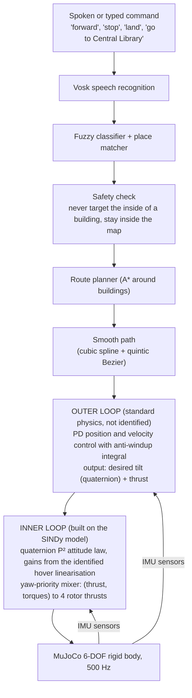

<h1 align="center">Voice-Controlled Quadrotor<br>with a Data-Driven Attitude Loop</h1>

<p align="center">
  <b>Say "forward", "stop", or "go to the library". A simulated drone flies there on a controller built from an equation it learned from its own flight data.</b><br>
  Group project · <i>Data Driven Control of Drones</i> · B.Tech AI Engineering<br>
  School of Artificial Intelligence, Amrita Vishwa Vidyapeetham, Coimbatore
</p>

<p align="center">
  
  
  
  
  
  
  
</p>

<p align="center">
  <a href="#1-objective">Objective</a> ·
  <a href="#3-the-pipeline-stage-by-stage">Pipeline</a> ·
  <a href="#4-method">Method</a> ·
  <a href="#5-the-campus-world">Campus</a> ·
  <a href="#6-results">Results</a> ·
  <a href="#7-honest-limits">Limits</a> ·
  <a href="#8-how-to-run">Run it</a>
</p>

Runs in MuJoCo on a 1:10 scale model of the real campus, built from OpenStreetMap building outlines and a satellite photo.

[](docs/recordings/campus_demo.mp4)

*31-second recording of the campus demo (click for the MP4). Left: chase camera. Right: bird's-eye camera. Bottom: live speed trace. Every "stop" brings the drone to rest in 0.92 s over 0.50 m, with altitude held to within 2 cm. Recorded by [`record_demo_video.py`](05_voice_interface/record_demo_video.py).*

---

## Abstract

This project builds a drone that is flown by voice and whose attitude controller is calculated from an equation it learned from its own flight data. A simulated quadrotor in MuJoCo is excited with random and sweep rotor inputs; SINDy (sparse identification of nonlinear dynamics) finds the rotation equations from the recorded data, keeping 44 of 156 candidate coefficients and predicting held-out data with $R^2 = 0.9946$. DMDc (dynamic mode decomposition with control), a linear method that is valid near hover only, is the comparison, and SINDy was selected after held-out trials, 11 s rollouts, eigenvalue and noise checks. The inner quaternion attitude loop takes its gains from the learned model; the outer position loop is standard physics by design. A person can say or type "forward", "stop", "land" or "go to the library", and the drone flies there on a 1:10 scale model of the Amrita Coimbatore campus, routing around buildings. It completed 24/24 voice trials, 5/5 chained commands and a 67/67 manoeuvre gauntlet, and brakes to rest in 0.92 s over 0.50 m. The 167 automated tests pass. All results are from simulation; there was no hardware flight.

## Contents

1. [Objective](#1-objective), including tools and background
2. [System overview](#2-system-overview)
3. [The pipeline, stage by stage](#3-the-pipeline-stage-by-stage) and how the project evolved
4. [Method](#4-method)
5. [The campus world](#5-the-campus-world)
6. [Results](#6-results), including parameters at a glance
7. [Honest limits](#7-honest-limits), known issues, and what was left out
8. [How to run](#8-how-to-run)
9. [Repository layout](#9-repository-layout)
10. [Conclusion](#10-conclusion)
11. [Credits and references](#11-credits-and-references)

---

## At a glance

| | |
|---|---|
| **What was learned from data** | The drone's rotational dynamics: SINDy keeps **44 of 156** candidate coefficients (26 terms in each of 6 equations) and predicts held-out data with **$R^2 = 0.9946$** |
| **What it was checked against** | DMDc (a linear alternative), with held-out trials, 11 s rollouts, eigenvalues, sparsity and noise ablations |
| **How it flies** | Outer position loop (standard physics) feeding an inner quaternion attitude loop whose gains are **calculated from the learned model**, not hand-tuned |
| **How you command it** | Offline speech (Vosk) or typed text: 8 moves, `land`, and `go to <building>` for 31 named buildings |
| **How well it works** | 24/24 voice trials, 5/5 chained, 67/67 maneuver gauntlet, braking in 0.92 s over 0.50 m, 167 automated tests passing |
| **How it was stressed** | Sensor noise, wind, wrong payload mass, mid-flight command reversal, moving obstacles |

---

## 1. Objective

Many drone-control projects fail in one of two ways. Either a speech interface is attached to textbook physics with no identification step, or the dynamics are identified in a notebook and never flown in closed loop.

This project closes that gap. The goal is a **complete, validated chain** from raw simulated flight data to a spoken command moving a drone, where the identified model is the thing the controller is built on.

**One design decision shapes everything.** Only the **inner attitude loop** is identified from data. Flying in a straight line under a thrust vector is Newton's second law, a plain double integrator with nothing for a data-driven method to discover. Rotation is different: it has drag, cross-axis coupling and quaternion constraints, which is worth learning from data. So the outer position loop is deliberately standard physics (see [`docs/TDD.md`](docs/TDD.md) §7b).

### Tools and background

| Tool | Used for | Why this one |
|---|---|---|
| **MuJoCo** | The 6-DOF rigid-body quadrotor at 500 Hz, with IMU sensors | Fast, accurate contact and rigid-body physics; sensors are built in |
| **SINDy** | Learning the rotation equation from data | Returns a short readable equation (44 of 156 terms kept) that can be linearised for the gain design |
| **DMDc** | The linear comparison model | The standard linear data-driven method with control inputs; valid near hover only, so it shows what SINDy adds |
| **Savitzky-Golay filter** | Smoothing before differentiating | Differentiating raw data amplifies noise |
| **A\* and spline smoothing** | Routing around buildings, then a flyable path | A* is simple, exact on a grid, and easy to test |
| **Vosk** | Offline speech recognition | Runs without internet; its mistakes are visible in the HEARD LOG |
| **OpenStreetMap and a satellite photo** | The campus footprints, names and ground | Real outlines and names at no cost |

---

## 2. System overview



Everything runs at **500 Hz** ($\Delta t = 0.002$ s). Frames are ENU world and FLU body, with Hamilton scalar-first quaternions. Units are SI.

---

## 3. The pipeline, stage by stage

Each stage had a pass/fail gate that had to be met before the next one started.

| Stage | What happens | Key result | Code |
|---|---|---|---|
| **A. Excitation** | Open-loop random (PRBS) and sweep (chirp) rotor inputs on each axis, with no controller active, so the data is rich | Varied, non-flat responses on every axis; trials split into train and held-out **by whole trial** | [`01_simulation/`](01_simulation) |
| **B. Identification** | Smooth the data (Savitzky-Golay), then fit **SINDy** and **DMDc** on the same trials | SINDy held-out $R^2$ **0.9946**, 44/156 coefficients. DMDc $R^2$ 0.9926 near hover only | [`02_identification/`](02_identification) |
| **C. Validation** | One-step error, then 11 s open-loop rollouts, eigenvalues, sparsity and noise ablations, head-to-head | **SINDy selected.** 0/7 rollouts diverged | [`03_validation/`](03_validation) |
| **D. Control** | Inner quaternion loop (gains from the model) and outer position loop (standard physics) | Settling 0.56-0.86 s inner, 1.87 s full cascade, final error 0.0006 m | [`04_control/`](04_control) |
| **E. Voice demo** | Speech to command to waypoint to trajectory to cascade to MuJoCo | 24/24 trials, 5/5 chained, 36 ms processing latency | [`05_voice_interface/`](05_voice_interface) |

### How the project evolved

| Step | What was built | What forced the next step |
|---|---|---|
| **1. Excitation and identification** (Stages A, B) | Open-loop PRBS and chirp data, then SINDy and DMDc fits | The first SINDy fit looked broken (NRMSE 0.99): snapshot pairs had been formed across a trial boundary. Fixed by pairing inside segments only (section 6.7) |
| **2. Validation** (Stage C) | Rollouts, eigenvalues, noise and sparsity ablations, head-to-head | SINDy selected over DMDc, which is valid near hover only |
| **3. Cascade controller** (Stage D) | Inner quaternion loop from the SINDy model, outer position loop from standard physics | The first integral term added lag and a 0.196 m overshoot, so it was gated to near-rest (section 6.7) |
| **4. Voice demo** (Stage E, 2026-09-07) | Speech to command to waypoint to trajectory to cascade to MuJoCo | A browser dashboard was tried the same day and reverted; the matplotlib HUD stayed |
| **5. Campus world** | 1:10 model of the campus from OSM outlines and a satellite photo, 31 named buildings | Straight lines flew into buildings, so a route planner was needed |
| **6. Autonomous navigation** (2026-10-19) | A* routing, moving obstacles, no straight-through flights | Review preparation: one launcher, a cleaner HUD (2026-10-21) |
| **7. Live graphs, wall-graze fix, rounded turns** (2026-10-22) | Live status graphs; the drone can no longer wedge against an angled wall; corners are rounded arcs instead of right angles | Current state |

---

## 4. Method

### 4.1 Data: the plant and the excitation
A full nonlinear 6-DOF quadrotor in MuJoCo: X configuration, four rotors, 1.0 kg, arm 0.15 m, with drag applied as a generalized force. Excitation signals are generated with seeds derived deterministically per trial (not Python's `hash()`), so results are reproducible across processes. A test enforces this.

Savitzky-Golay smoothing is applied before any differentiation. Held-out data means **separate trials**, never a slice of one trajectory.

### 4.2 SINDy: learning the rotational dynamics
SINDy (Sparse Identification of Nonlinear Dynamics) is given the four rotor thrusts and the measured angular velocity, and must find the equation connecting them. It builds a library of **26** candidate terms for each of the **6** state equations (156 coefficients in all) and runs **STLSQ** (sequentially thresholded least squares): fit, drop the weakest terms, refit, repeat.

- **44 coefficients survive.** They recover the true control effectiveness, drag, gyroscopic cross-term and kinematics to within **2-6%** of the simulator's ground truth ([`tests/test_identification_physics.py`](tests/test_identification_physics.py)). That match is the evidence that physics was learned, not just a curve.
- **Quaternions are never fitted raw.** The attitude is handled in local coordinates with a reset at segment boundaries, and fit pairs are never formed across a boundary (a fake pair there outweighed a million real ones).
- Sparsity is chosen by a parsimony rule on validation data, not by $R^2$ alone, which would pick the densest model (127 terms for +0.0002 $R^2$).

### 4.3 DMDc: the linear comparison
DMDc (Dynamic Mode Decomposition with control) fits $x_{k+1} = A x_k + B u_k$ by least squares. It is SINDy with a **linear-only library**, no sparsity, and a discrete-time form.

It matches SINDy near hover (NRMSE 0.0825 vs 0.0789) but **degrades to a one-step NRMSE of about 0.70 outside hover** (where 1.0 is a model that does nothing), because a linear model cannot hold the nonlinear terms. So it is reported honestly as valid near hover only, and never used as a pass outside that regime.

### 4.4 Validation and model selection
| Check | Result |
|---|---|
| One-step prediction on held-out trials | SINDy NRMSE **0.0786**, $R^2$ **0.9946** |
| 11 s open-loop rollout, full envelope | **0/7 diverged**, mean final error 0.095 (bound 0.5) |
| Eigenvalues | 3 of 6 poles are marginal. That is expected: an uncontrolled rigid body's attitude has no restoring force. The rest are stable |
| Sparsity ablation | $R^2$ plateaus above threshold 0.2, collapses at 1.0 (0.588) |
| Noise ablation | Robust to about 1 rad/s injected gyro noise; knee at 2.0 rad/s; breakdown by 4.0 |
| Head-to-head in DMDc's own regime | SINDy 0.0789 vs DMDc 0.0825, so SINDy matches it there and also works everywhere else |

**SINDy is selected.** The chosen model is frozen to `data/processed/sindy_fitted_model.npz`, and the flight controller loads exactly that file, so what flies is provably the model that passed the gates.

### 4.4b The equations that matter

The state is $x = (\theta, \omega) \in \mathbb{R}^6$: the attitude $\theta$ in local (rotation-vector) coordinates and the body rates $\omega$. The inputs are the four rotor thrusts $u = (u_1, u_2, u_3, u_4)$.

**The physics SINDy has to find** (docstring of [`02_identification/sindy_fit.py`](02_identification/sindy_fit.py)), with inertia $I$, the torque rows $M_\tau$ of the mixer matrix and rotational drag $c_{rot}$:

```math
\dot\theta = \omega + \tfrac{1}{2}\,\theta \times \omega + O(\lVert\theta\rVert^2), \qquad
\dot\omega = I^{-1}\left(M_\tau u - \omega \times (I\omega) - c_{rot}\,\omega\right)
```

**SINDy model and its library** ([`sindy_fit.py`](02_identification/sindy_fit.py)). Each row of $\Theta$ holds 26 candidate terms, one group for every mechanism above (constant, kinematics, drag, control, gyroscopic and bilinear kinematic terms):

```math
\Theta(x, u) = \begin{bmatrix} 1 & \theta^\top & \omega^\top & u^\top & \omega_i\omega_j\ (i \le j) & \theta_i\omega_j \end{bmatrix}, \qquad
\dot x = \Theta(x, u)\,\Xi, \qquad \Xi \in \mathbb{R}^{26 \times 6}
```

The library has $1 + 3 + 3 + 4 + 6 + 9 = 26$ terms, so $\Xi$ has $26 \times 6 = 156$ coefficients, of which 44 are non-zero after fitting.

**STLSQ** (sequentially thresholded least squares). Repeat until the set of kept terms stops changing:

```math
\Xi \leftarrow \arg\min_{\Xi} \lVert \dot X - \Theta\,\Xi \rVert_2^2, \qquad \Xi_{ij} \leftarrow 0 \ \text{ wherever } \lvert \Xi_{ij} \rvert < \lambda
```

**DMDc** ([`02_identification/dmdc_fit.py`](02_identification/dmdc_fit.py)), fitted by least squares on snapshot pairs taken inside each segment:

```math
x_{k+1} = A\,x_k + B\,u_k
```

**Quaternion error and inner law** ([`04_control/controller.py`](04_control/controller.py)). With the desired attitude $q_{des}$ and the measured attitude $q$ (Hamilton, scalar first), the vector part $q_{e,vec}$ is about half the angle error, and $\mathrm{sign}(q_{e,w})$ picks the short way round:

```math
q_e = q_{des}^{*} \otimes q, \qquad
\tau = -K_q\,\mathrm{sign}(q_{e,w})\,q_{e,vec} - K_\omega\,(\omega - \omega_{des})
```

**Gains from the model** (`gains_from_identified_model()` in `controller.py`). For each axis, $a$ (negative: minus drag divided by inertia) and $b$ (control effectiveness, about 1/inertia) are read from the SINDy hover Jacobian. The closed loop $\ddot e + (b K_d - a) \dot e + b K_p e = 0$ is matched to a second-order system with damping $\zeta = 0.7$ and settling time $T_s = 0.5$ s, the only two hand-chosen numbers. Because $q_{e,vec} \approx e/2$, $K_q = 2K_p$:

```math
\omega_n = \frac{4}{\zeta T_s}, \qquad K_q = \frac{2\,\omega_n^2}{b}, \qquad K_\omega = \frac{2\zeta\omega_n + a}{b}
```

With these values $\omega_n = 4/(0.7 \cdot 0.5) \approx 11.4$ rad/s.

**Outer law** ([`04_control/position_controller.py`](04_control/position_controller.py)). PD on position error $e_p$ and velocity error $e_v$, with an integral that is gated to near-rest and has anti-windup; $m$ is the mass and $\hat z$ the world up axis:

```math
a_{cmd} = K_p\,e_p + K_d\,e_v + K_i \int e_p\,dt, \qquad f = m\,(a_{cmd} + g\,\hat z)
```

**Mixer** ([`04_control/mixer.py`](04_control/mixer.py)), solved with $M^{-1}$; yaw torque is shed first when a rotor would clip:

```math
\begin{bmatrix} T & \tau_x & \tau_y & \tau_z \end{bmatrix}^\top = M \begin{bmatrix} f_1 & f_2 & f_3 & f_4 \end{bmatrix}^\top
```

**Stopping distance** (`_braking_target` in [`05_voice_interface/flight.py`](05_voice_interface/flight.py), and [`04_control/trajectory.py`](04_control/trajectory.py)). Braking at the planner's deceleration limit $a_{max}$:

```math
d = \frac{v^2}{2\,a_{max}} = \frac{(1.0\ \mathrm{m/s})^2}{2 \cdot 1.0\ \mathrm{m/s^2}} = 0.5\ \mathrm{m}
```

which is the braking distance measured in section 6.1.

### 4.5 The cascade controller
- **Inner loop** ([`04_control/controller.py`](04_control/controller.py)): a singularity-free quaternion $P^2$ law [6]. Its gains come from `gains_from_identified_model()`, which reads the drag-to-inertia ratio of each axis from the SINDy hover Jacobian and applies a standard second-order design rule. Only two numbers are chosen by hand (settling time and damping). When the model changes, the gains recompute.
- **Outer loop** ([`position_controller.py`](04_control/position_controller.py)): PD position and velocity control with an anti-windup integral that acts only when the drone and trajectory are nearly at rest. It outputs the smallest tilt that gives the wanted acceleration.
- **Mixer** ([`mixer.py`](04_control/mixer.py)): inverts the real X-configuration rotor geometry. When a command would saturate a rotor, the **yaw-priority** version sheds yaw torque first so thrust is kept.
- **Bandwidth separation** between the loops is a factor of 2.86, which justifies designing them independently.

### 4.6 Interpolation: from a few points to a flyable path
- **Cubic smoothing spline** (a B-spline fit) through the A* route waypoints rounds every corner.
- **Quintic Bezier** for each leg, with position, velocity and acceleration matched at the start, so chained commands do not stop dead between legs.
- Each curve is **checked** against the building map and against the speed and acceleration limits before it is flown.

### 4.7 IMU sensing
The controller reads state through the model's named sensors (position, attitude, a body-frame velocimeter and a gyro), and rotates the velocity into the world frame as a real flight computer would. These are idealized MuJoCo sensors, noiseless by default. Sensitivity to noise is measured separately in section 6.6.

### 4.8 Voice and navigation
Vosk (offline) produces text, a fuzzy classifier maps it to a command, and a place matcher maps names to buildings. Commands include synonyms (`halt`, `climb`, `descend`). The transcript is always shown, including misses, so a misheard word is visible, never silent. `stop` brakes the drone to rest ahead of it at the planner's deceleration limit instead of turning back.

### 4.9 Safety
Targets are clipped so the drone never flies into a building, including when several commands are chained in one direction. The geofence stops flight inside the map edge. Landing finds the surface below (ground or a roof) and shuts the motors off at touchdown.

---

## 5. The campus world

The map is a **1:10 scale model of the Amrita Coimbatore campus**: 86 buildings, 31 of them named and addressable by voice.

| Real campus footprints and heights | 3D scene with the satellite ground |
|:---:|:---:|
|  |  |

- **Footprints and names** come from OpenStreetMap. **Heights are estimated** from building type, because OSM does not carry floor counts.
- **Ground** is a real satellite photo (Esri World Imagery, zoom 18, about 0.6 m per pixel) resampled onto the floor plane.
- **Alignment.** The photo and the outlines come from different sources, so a single offset is not enough. `align_buildings.py` measures each building against its roof edges and moves it onto the photo. 51 of 80 measurable buildings were moved (median move 2 m); the other 29 stayed at their OSM position because the evidence was unclear. The mean edge match at the outlines rose from 38.8 to 62.4.
- The visual layers are physics-inert (no mass, joints or contacts), and a test enforces that.

---

## 6. Results

Every number below comes from a reproducible script. Held-out data is used wherever a model is judged.

### 6.1 Stopping: the drone brakes to rest


| Move | Speed when "stop" was said | Time to rest | Braking distance | Altitude change |
|---|---|---|---|---|
| forward | 1.00 m/s | **0.92 s** | **0.50 m** | 0.019 m |
| left | 1.00 m/s | **0.92 s** | **0.50 m** | 0.001 m |

The distance matches the physics: stopping from 1.0 m/s at the planner's $1.0\ \mathrm{m/s^2}$ deceleration limit takes 0.5 m. Rest is defined as speed below 0.05 m/s. Speeds are in simulation units. Source: [`docs/recordings/stop_metrics.json`](docs/recordings/stop_metrics.json).

### 6.2 Identification and validation

| Metric | Value |
|---|---|
| SINDy held-out derivative $R^2$ / one-step NRMSE | **0.9946** / **0.0786** (44 of 156 coefficients) |
| DMDc held-out $R^2$ / NRMSE (near hover) | 0.9926 / 0.0825 (NRMSE about 0.70 outside hover) |
| Coefficients vs simulator truth | within **2-6%** |
| Rollouts diverged (11 s) | SINDy **0/7**, DMDc 0/16 (hover only) |

| SINDy vs DMDc near hover | Eigenvalue spectra |
|:---:|:---:|
|  |  |

| Sparsity ablation | Noise ablation |
|:---:|:---:|
|  |  |


### 6.3 Control

| Metric | Value |
|---|---|
| Inner-loop step settling (SINDy model vs MuJoCo plant) | **0.56-0.86 s**, agreeing within about 0.3% |
| Full cascade, six waypoints | settles in about **1.87 s**, final error **0.0006 m** |
| Demo flight with the curved Bezier path | about 2.95 s to settle |


### 6.4 Voice trials and the maneuver gauntlet

| Test | Result |
|---|---|
| 24 scripted voice trials, reset before each | **24/24**, tolerance 0.15 m, final error about 0.0044 m |
| 5 chained commands, no reset between legs | **5/5**, max leg error 0.022 m |
| Mid-flight reversal ("back" at 0.7 s while flying forward) | peak excursion 0.259 m, reversal in **0.42 s**, clear of the 2.3 m tower face by 2.04 m |
| Maneuver gauntlet (all commands, chains, edge cases) | **67/67** pass |
| Processing latency (classify + plan + dispatch) | **36 ms** (classify 0.42 ms, trajectory 34.8 ms, dispatch 0.86 ms) |

The 36 ms is measured on the typed-text path; live speech adds the recognizer's own decode time, measured separately per utterance. Full gauntlet tables are in [`results/RESULTS.md`](results/RESULTS.md).


### 6.5 Autonomous navigation among moving obstacles
The drone can also fly a patrol **by itself** around four moving obstacles plus the buildings, with no straight-line flight. An avoidance planner supplies only the reference; the same cascade does all the control.

| | Straight-line baseline | Autonomous |
|---|---|---|
| Development seeds 0-4 | **0/5** collision-free, 43 s inside obstacles | **5/5** collision-free, min clearance 0.284 m |
| Never-seen seeds 100-129 | n/a | **29/30** collision-free, median clearance 0.394 m |


### 6.6 Robustness to noise, wind and wrong mass
Each disturbance was swept one at a time on a `forward` leg. Two fixes were added after measuring where it failed: the yaw-priority mixer (yaw is the cheapest axis to saturate) and an anti-windup integral (a PD law has a steady offset under constant force).

| Disturbance | Original cascade fails at | With the two fixes, still within 0.15 m up to |
|---|---|---|
| Gyro noise | 0.05 rad/s | 2.0 rad/s |
| Constant wind | 1 N | 2 N (fails at 3 N) |
| Payload mass error | $\pm 10$% | $\pm 20$% (fails at +50%) |


### 6.7 What building this taught us

Each of these was a real failure that was measured and then fixed.

1. **Never pair snapshots across a segment boundary.** At an attitude reset the angle jumps about 2.6 rad against about 0.002 rad of real motion. Squared, one fake pair outweighs a million real ones. It made SINDy look broken (NRMSE 0.99) when the model was fine (0.08).
2. **Single-axis excitation is rank-deficient.** Roll-only data fills only 2 of the 6 state directions (condition number about $10^{48}$). `pinv` hides this and `pydmd` returns garbage near $10^{11}$. DMDc is cross-checked only on full-rank combined-axis trials.
3. **Error normalised by state size is meaningless at 2 ms steps.** A model that does nothing scores well. Normalising by the state's *change* makes the do-nothing baseline exactly 1.0.
4. **Marginal poles are not instability.** An uncontrolled rigid body has $\dot\theta = \omega$ and no restoring force, so poles on the stability boundary are expected. A strict `< 0` test briefly flipped model selection to DMDc for the wrong reason; a tolerance fixed it.
5. **A noise ablation with no visible effect proves nothing.** The first range (0 to 0.1 rad/s) was a flat line. The real knee was at 2 to 4 rad/s, so the range was widened.
6. **Yaw is the expensive axis.** With yaw torque costing about 5 times more rotor headroom than roll or pitch, gyro noise saturated rotors on about 70% of steps and thrust was lost. Shedding yaw first fixed it.
7. **An integral term must not integrate through a move.** The first version added lag and a 0.196 m overshoot. Gating it to "trajectory and drone both nearly at rest" fixed that; the speed gate was swept (0.08 to 1.0 m/s) and 0.15 m/s chosen.
8. **A design claim did not survive the real plant.** The outer loop was designed as a critically damped double integrator; the real cascade, with inner-loop lag and drag, shows about 0.07 m of ringing. It is reported as measured.
9. **Sensors lag one step.** MuJoCo computes sensor values from the state before integration, so reading right after `mj_step()` is 2 ms stale. One extra `mj_forward()` call fixed it.

### 6.8 Assumptions we chose and stated

| Quantity | Choice | Why it is stated |
|---|---|---|
| Plant | 1.0 kg, arm 0.15 m, X configuration, drag as a generalized force | Fixed in [`docs/TDD.md`](docs/TDD.md) §2 so nothing drifts mid-project |
| Excitation | PRBS and chirp per axis, deterministic seed per trial | Reproducible across processes (tested) |
| Smoothing | Savitzky-Golay before any differentiation | Differentiating raw data amplifies noise |
| Gain design | $\zeta = 0.7$, $T_s = 0.5$ s are the only hand-chosen numbers | Everything else is computed from the model |
| Command offsets | 1.5 m lateral, 0.5 m vertical per discrete move | Hover altitude is about 1 m, so a 1.5 m "down" would pass through the floor |
| Building heights | Estimated from OSM type | OSM has no floor counts |
| Scale | 1:10 of the real campus | Keeps flight inside the sensible simulator range |
| Sensors | Ideal IMU, noise injected only in the robustness study | Honest limit, see section 7 |

### Parameters at a glance

| Parameter | Value | Where |
|---|---|---|
| Simulation step | 0.002 s (500 Hz) | `01_simulation/`, `04_control/` |
| Plant | mass 1.0 kg, arm 0.15 m, hover thrust 2.45 N per rotor, 24 N maximum total thrust | `04_control/mixer.py`, `trajectory.py` |
| Smoothing | Savitzky-Golay, window 31, order 3 | `02_identification/preprocessing.py` |
| Gain design | $\zeta = 0.7$, $T_s = 0.5$ s (the only hand-chosen numbers) | `04_control/controller.py` |
| Maximum bank angle | 30 degrees | `04_control/position_controller.py` |
| Cruise speed limit | 1.0 m/s | `04_control/trajectory.py` |
| Sideways acceleration limit in turns | $0.8\ \mathrm{m/s^2}$ | `04_control/trajectory.py` |
| Integral gate | engaged only when trajectory and drone are both below 0.15 m/s | `04_control/position_controller.py` |
| Wall safety margin | 0.3 m | `01_simulation/models/city.py` |
| Route planner clearance | 0.45 m (hard) | `04_control/route_planner.py` |
| Minimum height for `down` | 0.3 m (only `land` goes lower) | `05_voice_interface/flight.py` |

---

## 7. Honest limits

- **No state estimator.** The controller reads idealized IMU sensors directly. There is no Kalman filter. Noise tolerance is measured by injecting noise, not by filtering it.
- **DMDc is valid near hover only.** It is reported that way and is never claimed beyond it.
- **Building heights are estimated** from type, not surveyed. Footprints and names are real.
- **The photo leans.** It was taken at a slight angle, so tall buildings show a pale rim around the 3D box that no outline shift can remove. 29 of 80 buildings were left at their OSM position.
- **Disturbance limits.** 3 N wind and +50% payload still fail. The integral's authority is capped at $2\ \mathrm{m/s^2}$ by design.
- **Autonomy assumes perfect obstacle perception**, and its one failure (seed 104) is a double pinch that a planner with no lookahead cannot foresee.
- **Speech recognition makes mistakes.** The small Vosk model mishears words; the HEARD LOG shows exactly what it heard.
- **Results are from simulation** at 1:10 scale. No hardware flight was done.

### Future work
- A state estimator (Kalman or complementary filter) between noisy IMU data and the controller.
- Controllability of the identified model has been checked for the near-hover DMDc model (full rank, 6 of 6; see `DMDC_DEEP_DIVE.md`). A reachability analysis of the SINDy model over large attitudes is still open.
- Extend DMDc beyond hover with a Koopman lift, so it can be compared with SINDy across the full envelope.
- Surveyed building heights, and a roof-aware photo correction for tall buildings.
- Obstacle perception from simulated sensors instead of perfect knowledge, and lookahead in the avoidance planner.
- A hardware flight on a real quadrotor with the same frozen model.


### Known issues (fixed and open)

**Fixed**

| Problem | Cause | Fix |
|---|---|---|
| Chart windows never appeared | The check `"agg" not in get_backend()` also matches `tkagg`, so `fig.show()` never ran | Compare the lower-cased backend name to `"agg"` exactly (`demo.py`, `minimap.py`, `status_graphs.py`) |
| Drone wedged against a building | `CampusWorld.clamp` only stopped the drone on *entering* a building box. Sliding along an angled wall grazed it at 3 cm, and the 0.34 m hull tipped about 91 degrees | The clamp now also samples the path every 5 cm and stops at the first point inside the margin that is still closing in (`tests/test_wall_graze.py`) |
| Corners were exact right angles with a speed dip to 0.32 m/s | `CruiseTrajectory` kept only the along-line speed | `CruiseTurnTrajectory` keeps the sideways velocity and bleeds it off with a raised-cosine arc (`tests/test_turn_trajectory.py`) |

**Still open**

| Problem | Effect | Workaround or idea |
|---|---|---|
| No recovery after a tip-over | A tipped drone stays down until the demo is restarted | Restart; a recovery or reset command is future work |
| A `stop` said at speed toward a wall can end inside the 0.3 m margin | The drone is safe from collision but closer than intended | Brake earlier, or lengthen the stopping lookahead |
| The city world still turns at exact right angles | Rounded turns are applied only on the campus | Extend `CruiseTurnTrajectory` to the city world |
| The stored near-hover DMDc score (one-step NRMSE 0.0825) did not reproduce today (0.0747) | Cause not yet determined; the SINDy figures were not affected | Re-run `02_identification/run_identification.py` and refresh the stored results |
| The real-display look of the new graphs and arcs is confirmed only by window checks and plots | Not yet confirmed by eye on a real display | Run `RUN.bat` option 1 and look |

### Left out or not finished

- **State estimator** (Kalman or complementary filter): the controller reads ideal IMU values.
- **Hardware flight:** everything is simulation at 1:10 scale.
- **Perception:** obstacles are known exactly; nothing is sensed.
- **Surveyed building heights:** heights are estimated from the OSM building type.
- **A web dashboard:** built and then reverted by decision on 2026-09-07.
- **DMDc beyond hover:** no Koopman lift, so no like-for-like comparison with SINDy over the full envelope.

---

## 8. How to run

**Windows, PowerShell, Python 3.11 or newer.** One-time setup:
```powershell
git clone --branch drone_mujoco --single-branch https://github.com/praann07/Drones_S5_AB8_ESP32VoiceDrone.git
cd Drones_S5_AB8_ESP32VoiceDrone
python -m venv .venv
.\.venv\Scripts\Activate.ps1
pip install -r requirements.txt
```

`requirements.txt` pins these packages:

| Package | Version | Used for |
|---|---|---|
| `mujoco` | 3.12.0 | Rigid-body simulation, sensors and viewer |
| `numpy`, `scipy` | 2.5.2, 1.18.1 | Arrays, least squares, splines, linear algebra |
| `pysindy` | 2.1.0 | SINDy fit |
| `PyDMD` | 2025.8.1 | DMDc cross-check (`dmdc_fit.py`, `dmdc_deep_dive.py`) |
| `pandas`, `pyarrow` | 3.0.5, 25.0.1 | Trial tables and Parquet files of the excitation data |
| `matplotlib` | 3.11.1 | HUD, live status graphs and every plot |
| `vosk`, `sounddevice` | not pinned | Offline speech recognition and microphone input |
| `pillow`, `imageio`, `imageio-ffmpeg` | 12.3.0, 2.37.0, 0.6.0 | Satellite image processing and the GIF and MP4 recordings |
| `pytest` | 9.1.1 | The automated tests |
For voice control, download the small English model from the [Vosk model list](https://alphacephei.com/vosk/models) and unzip it as `vosk-model-small-en-us-0.15\` in the project root. Without it, the demo falls back to typed commands.

### The one launcher
Double-click **`RUN.bat`** and pick a number:

| | |
|---|---|
| **1** | Fly the drone: live campus demo with a commands guide that stays open |
| **2** | After flying: 2D and 3D graphs of the flight you just did |
| **3** | Drone parameters (mass, inertia, gains, identified model) |
| **4** | Run the tests |
| **5** | Browser simulator on localhost only |
| **6** | Rebuild every result and plot (several minutes) |

### What to say
`forward`, `back`, `left`, `right`, `up`, `down` keep moving until a building, the map edge or the next command. `stop` or `hover` brakes to rest. `land` descends onto the ground or a roof. `go to <building>` flies a curved route around the buildings, for example "go to central library". The window also has click buttons for every command, a live LISTENING line and a HEARD LOG. A fourth window, **Flight Status**, draws altitude, speed, distance to the nearest building, x/y position and a command timeline over the last 60 s (pause button; the data is saved as a CSV next to the flight log). Start the demo with `--no-graphs` to hide it.

### Reproduce the results
```powershell
.\.venv\Scripts\python.exe 01_simulation\run_excitation.py          # A: excitation data
.\.venv\Scripts\python.exe 02_identification\run_identification.py  # B: SINDy and DMDc
.\.venv\Scripts\python.exe 03_validation\run_validation.py          # C: validation, freezes the model
.\.venv\Scripts\python.exe 04_control\run_inner_loop.py             # D: inner loop
.\.venv\Scripts\python.exe 04_control\run_cascade.py                # D: full cascade
.\.venv\Scripts\python.exe 05_voice_interface\run_trials.py         # E: 24 + 5 voice trials
.\.venv\Scripts\python.exe 05_voice_interface\run_preemption.py     # E: mid-flight reversal
.\.venv\Scripts\python.exe run_gauntlet.py                          # 67 maneuvers
.\.venv\Scripts\python.exe 05_voice_interface\run_robustness.py     # noise, wind, payload
.\.venv\Scripts\python.exe 05_voice_interface\run_autonomous.py --render   # moving obstacles
.\.venv\Scripts\python.exe 05_voice_interface\record_demo_video.py  # the video above
.\.venv\Scripts\python.exe -m pytest                                # 167 tests
```
`REBUILD_RESULTS.bat` runs the whole chain and collects every plot into `results/`.

### What the 167 tests cover

| Test file | Tests | Checks |
|---|---|---|
| `test_autonomy.py` | 34 | Moving obstacles, scene fairness, avoidance, no stalls |
| `test_voice_interface.py` | 24 | Classifier, synonyms, end-to-end voice pipeline, live logger, safety clamp |
| `test_goto.py` | 23 | Place matching, route planning, curved paths, landing on roofs |
| `test_natural_motion.py` | 11 | Continuous moves and braking |
| `test_stability.py` | 10 | Cascade and loop stability |
| `test_mixer.py`, `test_inverse_mixer.py` | 12 | Rotor mixing, both directions |
| `test_robustness.py` | 8 | Noise, wind, payload, yaw-priority mixer, integral |
| `test_landing.py` | 7 | Touchdown on ground and roofs |
| `test_identification_physics.py` | 6 | Learned coefficients match simulator truth within 2-6% |
| `test_minimap.py`, `test_campus.py`, `test_web_sim_parity.py` | 11 | Map window, campus scene, browser simulator parity |
| `test_status_graphs.py` | 7 | Live flight-status graphs: sampling rate, values equal the controller state, events, pause, CSV |
| `test_wall_graze.py` | 4 | The drone may not slide along a wall close enough to touch it (clamp sweeps the margin, flight never tips over) |
| `test_turn_trajectory.py` | 6 | A change of direction sweeps a rounded corner (speed never drops, no velocity jump, acceleration limits kept) |
| `test_scene_physics_inert.py`, `test_reproducibility.py` | 4 | Visual layers add no physics; seeds reproduce across processes |

### What you can do with it

- **Fly by voice or text:** `take off`, the eight moves, `stop`, `land`, and `go to <building>` for 31 named buildings.
- **Watch it live:** the HUD, the "Where am I?" map and the live status graphs (altitude, speed, distance to the nearest building, position, command timeline).
- **Reproduce the results:** the commands in "Reproduce the results" regenerate the plots, tables and the 167-test suite.
- **Swap the model:** change the SINDy library or threshold in `02_identification/` and see how the gains and the flight change.
- **Rebuild the world:** regenerate the campus from OSM and the satellite photo (next section).
- **Extend it:** a state estimator, obstacle sensing and the hardware flight are the natural next steps.

### Rebuild the campus
```powershell
.\.venv\Scripts\python.exe 01_simulation\models\fetch_satellite.py   # photo (cached after first run)
.\.venv\Scripts\python.exe 01_simulation\models\align_buildings.py   # per-building alignment
.\.venv\Scripts\python.exe 01_simulation\models\make_campus.py       # scene, floor, map
```

---

## 9. Repository layout

```
.
├── RUN.bat                    the one launcher
├── 01_simulation/             MuJoCo quadrotor, excitation signals, campus and city scenes
│   └── models/                quad.xml, campus generators (OSM, satellite, alignment), obstacles
├── 02_identification/         SINDy and DMDc fits, preprocessing
├── 03_validation/             rollouts, eigenvalues, ablations, model selection, frozen model
├── 04_control/                quaternion controller, position loop, mixer, trajectories,
│                              route planner, avoidance planner
├── 05_voice_interface/        voice input, commands, flight wrapper, demo, trials, recording
├── tests/                     167 automated tests
├── results/                   plots, data and the gauntlet summary (RESULTS.md)
├── docs/                      PRD, TDD, design flow, codebase guide, images, recordings
├── web/                       browser simulator (localhost only)
├── CONTROLLER_AND_IMU_EXPLAINED.md   plain-English controller and IMU walkthrough
├── UNDERSTAND_MY_PROJECT.md          guided tour of every file
└── CLAUDE.md                  stage-gate log and decision history
```

New to the project? Start with [`PROJECT_EXPLAINED.md`](PROJECT_EXPLAINED.md), a plain-language walkthrough of the whole pipeline and every piece of maths. For the flow diagrams see [`PIPELINE_FLOW_ARCHITECTURE.md`](PIPELINE_FLOW_ARCHITECTURE.md); for the DMDc mathematics with a worked example see [`DMDC_DEEP_DIVE.md`](DMDC_DEEP_DIVE.md).

More detail: [`docs/CODEBASE_GUIDE.md`](docs/CODEBASE_GUIDE.md) (code map), [`docs/TDD.md`](docs/TDD.md) (design), [`ONBOARDING.md`](ONBOARDING.md) (what is claimed and how to check it).

---

## 10. Conclusion

The project closes the gap between identifying a model and flying with it. A rotation equation learned from the drone's own data, checked against a linear alternative, sets the gains of the attitude controller, and that controller flies spoken commands on a map of the real campus: 24/24 voice trials, 5/5 chained, a 67/67 manoeuvre gauntlet, and 167 passing tests. The limits are stated plainly: simulation only, ideal sensors, estimated building heights, and a few open issues listed in section 7. The next steps are a state estimator, obstacle sensing and a hardware flight with the same frozen model.

---

## 11. Credits and references

- **Data and imagery.** Building footprints and names: © OpenStreetMap contributors (ODbL) [17]. Ground photo: Imagery © Esri, Maxar, Earthstar Geographics [18].
- **Software.** MuJoCo (Google DeepMind), PySINDy, PyDMD, Vosk (Alpha Cephei), NumPy, SciPy, pandas, Matplotlib.

Every DOI and link was checked on 2026-10-24.

1. S. L. Brunton, J. L. Proctor, and J. N. Kutz, "Discovering governing equations from data by sparse identification of nonlinear dynamical systems," *Proc. Natl. Acad. Sci. USA*, vol. 113, no. 15, pp. 3932–3937, 2016. doi: [10.1073/pnas.1517384113](https://doi.org/10.1073/pnas.1517384113)
2. J. L. Proctor, S. L. Brunton, and J. N. Kutz, "Dynamic mode decomposition with control," *SIAM J. Appl. Dyn. Syst.*, vol. 15, no. 1, pp. 142–161, 2016. doi: [10.1137/15M1013857](https://doi.org/10.1137/15M1013857)
3. B. M. de Silva, K. Champion, M. Quade, J.-C. Loiseau, J. N. Kutz, and S. L. Brunton, "PySINDy: A Python package for the sparse identification of nonlinear dynamical systems from data," *J. Open Source Softw.*, vol. 5, no. 49, p. 2104, 2020. doi: [10.21105/joss.02104](https://doi.org/10.21105/joss.02104)
4. A. A. Kaptanoglu *et al.*, "PySINDy: A comprehensive Python package for robust sparse system identification," *J. Open Source Softw.*, vol. 7, no. 69, p. 3994, 2022. doi: [10.21105/joss.03994](https://doi.org/10.21105/joss.03994)
5. N. Demo, M. Tezzele, and G. Rozza, "PyDMD: Python Dynamic Mode Decomposition," *J. Open Source Softw.*, vol. 3, no. 22, p. 530, 2018. doi: [10.21105/joss.00530](https://doi.org/10.21105/joss.00530)
6. E. Fresk and G. Nikolakopoulos, "Full quaternion based attitude control for a quadrotor," in *Proc. European Control Conf. (ECC)*, Zürich, 2013, pp. 3864–3869. doi: [10.23919/ECC.2013.6669617](https://doi.org/10.23919/ECC.2013.6669617)
7. R. Mahony, V. Kumar, and P. Corke, "Multirotor aerial vehicles: Modeling, estimation, and control of quadrotor," *IEEE Robot. Autom. Mag.*, vol. 19, no. 3, pp. 20–32, 2012. doi: [10.1109/MRA.2012.2206474](https://doi.org/10.1109/MRA.2012.2206474)
8. A. Savitzky and M. J. E. Golay, "Smoothing and differentiation of data by simplified least squares procedures," *Anal. Chem.*, vol. 36, no. 8, pp. 1627–1639, 1964. doi: [10.1021/ac60214a047](https://doi.org/10.1021/ac60214a047)
9. P. E. Hart, N. J. Nilsson, and B. Raphael, "A formal basis for the heuristic determination of minimum cost paths," *IEEE Trans. Syst. Sci. Cybern.*, vol. 4, no. 2, pp. 100–107, 1968. doi: [10.1109/TSSC.1968.300136](https://doi.org/10.1109/TSSC.1968.300136)
10. C. de Boor, *A Practical Guide to Splines*. New York, NY, USA: Springer-Verlag, 1978.
11. E. Todorov, T. Erez, and Y. Tassa, "MuJoCo: A physics engine for model-based control," in *Proc. IEEE/RSJ Int. Conf. Intelligent Robots and Systems (IROS)*, 2012, pp. 5026–5033. doi: [10.1109/IROS.2012.6386109](https://doi.org/10.1109/IROS.2012.6386109)
12. D. Povey *et al.*, "The Kaldi speech recognition toolkit," in *Proc. IEEE Workshop on Automatic Speech Recognition and Understanding (ASRU)*, Hawaii, USA, 2011.
13. Alpha Cephei, "Vosk offline speech recognition toolkit" (model `vosk-model-small-en-us-0.15`). [Online]. Available: <https://alphacephei.com/vosk/>
14. C. R. Harris *et al.*, "Array programming with NumPy," *Nature*, vol. 585, pp. 357–362, 2020. doi: [10.1038/s41586-020-2649-2](https://doi.org/10.1038/s41586-020-2649-2)
15. P. Virtanen *et al.*, "SciPy 1.0: Fundamental algorithms for scientific computing in Python," *Nat. Methods*, vol. 17, pp. 261–272, 2020. doi: [10.1038/s41592-019-0686-2](https://doi.org/10.1038/s41592-019-0686-2)
16. J. D. Hunter, "Matplotlib: A 2D graphics environment," *Comput. Sci. Eng.*, vol. 9, no. 3, pp. 90–95, 2007. doi: [10.1109/MCSE.2007.55](https://doi.org/10.1109/MCSE.2007.55)
17. Map data © OpenStreetMap contributors, available under the Open Database License (ODbL). [Online]. Available: <https://www.openstreetmap.org/copyright>
18. Esri, "World Imagery" basemap. Imagery © Esri, Maxar, Earthstar Geographics. [Online]. Available: <https://www.arcgis.com/home/item.html?id=10df2279f9684e4a9f6a7f08febac2a9>
19. M. Haklay and P. Weber, "OpenStreetMap: User-generated street maps," *IEEE Pervasive Comput.*, vol. 7, no. 4, pp. 12–18, 2008. doi: [10.1109/MPRV.2008.80](https://doi.org/10.1109/MPRV.2008.80)
20. W. McKinney, "Data structures for statistical computing in Python," in *Proc. 9th Python in Science Conf. (SciPy)*, 2010, pp. 56–61. doi: [10.25080/Majora-92bf1922-00a](https://doi.org/10.25080/Majora-92bf1922-00a)
