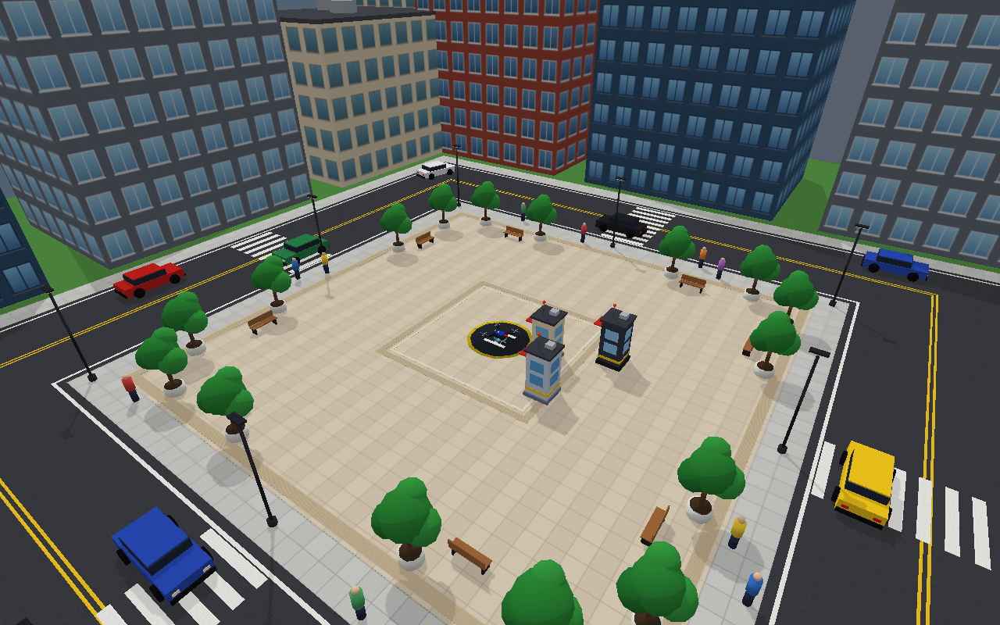
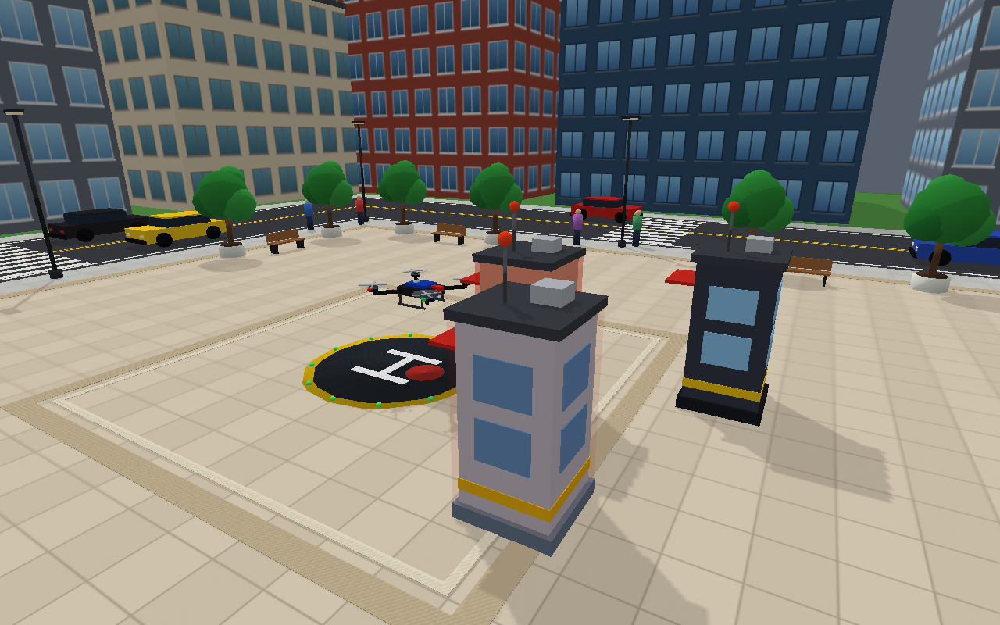
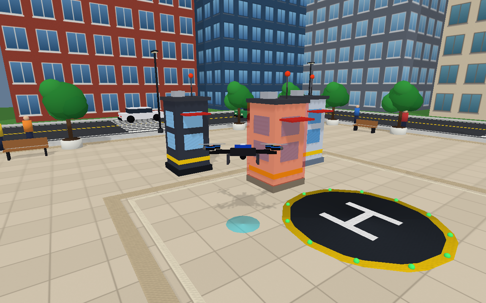
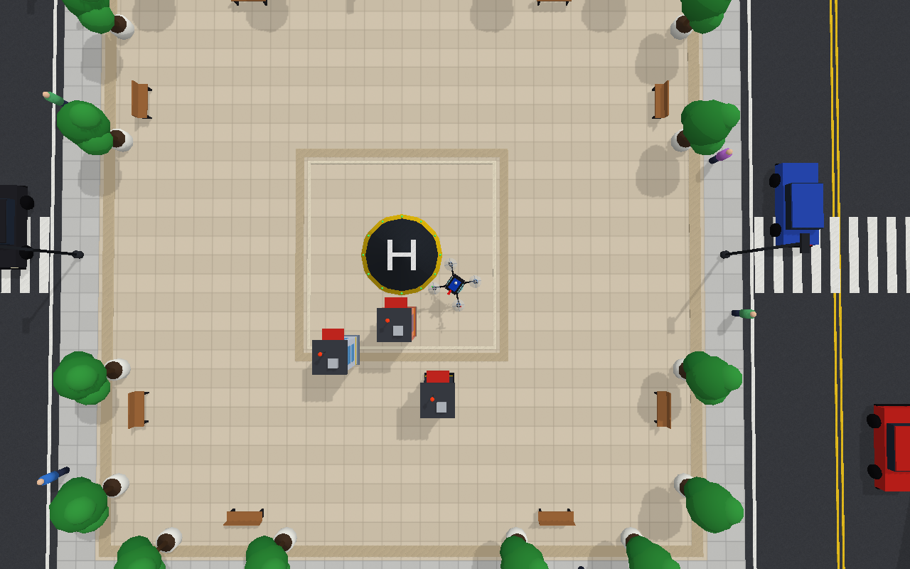

<p align="center">
  
</p>

<h1 align="center">Voice-Controlled Quadcopter Simulation with Obstacle Handling</h1>

<p align="center">
  <b>Speak a command, watch the drone fly: a PyBullet city simulation with a speech-driven command parser</b><br>
  Amrita Vishwa Vidyapeetham
</p>

---

## Team Members

| S. No. | Name | Roll Number | Email |
|---:|---|---|---|
| 1 | Mamidala Som Praneeth Babu | CB.SC.U4AIE24029 | cb.sc.u4aie24029@cb.students.amrita.edu |
| 2 | C. Karthik | CB.SC.U4AIE24107 | cb.sc.u4aie24107@cb.students.amrita.edu |
| 3 | Ch. Virinchi | CB.SC.U4AIE24158 | cb.sc.u4aie24158@cb.students.amrita.edu |
| 4 | K. Jatin Chandra Gupta | CB.SC.U4AIE24162 | cb.sc.u4aie24162@cb.students.amrita.edu |

This README describes the `tittu-09-voice-drone` branch. All of its code is in [`pybullet_voice_drone/`](pybullet_voice_drone/); the short usage guide is [`pybullet_voice_drone/README.md`](pybullet_voice_drone/README.md). Other attempts at the same drone are listed in [Section 19](#19-other-work-in-this-repository).

---

## Abstract

This project is a voice-controlled quadcopter simulator built with **PyBullet** and the **SpeechRecognition** library. A speech phrase such as *"forward three meters"* or *"go home"* is transcribed by Google's speech service, turned into a command by a small natural-language parser, and executed by a flight model that moves a drone through a generated city plaza. The drone brakes smoothly and stops in front of obstacles, can fly exactly the distance or angle it is asked for, can return to its take-off pad on its own, and records every flight to a CSV file. The keyboard works at any moment as a manual override. The simulation is kinematic (commanded velocities with a limited acceleration, not simulated rotor thrust), which keeps the focus on the voice interface, command logic and visualisation. The whole system, including the city, textures and traffic, is generated in Python with no downloaded assets, and is covered by 133 headless unit tests.

---

## 1. Introduction

A voice-controlled drone has to solve three problems at once: understand an imperfect, noisy transcription of speech; turn that into safe, predictable motion; and show the operator clearly what the drone is doing and why.

**Why speech is hard to use directly.** Speech-to-text engines return the most likely transcript, not the intended command. Accents, background noise and short words produce transcripts such as *"for this"* instead of *"forward"*. A usable voice drone therefore cannot match exact strings; it needs ranked guesses, tolerance for common mishearings and a way to show the operator what was heard.

**Why a kinematic simulator.** The purpose here is the command and safety layer that sits in front of any flight controller. Simulating rotor thrust and attitude control is the job of the dynamics-based simulators on the other branches of this repository. A kinematic model gives deterministic, testable behaviour (a 3 m move really ends 3 m away), which is what makes the voice, obstacle and return-home logic verifiable.

**Why a city.** Height, distance and speed are hard to judge in an empty scene. A paved plaza with a helipad, shadows, traffic and buildings gives the operator real depth cues, and gives the obstacle logic something realistic to react to.

---

## 2. Problem Statement

Build and simulate a voice-controlled quadcopter that:

- Understands spoken commands in natural wording, including distances and angles (*"rotate left ninety degrees"*), despite imperfect transcription.
- Accepts keyboard control at any time without conflicting with a running voice command.
- Flies with smooth, bounded acceleration and has well-defined flight states (on the ground, taking off, flying, landing).
- Detects obstacles ahead and stops safely in front of them, instead of relying on the operator.
- Can fly a measured distance or turn, and can return to the take-off point and land.
- Logs every command and the flight state to a CSV file.
- Shows its state clearly (camera modes, labels, sensor ray, trail) while keeping its main loop fast on ordinary laptop graphics.
- Is covered by automated tests that need no window, microphone or internet.

---

## 3. Tools and Background

| Tool | Role |
|---|---|
| **PyBullet** (Coumans & Bai) | 3D world, rendering, camera, debug drawing |
| **SpeechRecognition** (A. Zhang) + Google Web Speech API | Microphone capture and speech-to-text with ranked alternative transcripts |
| **PyAudio** | Microphone access |
| Python standard library (`difflib`, `threading`, `queue`, `csv`, `unittest`) | Spelling repair, concurrency, logging, tests |

The drone model (`drone.urdf`), the textures and the meshes are written for this project. Textures and meshes are generated by `scene_assets.py`; nothing is downloaded.

---

## 4. Methodology

The system is organised as five layers, each testable on its own without a window.

```
speech / typed text → command parser → flight controller → drone + scene (PyBullet) → camera, labels, overlays
```

---

### 4.1 From Speech to a Command

```
microphone → speech service → up to 3 ranked guesses → first guess that is a command
          → words → join split words → repair slips → (intent, distance/angle) → controller
```

1. **Ranked guesses.** Google returns several alternative transcripts. The first of the top three that parses to a command is used, so a transcript whose best guess is *"for this"* but whose second guess is *"forward"* still works.
2. **Language.** The service is queried in Indian English (`en-IN`) by default; `--language` changes it.
3. **Split words are joined.** Recognisers often split one word in two, so pairs such as *"for word"*, *"four ward"* and *"back word"* become *forward* and *backward*.
4. **One-letter slips are repaired.** A word of five or more letters is replaced by the closest command word if their similarity ratio is at least 0.85:

$$\text{ratio}(a,b) = \frac{2\,M}{|a| + |b|}$$

where $M$ is the number of matching characters. *"forwad"* (ratio 0.92) becomes *forward*, while *"island"* (ratio 0.62 to *landing*) is left alone.

> **📘 What this means:**
> The parser matches whole words, never substrings, so *"island"* cannot trigger *land*. The strict 0.85 cutoff means ordinary conversation is not turned into commands: unrelated speech is simply reported as "not recognised".

5. **Distances and angles.** The first number in the phrase, written as digits or words (`3`, `three`, `twenty five`, `2.5`), becomes the amount: metres by default or feet, degrees for turns. Distances are capped at 50 m and turns at 720°.
6. **Listening does not stop while transcribing.** One thread only records; a second thread sends each recording to the speech service. A command spoken right after another is therefore not lost while the first is being transcribed.

---

### 4.2 Kinematic Flight Model

A command sets a *target* body-frame velocity. The drone's actual world-frame velocity follows that target with a limited acceleration $a = 3\ \mathrm{m/s^2}$:

$$\begin{bmatrix} v_x \\ v_y \end{bmatrix}_{cmd} = \begin{bmatrix} \cos\psi & -\sin\psi \\ \sin\psi & \cos\psi \end{bmatrix} \begin{bmatrix} v_{fwd} \\ v_{left} \end{bmatrix}$$

$$v \leftarrow v + \mathrm{clip}\big(v_{cmd} - v,\ -a\,\Delta t,\ a\,\Delta t\big), \qquad x \leftarrow x + v\,\Delta t$$

The heading $\psi$ follows the commanded yaw rate with a yaw-acceleration limit of 180°/s². Position is clamped to a ±12 m geofence and 0.5 – 8 m altitude.

> **📘 What this means:**
> "Forward" always means the way the red nose points, whatever the heading. The drone never jumps to a new speed; it speeds up and slows down smoothly, which also makes stopping distances predictable.

---

### 4.3 Flight States

| State | Entered by | Behaviour |
|---|---|---|
| `LANDED` | start, landing complete | Only *take off* and *up* are accepted; rotors still |
| `TAKEOFF` | *take off* | Climbs to 2 m, slowing near the target, then hovers. Never snaps a higher drone back down |
| `FLYING` | take-off complete, or any motion command | Obeys commands; the obstacle logic is active |
| `LANDING` | *land*, or the end of *go home* | Descends to the pad (0.31 m body height: the skids rest on the pad) |

A manual command during take-off or landing cancels the automatic manoeuvre and returns to `FLYING`.

---

### 4.4 Measured Manoeuvres and Return Home

*"Forward 3 meters"*, *"rotate left 90 degrees"* and *"go home"* are *manoeuvres*. The speed (or turn rate) shrinks as the goal gets close, so the drone arrives smoothly:

$$v = \mathrm{clip}\big(2\,d_{remaining},\ 0.15,\ v_{max}\big), \qquad \omega = \mathrm{clip}\big(2\,\theta_{remaining},\ 0.15,\ \omega_{max}\big)$$

Return home uses $v = \mathrm{clip}(1.5\,d,\ 0.15,\ 1.5)$ towards the pad and then lands. A manoeuvre ends when it completes, when it is cancelled (*stop*, or any new command), when the drone is pinned (speed below 0.05 m/s for 1.5 s, for example against the geofence), when an obstacle stops it, or after a timeout of $3d/v + 10$ s.

---

### 4.5 Obstacle Handling

**The safety zone.** Each obstacle box is grown by the drone's footprint (propeller-tip radius $R = 1.32$ m, vertical half-height 0.30 m) plus a safety distance $s = 0.25$ m. A ray is cast every frame along the commanded direction of travel, up to 2 m ahead, and tested against these zones with the slab method; the distance to the first zone entered is $t_{hit}$.

**Stopping (default).** The drone keeps its speed until it is close enough that a gentle deceleration $a_b = 2\ \mathrm{m/s^2}$ can still stop it, and then slows to halt a fixed distance $d_{stop} = 0.4$ m before the zone:

$$v_{allowed} = \sqrt{2\,a_b\,\max(t_{hit} - d_{stop},\ 0)}$$

Once held, its command is dropped so it cannot set off again by itself (for example when it is turned to face open space). Any direction that is clear works immediately, and moving away from the obstacle always works.

> **📘 What this means:**
> The drone starts braking early enough to stop smoothly, never later. Holding still and waiting for a new instruction is the safe behaviour: the operator decides how to continue.

**Steering (optional, `--on-obstacle steer`).** The drone computes how far it would have to shift left and right to clear every obstacle within a 4 m planning horizon and takes the cheaper free side; if both sides are blocked it climbs over, and if it cannot, it stops. It resumes the original command as soon as the ray is clear.

**Safety net.** Independently of the above, any motion that would put the drone inside an obstacle is rejected one axis at a time, so it can never pass through one.

---

### 4.6 The Scene

| Part | How it is made |
|---|---|
| Ground layers | Grass, ring road, sidewalks and plaza are flat textured quads, each 1 cm above the one below to avoid flicker |
| Textures | Generated in pure Python and tiled every 2 m; building facades repeat a 2.5 m × 3.2 m window bay |
| Buildings | Textured walls plus roofs and rooftop details; **taller on the side away from the sun**, so no building casts a shadow on the plaza |
| Traffic | 9 cars on two rounded-square lanes (opposite directions) and 10 pedestrians on the sidewalk, moved along the same path function |
| Obstacles | Kiosk towers whose collision boxes are exactly the boxes the obstacle logic uses, with a red halo that grows as the drone nears |
| Lighting | One sun at about 52° elevation with a 2048-pixel shadow map |

The drone is one PyBullet multibody loaded from `drone.urdf` (landing skids, camera gimbal, GPS puck, navigation lights, four counter-rotating propellers and translucent rotor discs), so a single call moves all of it at the same instant.

---

### 4.7 Cameras and On-screen Information

Four cameras, cycled with `C` (or the word *"camera"*): **follow** (keeps the angle and zoom set with the mouse), **chase** (behind the drone, turning with it), **top** (straight down, like a mission map) and **fixed**. For the chase camera, PyBullet's camera yaw equals the drone's heading minus 90°, a relation measured directly from PyBullet's own view matrices.

Four labels attached to the drone show its state (colour-coded), position, speed and heading, the distance to the nearest obstacle, and the last phrase heard. A floor marker with a thin line shows height, a sensor ray shows what is ahead (green to red), and a flight trail is coloured by speed.

---

### 4.8 Keeping It Smooth: Measuring the GUI

An early version managed only about 11 frames per second. The cost of each PyBullet call was measured in the real window with the full city loaded:

| Call | Cost |
|---|---|
| Move a body / set a rotor angle | 0.1 / 0.04 ms |
| Change a colour (`changeVisualShape`) | 0.1 – 0.9 ms |
| Rewrite a text label | about 3 ms when idle, **4 ms or more while the scene moves** |
| One physics step | 2.2 ms (nothing here is dynamic) |

Seven labels re-pinned to the screen every frame would cost about 30 ms, so they are instead **attached to the drone** (the window moves them for free) and rewritten only when their text changes, at most twice a second, one at a time. Rotor discs use three fixed opacity levels, the glow uses coarse steps, traffic moves at 60 Hz, and the physics step runs every third frame.

---

### 4.9 Telemetry

Every command, and one sample per second while airborne, is appended to a CSV file (`Time, Voice_Input, Command`, world-frame velocity, position and yaw), so a flight can be replayed or analysed afterwards.

---

## 5. Results

### 5.1 The Simulation

| City plaza overview | Held in front of an obstacle (the tower glows) |
| :---: | :---: |
|  |  |
| **Chase camera** | **Top camera** |
|  |  |

These are frames from the window's own renderer. The labels, sensor ray, floor line and trail are drawn by the window and do not appear in such captures.

---

### 5.2 Measured Behaviour of the Flight Model

Measured by running the controller headless at 60 steps per second.

| Behaviour | Command | Result |
|---|---|---|
| Take-off | *take off* | Reaches 2.000 m in **2.78 s** |
| Measured move | *forward 3 meters* | Done in 3.25 s; **1.6 cm** along-track error, 0 lateral error |
| Measured turn | *rotate left 90 degrees* | Done in 2.9 s; **0.13°** heading error |
| Stop before an obstacle | *forward* towards the first tower | Halts at x = 0.83 m, **0.40 m** from the safety zone (the designed stop distance); peak deceleration 3.0 m/s², equal to the acceleration limit; the hard safety net was never needed |
| Steer around obstacles | *forward* through all three towers (`steer`) | Reaches the far wall in 9.8 s; closest approach to any safety zone **0.70 m**; safety net never needed |
| Return home, open space | *go home* from 9.4 m away | Lands in 10.1 s, **9.6 cm** from the pad centre |
| Return home, through the towers (`steer`) | *go home* from the far wall, 13.0 m away | Lands in 13.1 s, **9.5 cm** from the pad centre |

### 5.3 Randomised Safety Check

190 random runs: random start position in the plaza, random heading, and a random one of *forward / backward / left / right*, each flown for 20 s with the default stopping behaviour (30 further random starts were discarded because they began inside a safety zone).

| Result | Count |
|---|---:|
| Runs | 190 |
| Times the drone entered a safety zone | **0** |
| Times the hard safety net was needed | **0** |
| Runs that ended held at an obstacle | 27 |

### 5.4 Loop Performance

Measured in the real window with the full city, traffic, labels, chase camera and overlays running, on integrated Intel UHD graphics:

| | Frames in 6 s | Loop rate | Work per frame |
|---|---:|---:|---|
| First version (labels re-pinned every frame) | 68 – 86 | about 11 – 14 Hz | about 70 – 88 ms |
| Current | **670** | **about 112 Hz** | **2.6 ms** of an 8.3 ms budget |

This measures the Python loop, not the GPU's own frame rate, which depends on the machine.

---

## 6. Parameters

| Parameter | Value | Description |
|---|---:|---|
| Horizontal / vertical speed | 1.5 / 1.0 m/s | Cruise speeds |
| Turn rate | 45 °/s | Yaw rate |
| Acceleration | 3 m/s² | How fast velocity follows the command |
| Take-off height | 2.0 m | Cruise altitude after *take off* |
| Minimum flight height | 0.5 m | *down* stops here; *land* goes lower |
| Maximum height / geofence | 8 m / ±12 m | World limits |
| Drone footprint radius | 1.32 m | Propeller tip to centre |
| Safety distance | 0.25 m | Added around every obstacle |
| Detection distance | 2.0 m | How far ahead the ray looks |
| Stop distance / braking | 0.4 m / 2 m/s² | Where the drone halts, and how gently |
| Speech guesses considered | 3 | Top Google alternatives |
| Spelling-repair similarity | 0.85 | Minimum ratio, words of 5+ letters |

---

## 7. System Architecture

```
Windows host (one Python process)
│
├── Main thread: the loop (~112 Hz)
│     ├── KeyboardInput        ← held keys steer, one-shot keys (T, L, H, C ...)
│     ├── DroneController      ← commands → smooth motion, flight states, obstacle logic
│     ├── DroneModel           ← pose, lean, rotors, lights → PyBullet
│     ├── World / CityScene    ← kiosk halos, traffic, pedestrians
│     ├── CameraRig, Hud, Overlays
│     └── TelemetryLogger      ← CSV
│
├── VoiceListener thread       ← microphone → recordings
│     └── transcription worker ← speech service → best of 3 guesses → command queue
│
└── ConsoleListener thread     ← typed commands (--console) → the same queue

PyBullet GUI window            ← draws everything (shadows, textures, labels)
```

---

## 8. Project Structure

```
Drones_S5_AB8_ESP32VoiceDrone/
│
├── README.md                        # this file
├── README_ESP32_SIMULATOR.md        # documentation of the original ESP32 simulator (main branch)
├── drone_sim/                       # code of the original simulator (from main)
│
└── pybullet_voice_drone/            # this branch's project
    ├── drone_core.py                # parser, flight model, obstacle logic, drone model, cameras, HUD, voice, telemetry, main loop
    ├── scene_city.py                # the city: plaza, roads, buildings, trees, kiosks, helipad, traffic, pedestrians
    ├── scene_assets.py              # generates textures and meshes
    ├── main.py                      # launcher: keyboard mode
    ├── Voice_Drone_PyBullet.py      # launcher: voice mode
    ├── obstacles.py                 # launcher: voice + obstacles (the full demo)
    ├── drone.urdf                   # the drone model
    ├── test_drone_core.py           # 133 headless unit tests
    ├── assets/                      # generated textures
    ├── screenshots/                 # pictures used in the READMEs
    ├── legacy/                      # the first versions of the scripts and screenshots
    └── requirements.txt
```

---

## 9. Prerequisites & Installation

| Component | Requirement |
|---|---|
| Python | 3.9 – 3.12 |
| Packages | `pybullet`, `SpeechRecognition`, `PyAudio` (see `requirements.txt`) |
| For voice | A microphone and an internet connection (the speech service is online) |
| Without voice | Keyboard mode and `--console` work offline |

```powershell
cd pybullet_voice_drone
python -m venv venv
venv\Scripts\activate
pip install -r requirements.txt
```

On Windows, `pip install PyAudio` normally works because wheels exist for Python 3.9 – 3.12. On Linux install PortAudio first (`sudo apt install portaudio19-dev`).

---

## 10. How to Run

| Command | Voice | Obstacles |
|---|:---:|:---:|
| `python obstacles.py` | on | on (the full demo) |
| `python Voice_Drone_PyBullet.py` | on | off |
| `python main.py` | off | off |

The drone starts on the helipad: say *"take off"* (or press `T`) first. Useful options:

| Option | Meaning |
|---|---|
| `--on-obstacle stop\|steer` | Stop in front of obstacles (default) or fly around them |
| `--language CODE` | Speech language: `en-IN` (default), `en-US`, `en-GB`, ... |
| `--scene city\|simple` | Full city (default) or a light plain scene for slow machines |
| `--camera follow\|chase\|top\|fixed` | Starting camera |
| `--console` | Also accept commands typed into the terminal |
| `--no-voice`, `--no-log`, `--no-hud`, `--hud-size S`, `--zones`, `--no-trail` | Switch features off or tune them |

---

## 11. Commands

### Voice (or typed with `--console`)

| Say | Action |
|---|---|
| *take off*, *land*, *stop*, *exit* | Basic flight control |
| *forward*, *backward*, *left*, *right*, *up*, *down* | Move until *stop* |
| *forward 3 meters*, *up ten feet*, *back 4m* | Move exactly that far, then hover |
| *rotate left*, *turn right 90 degrees* | Turn (continuously, or by an angle) |
| *go home* | Fly back over the take-off point and land |
| *camera*, *trail*, *zones* | Cycle the camera, toggle the trail, toggle the safety zones |

### Keyboard (click the window first)

| Key | Action |
|---|---|
| `W` `S` `A` `D` | Forward, backward, left, right (hold) |
| `Q` `E` | Up, down (hold) |
| `←` `→` | Rotate (hold) |
| `T` `L` `H` | Take off, land, go home |
| `Space` | Stop and hover |
| `C` `P` `Z` | Camera, trail, safety zones |
| `[` `]` | Smaller / bigger labels |
| `X` | Exit |

---

## 12. Telemetry Format

```csv
Time,Voice_Input,Command,Velocity_X,Velocity_Y,Velocity_Z,Drone_X,Drone_Y,Drone_Z,Yaw
2026-10-21 20:54:44,take off,TAKE OFF,0.000,0.000,0.000,0.000,0.000,0.310,0.0
2026-10-21 20:54:45,,TAKE OFF,0.000,0.000,1.000,0.000,0.000,1.152,0.0
2026-10-21 20:54:47,,HOVER,0.000,0.000,0.000,0.000,0.000,2.000,0.0
```

Velocities are in m/s (world frame), positions in metres and yaw in degrees. `Voice_Input` is empty on the periodic rows.

---

## 13. Running Tests

```powershell
cd pybullet_voice_drone
python -m unittest -v
```

The 133 tests need no window, microphone or internet.

| Area | Tests |
|---|---:|
| Command parser, distances and angles, mishearings | 16 |
| Flight states | 12 |
| Measured moves and return home | 12 |
| Stopping before obstacles | 14 |
| Steering around obstacles | 7 |
| Obstacle sensor | 3 |
| Voice thread (with a stand-in recogniser) | 9 |
| Keyboard | 5 |
| Labels | 13 |
| Cameras | 8 |
| City, lane paths, texture and mesh generators | 16 |
| Drone model, visual effects, scene | 16 |
| Telemetry | 2 |

Examples of what is checked: the drone never enters a safety zone and never exceeds its braking limit; cars stay on the road and pedestrians never walk through a lamp post; no building's shadow reaches the plaza; the obstacle towers keep exactly the collision boxes the obstacle logic uses; and a slow speech service cannot stop the microphone loop from hearing the next phrase.

---

## 14. Key Observations

1. Ranking matters more than accuracy: taking the first of Google's top three guesses that is a command recovers phrases whose best guess is wrong.
2. A keyboard override must not fight a voice command: held keys steer, and with no key activity a running voice command carries on.
3. Dropping the command when the drone is held at an obstacle prevents a "ghost" restart when it is later turned to face open space.
4. In PyBullet's GUI, anything that rewrites text or colours is slow while the scene moves, but moving bodies is cheap. Designing around those measured costs raised the loop from about 11 Hz to about 112 Hz.
5. PyBullet's OpenGL renderer draws a whole link in one colour, so every differently coloured part of the drone is its own link.
6. Wide, very thin discs a few millimetres above the floor flicker; thin boxes do not.
7. Large buildings must be kept low on the sunny side, or their shadows cover the area the drone flies in.

---

## 15. Limitations

- The flight model is kinematic: it does not simulate rotor thrust, attitude control, drag or wind.
- Speech recognition needs an internet connection, and everything the microphone hears, background talk included, is sent to Google's service.
- The obstacle set is fixed in code (three kiosk towers); there is no map building.
- The speed of the PyBullet window itself depends on the graphics hardware; `--scene simple` is provided for slow machines.
- The size of the labels depends on how PyBullet scales text on a given machine, so it is adjustable (`[` and `]`, or `--hud-size`).

---

## 16. Future Work

- Waypoint navigation by name (*"go to point A"*) and a stored mission (HOME → A → B → C → HOME), as in the team's plan for the ESP32 drone.
- Failsafes: return home on geofence breach, low battery or lost connection.
- Replace the kinematic model with a thrust-and-attitude model so the same voice and obstacle layers drive a PID-controlled drone, and compare it with the MuJoCo and Gazebo branches.
- Random obstacle layouts and moving obstacles.
- Offline speech recognition for use without internet.

---

## 17. Conclusion

The project shows that a voice interface for a drone depends as much on forgiving command handling as on the recogniser: ranked guesses, split-word joining, spelling repair and strict whole-word matching turn imperfect transcripts into reliable commands without turning conversation into commands. Behind the interface, a kinematic flight model with smooth acceleration, measured manoeuvres, return-home and a braking-based obstacle stop gives deterministic behaviour that is verified by measurement (a 3 m move ends 1.6 cm from its target, the drone holds exactly 0.40 m from an obstacle's safety zone, and 190 randomised runs never entered one) and by 133 automated tests. A generated city, four cameras and on-screen labels make the behaviour easy to see, and measuring the real cost of each GUI call kept the whole system smooth.

---

## 18. References

1. E. Coumans and Y. Bai, *PyBullet, a Python module for physics simulation for games, robotics and machine learning*, http://pybullet.org, 2016 – 2021.
2. A. Zhang, *SpeechRecognition* (Python library), https://github.com/Uberi/speech_recognition.
3. Google Web Speech API, used through the SpeechRecognition library for speech-to-text.

---

## 19. Other Work in This Repository

The repository holds several attempts at the same voice-controlled drone, each on its own branch:

- **[`main`](https://github.com/praann07/Drones_S5_AB8_ESP32VoiceDrone/tree/main)** is the original ESP32-based attempt. Its documentation (Vosk voice parsing, cascaded PID control, GPS waypoints, SINDy/DMDc analysis) is kept in this branch as [`README_ESP32_SIMULATOR.md`](README_ESP32_SIMULATOR.md), and its code is in [`drone_sim/`](drone_sim/).
- **[`drone_mujoco`](https://github.com/praann07/Drones_S5_AB8_ESP32VoiceDrone/tree/drone_mujoco)** is a MuJoCo-based voice-controlled quadrotor with a SINDy-identified data-driven attitude controller (full pipeline: excitation → identification → validation → cascaded control → live voice demo).
- **[`drone_gazebo`](https://github.com/praann07/Drones_S5_AB8_ESP32VoiceDrone/tree/drone_gazebo)** is a PX4 + Gazebo voice-controlled quadrotor, also using SINDy/DMDc identification.
