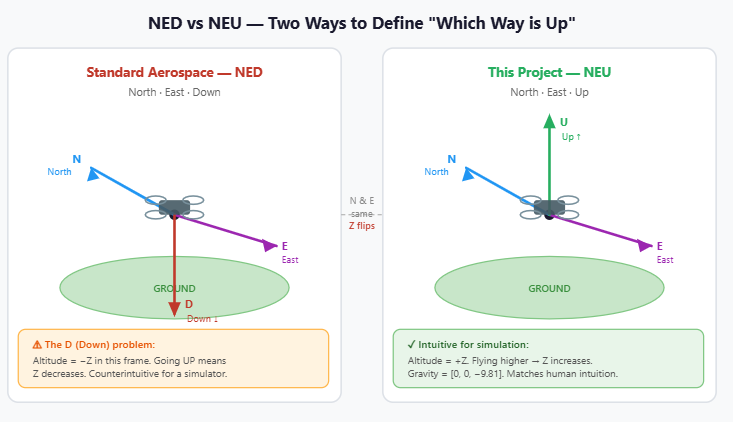
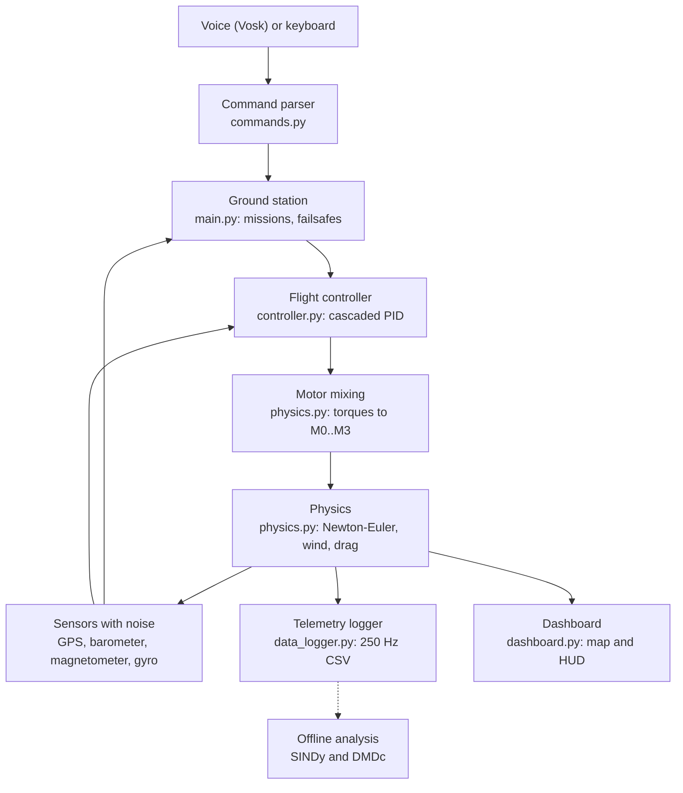
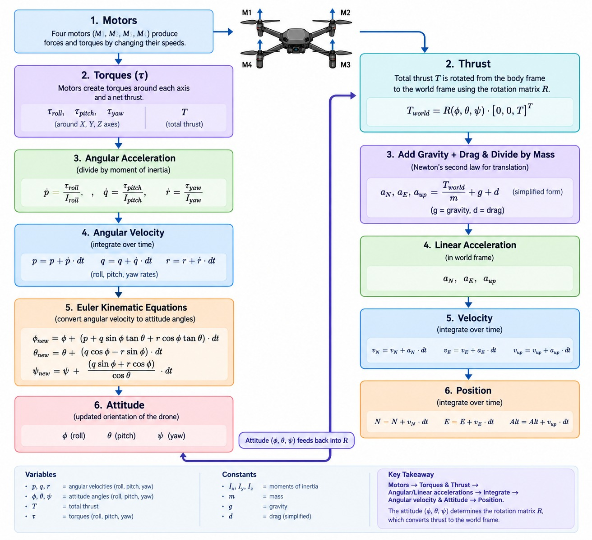
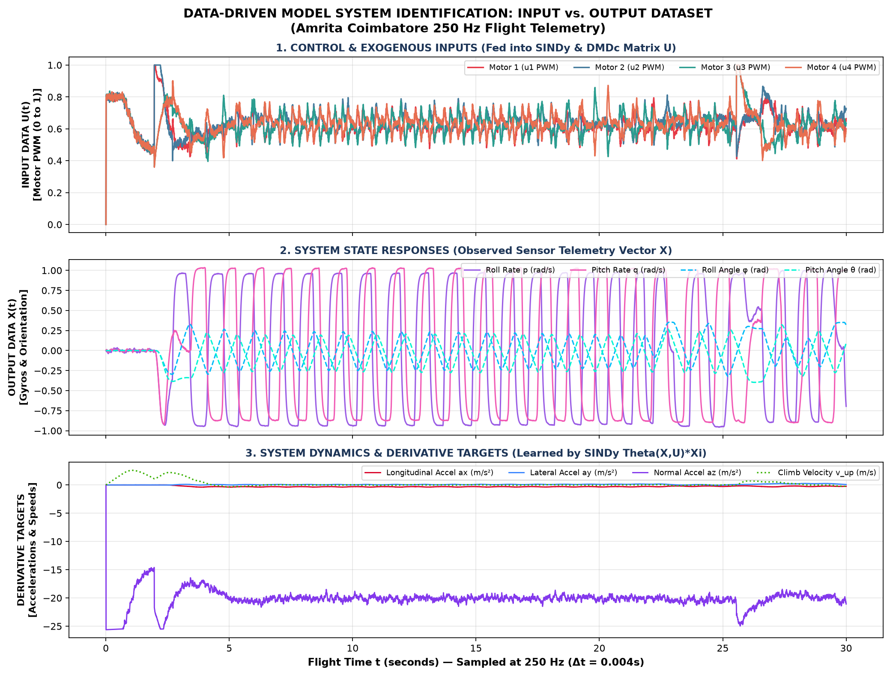
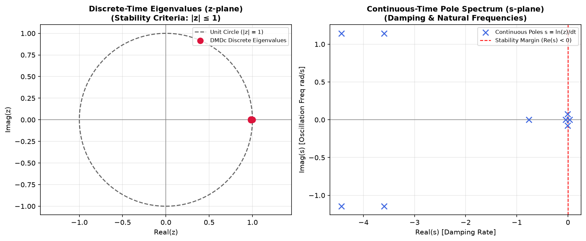
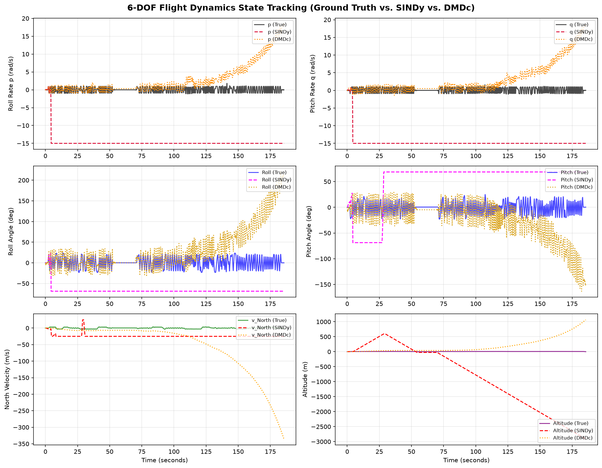

<p align="center">
  
</p>

> **Archived first attempt.** This branch holds the team's original ESP32/LiteWing-style Python simulator. It was moved here from `main` (its last state on `main` is commit `d0b2883`), it is no longer developed, and it was replaced by the models listed below. It is kept for reference.
>
> **Known issues, not fixed:**
>
> - `drone_sim/tests/test_sonification.py` (17 tests) imports `synthesize_tone`, `build_flight_composition`, `export_wav` and `play_wav`, which `sonification.py` does not contain, so those tests cannot pass.
> - In `drone_sim/physics.py` the wind vector is mixed up between axes: a wind vector pointing north pushes the drone east (checked by running the code with the random noise switched off).
> - The SINDy and DMDc models in `data_driven_results/` fit the training data, but run forward on their own they diverge: SINDy's rates reach their 15 rad/s limit within about 4 s and DMDc's altitude drifts to about 2000 m. Yaw is stored wrapped to 0-360 degrees and is not unwrapped before fitting.
> - `drone_sim/requirements.txt` lacks pandas, matplotlib and scipy, which the analysis needs.
> - The results summary names the Amrita campus (10.9001 N, 76.9002 E), but the simulation runs at latitude/longitude 0, 0.


| Name | Roll No. | Email |
|---|---|---|
| Mamidala Som Praneeth Babu | CB.SC.U4AIE24029 | cb.sc.u4aie24029@cb.students.amrita.edu |
| C. Karthik | CB.SC.U4AIE24107 | cb.sc.u4aie24107@cb.students.amrita.edu |
| Ch. Virinchi | CB.SC.U4AIE24158 | cb.sc.u4aie24158@cb.students.amrita.edu |
| K. Jatin Chandra Gupta | CB.SC.U4AIE24162 | cb.sc.u4aie24162@cb.students.amrita.edu |

---

### Related work — the newer attempts

This branch (`drone_esp32_sim`) holds our original ESP32-based attempt, moved here from `main`. The project
continued as separate branches of this same repo:

- **[`drone_mujoco`](https://github.com/praann07/Drones_S5_AB8_ESP32VoiceDrone/tree/drone_mujoco)** — a MuJoCo-based voice-controlled quadrotor with a SINDy-identified data-driven attitude controller (full pipeline: excitation → identification → validation → cascaded control → live voice demo).
- **[`drone_gazebo`](https://github.com/praann07/Drones_S5_AB8_ESP32VoiceDrone/tree/drone_gazebo)** — a PX4 + Gazebo voice-controlled quadrotor, also using SINDy/DMDc identification.
- **[`Drone_pybullet`](https://github.com/praann07/Drones_S5_AB8_ESP32VoiceDrone/tree/Drone_pybullet)** — a PyBullet city simulation with a speech-driven command parser, obstacle stop and live graphs.
- **[`Drones_Matlab`](https://github.com/praann07/Drones_S5_AB8_ESP32VoiceDrone/tree/Drones_Matlab)** — a MATLAB Drone Flight Lab with a command interface, obstacle stop and telemetry analysis.

The overview of all the models is the README of [`main`](https://github.com/praann07/Drones_S5_AB8_ESP32VoiceDrone/tree/main).

---


# ESP32 Autonomous Drone Simulator

A full Python simulation of an autonomous quadrotor drone with a Ground Control Station (GCS), voice command interface, cascaded PID flight controller, GPS waypoint navigation, wind disturbance modelling, and a 250 Hz telemetry logger feeding SINDy and DMDc system identification.

---

## Glossary — Every Key Term Defined

These terms appear throughout the codebase and this document. Read this once before diving into the stages.

| Term | Definition |
|------|-----------|
| **Quadrotor** | A rotorcraft with exactly four motors. Unlike a helicopter, it has no tail rotor — yaw is controlled by spinning two motors faster than the other two. |
| **NED** | North–East–Down. The standard aerospace world-frame convention. This project uses NEU (North–East–Up) so that altitude is positive upward, which is more intuitive for simulation. |
| **250 Hz** | The simulation runs the physics loop 250 times per second. This is fast enough to capture the drone's fastest dynamics without numerical instability. |
| **Motor Mixing** | The algebra that converts desired total thrust + three torques into four individual motor throttle commands. Inverts the torque equations. |
| **Reaction Torque** | When a motor spins clockwise, Newton's 3rd law pushes the drone body counter-clockwise. CW and CCW motors are paired diagonally so their reactions cancel for pitch/roll but add for yaw. |
| **Geofence** | A maximum allowed distance from home (160 m by default, `GEOFENCE_DEFAULT_RADIUS` in `config.py`). In GPS and RTH modes, crossing it forces a return home. |
| **Orbit Mode** | The drone circles a Point of Interest at a fixed radius. Each step, the angular position around the POI advances by $\omega \Delta t$ rad, and the nose always points at the centre. |
| **Vosk** | An offline speech recognition library. Processes raw microphone audio (16000 Hz, mono, 16-bit) and outputs text — no internet required. |
| **TTS** | Text-To-Speech. The simulator uses a persistent PowerShell process running `System.Speech.Synthesis.SpeechSynthesizer` to speak status announcements. |
| **SINDy** | Sparse Identification of Nonlinear Dynamics. A data-driven algorithm that discovers the governing equations of the drone from flight telemetry, using sparse regression (STLSQ). |
| **DMDc** | Dynamic Mode Decomposition with Control. Fits a linear state-space model $x_{k+1} = A x_k + B u_k$ to flight data. Reveals stability poles and coherent dynamic modes. |
| **STLSQ** | Sequentially Thresholded Least Squares — the sparse regression algorithm inside SINDy. Alternates between least-squares fit and zeroing small coefficients to find the simplest model. |
| **State Vector** | The complete description of the drone at one instant: position (N, E, Up), velocity (vN, vE, vUp), attitude (roll, pitch, yaw), angular rates (p, q, r). 12 numbers total. |
| **Telemetry** | All data logged during flight: position, velocity, attitude, rates, accelerations, motor commands, thrust, battery and wind (28 columns). Logged at 250 Hz to CSV for post-flight analysis. |
| **Phonetic Matching** | Deliberately mapping speech-recognition mishearings to correct commands — e.g. "you cough" → takeoff, because Vosk often mishears the word "takeoff". |

### NED vs NEU — Coordinate Frame Comparison



---

## What Exactly Happens When You Run This Project

This is a step-by-step trace of what the code does from launch to mission completion.

### Step 1 — Startup (`main.py`)

When you run `python -m drone_sim.main`:

1. All physical constants are loaded from `config.py` (mass, arm length, gains, etc.)
2. A `Drone` object is created — position set to (0, 0, 0), all velocities zero, all angles zero
3. A `FlightController` is created with all PID objects initialised
4. A `GCS` object wraps both — it will manage commands and the mission queue
5. The default mission waypoints (A, B, C, D, Home) are loaded into `navigation.py`
6. A voice listener thread starts (if Vosk model is present) — it sits silently waiting for microphone input
7. A TTS announcer thread starts — it opens a background PowerShell pipe to the speech synthesiser
8. A data logger object is created — it will write to a timestamped CSV file once armed
9. The Pygame window opens (in GUI mode), map tiles load, and the main loop begins

### Step 2 — Every Physics Frame (250 times per second)

The main loop runs `drone.step(dt)` — this is where physics lives:

1. **Wind** is sampled from the current wind model (calm/light/strong/storm) and added to the velocity error
2. **Motor torques** are computed from the four motor throttle commands using the mixing equations ($\tau_{roll}$, $\tau_{pitch}$, $\tau_{yaw}$)
3. **Angular accelerations** are found: $\alpha = \tau / I$ for each axis
4. **Angular rates** $(p, q, r)$ are updated, for example $p \leftarrow p + \alpha_{roll} \Delta t$
5. **Euler kinematic equations** convert $(p, q, r)$ into $(\dot\phi, \dot\theta, \dot\psi)$, which give the new Euler angles
6. **Rotation matrix R** is recomputed from the new Euler angles
7. **Thrust vector** (pointing up in the body frame) is rotated to the world frame: $F_{thrust}^{world} = R [0, 0, T_{total}]^\top$
8. **Total world-frame force:** $F_{total} = F_{thrust}^{world} + F_{gravity} + F_{drag}$
9. **Linear acceleration:** $a = F_{total} / m$
10. **Velocity** and **position** are updated via Euler integration
11. **Simulated sensors** add noise: GPS ($\sigma = 1.2$ m plus a slow bias drift), barometer ($\sigma = 0.3$ m), magnetometer ($\sigma = 1.5^\circ$) and gyro ($\sigma = 0.012$ rad/s)
12. **Battery** depletes based on total motor current draw
13. The 28 telemetry columns are written to the logger (if armed)

### Step 3 — Flight Controller Update (`controller.py`)

After physics, the GCS calls `controller.update(drone, dt)`:

1. **Altitude PID** reads barometer altitude → computes error vs. target → outputs desired vertical acceleration → becomes thrust command
2. **Position P controller** reads the GPS position, computes the error $(\Delta N, \Delta E)$, multiplies it by $K_p = 0.9$ and outputs a desired velocity (clamped to $\pm 3$ m/s)
3. **Velocity → attitude**: desired velocity is converted into desired roll and pitch angles (clamped to $\pm 20^\circ$)
4. **Attitude P controller** reads the IMU angles, computes the angle errors, multiplies them by $K_p = 7.0$ and outputs desired angular rates
5. **Rate PID** reads gyroscope rates → computes rate errors → outputs torque commands
6. **Motor mixing** converts $(T_{total}, \tau_{roll}, \tau_{pitch}, \tau_{yaw})$ into $M_0, M_1, M_2, M_3 \in [0, 1]$
7. These motor commands are written back to the `Drone` object, which uses them in the next physics step

### Step 4 — GCS Update (`main.py`)

Between physics and controller, the GCS runs its update:

1. **Checks failsafes:** geofence ($d_{home} > 160$ m), battery (below 20 % return home, below 10 % land), command timeout (more than 12 s without a command)
2. **Checks waypoint arrival:** if the horizontal distance is below 1.6 m and the altitude difference below 0.6 m, advance to the next waypoint
3. **Orbit mode**: if active, computes new orbital position around the POI
4. **Consumes voice queue**: any new commands from the speech recognition thread are processed here

### Step 5 — Command Arrives (example: "take off to 10 meters")

1. Vosk converts microphone audio to text: `"take off to 10 meters"`
2. `commands.parse()` normalises → matches "take off" keyword → extracts number 10.0 → returns `("takeoff", {"alt": 10.0})`
3. The GCS receives this tuple, arms the drone, sets the target altitude to 10.0 m and switches to manual (altitude-hold) mode
4. On the next controller update, altitude PID has a new setpoint of 10.0 m
5. PID outputs upward thrust → motors spin faster → drone climbs
6. Text-to-speech announces "Armed. Taking off to 10 meters." through the PowerShell pipe

### Step 6 — Mission Execution

1. Command `"start mission"` → GCS loads waypoints A→B→C→D→Home into `Mission` object
2. GCS sets `target = mission.current()` → controller steers toward A (20m N, 18m E)
3. Position PID drives the drone north and east, altitude PID holds height
4. Every frame the arrival condition is checked. When $d < 1.6$ m and $\lvert \Delta alt \rvert < 0.6$ m, `mission.advance()` makes B the target
5. After HOME is reached the mission is complete, and the GCS returns home and lands

### Step 7 — Post-Flight Analysis

After landing:

1. The data logger writes the CSV: 28 columns, one row per 4 ms step while armed
2. SINDy runs on the logged data: builds a library of candidate functions (states, products, trig terms) → STLSQ sparse regression → discovers which terms actually appear in the equations of motion → outputs a symbolic equation per state variable
3. DMDc runs: it computes the best-fit linear matrices $A$ and $B$ such that $x_{k+1} \approx A x_k + B u_k$, extracts the eigenvalues and reports their stability (all eigenvalues inside the unit circle means stable)
4. A Markdown summary (`data_driven_results/ddms_final_summary.md`), text reports and PNG plots are written

---

## Project Structure

```
drone_sim/
├── physics.py       — 6-DOF equations of motion, motor dynamics, sensors
├── controller.py    — Cascaded PID flight controller
├── navigation.py    — GPS ↔ local coordinate transforms, waypoints, missions
├── main.py          — GCS, mission management, main simulation loop
├── commands.py      — Voice/text command parser
├── voice.py         — Vosk speech recognition + TTS announcer
├── dashboard.py     — Pygame GUI, map tiles, HUD
├── data_logger.py   — 250 Hz telemetry logger
├── sindy_model.py   — SINDy system identification
├── dmdc_model.py    — DMDc linear model discovery
└── config.py        — All physical constants and tuning gains
```

---

## Installation

Python 3.10 or newer. The branch's `drone_sim/requirements.txt` lists only part of what the analysis needs, so install these packages:

```bash
git clone --branch drone_esp32_sim --single-branch https://github.com/praann07/Drones_S5_AB8_ESP32VoiceDrone.git
cd Drones_S5_AB8_ESP32VoiceDrone
python -m venv venv
venv\Scripts\activate            # Linux/macOS: source venv/bin/activate
pip install numpy pygame-ce vosk sounddevice pandas matplotlib scipy
```

| Package | Used for |
|---|---|
| `numpy` | Telemetry arrays, SINDy and DMDc |
| `pygame-ce` | Ground-station window, map, HUD |
| `vosk`, `sounddevice` | Offline speech recognition and microphone input (the small English model is already in `drone_sim/models/`) |
| `pandas`, `matplotlib`, `scipy` | Loading logs, plots, matrix functions in `data_driven_analysis.py` |

Text-to-speech uses Windows PowerShell; on other systems the simulator runs without it. The optional map layers download tiles from the internet.

## How to Run

```bash
python drone_sim/main.py                  # ground-station window (GUI)
python drone_sim/main.py --console        # console mode, no window
python drone_sim/main.py --headless       # scripted mission test: take-off, A, B, C, D, home, landing
python drone_sim/main.py --no-voice       # GUI without the microphone
python drone_sim/data_driven_analysis.py  # SINDy and DMDc on the logged flight, writes data_driven_results/
```

The headless test was re-run on 2026-10-24 (Python 3.13): all seven phases pass.

---

## System Architecture

Every 4 milliseconds ($\Delta t = 0.004$ s), the simulator runs this chain:



---

## How the Stages Depend on Each Other

Each stage builds directly on the ones before it. You cannot understand the controller without the physics, and you cannot understand the physics without coordinate frames.

```
Stage 1 — Coordinate Frames & Rotation Matrix
    │
    ├──────────────────────┐
    ▼                      ▼
Stage 2 — Equations     Stage 5 — Navigation
of Motion (Newton)      GPS ↔ Local Coords
    │                      │
    ▼                      │
Stage 3 — Motor            │
Commands → Torques         │
    │                      │
    ▼                      │
Stage 4 — PID Control ◄────┘
Cascaded Loops
    │
    ├──────────────────────┐
    │                      │
    ▼                      ▼
Stage 6 — Mission      Stage 7 — Voice
Planning & Waypoints   Command Parsing
    │                      │
    └──────────┬───────────┘
               │
               ▼
        Stage 8 — Telemetry
        Logging (250 Hz)
               │
               ▼
        Stage 9 — Main Loop
        Everything runs here,
        250 times per second
```

**Reading this diagram:**
- Stage 1 is the foundation — the rotation matrix is used in every physics calculation
- Stages 2 and 3 define what the drone physically does — Stage 4 (control) is meaningless without them
- Stage 5 feeds into Stage 4 — the PID needs positions in metres, not GPS degrees
- Stages 6 and 7 both feed targets into the flight controller
- Stage 9 is the integration point — it calls physics, GCS, and controller in the right order every frame

---

## Stage 1 — Coordinate Frames & Rotation Matrix

### Two Frames

The simulator uses two coordinate systems simultaneously.

**World Frame (NED — North, East, Up):**
Fixed to the ground. North, East, and Up are constant directions regardless of how the drone moves. GPS positions, gravity, and wind all live here.

**Body Frame:**
Fixed to the drone. X points out the nose, Y points out the right arm, Z points up through the centre. This frame tilts and spins with the drone.

### Euler Angles

Three angles describe how the body frame is rotated relative to the world frame:

| Angle | Symbol | Physical meaning | Rotation axis |
|-------|--------|-----------------|---------------|
| Roll | $\phi$ | Wings tilt left/right | X (nose axis) |
| Pitch | $\theta$ | Nose tips forward/back | Y (arm axis) |
| Yaw | $\psi$ | Nose spins left/right | Z (up axis) |

The axis of rotation is always the axis that **stays still** during that rotation. When the drone rolls, the nose doesn't move — so roll is around X.

### Rotation Matrix

Motors push thrust straight up in body frame. Gravity pulls straight down in world frame. To add these two forces, they must first be expressed in the same frame — the rotation matrix R does this conversion.

R is built by composing three sequential rotations:

```math
R = R_z(\psi) \cdot R_y(\theta) \cdot R_x(\phi)
```

Applied right-to-left: first roll, then pitch, then yaw. The combined result:

```math
R = \begin{bmatrix}
c_\psi c_\theta & c_\psi s_\theta s_\phi - s_\psi c_\phi & c_\psi s_\theta c_\phi + s_\psi s_\phi \\
s_\psi c_\theta & s_\psi s_\theta s_\phi + c_\psi c_\phi & s_\psi s_\theta c_\phi - c_\psi s_\phi \\
-s_\theta & c_\theta s_\phi & c_\theta c_\phi
\end{bmatrix}
```

A body-frame vector **v** is converted to world frame by: **v_world = R · v_body**

> **The physical consequence:** When the drone tilts forward 15°, thrust that was "straight up" in body frame now has a North component in world frame. This is the entire mechanism of quadrotor horizontal motion — no separate forward thruster exists.

---

## Flight Dynamics — Complete Flow



*(Generated by GPT-5.6 Luna — Verified by Authors)*

---

## Stage 2 — Equations of Motion

### Translational Motion (Newton's 2nd Law)

```math
\vec{a} = \frac{\vec{F}_{total}}{m}
```

Three forces act on the drone:

- **Thrust** — motors push upward in body frame, rotated to world frame via R
- **Gravity** — always pulls down in world frame: $g = 9.81 \ m/s^2$
- **Aerodynamic drag** — opposes velocity: $F_{drag} = -k_d \cdot v$

World-frame accelerations:

```math
a_N = \frac{T_N}{m} - k_d v_N, \quad a_E = \frac{T_E}{m} - k_d v_E, \quad a_{up} = \frac{T_{up}}{m} - g - k_d v_{up}
```

These integrate to velocity, then to position (Euler integration, dt = 0.004 s):

```math
v^{new} = v + a \cdot dt, \qquad pos^{new} = pos + v \cdot dt
```

### Rotational Motion

Rotation has an exact parallel to Newton's law:

```math
\alpha = \frac{\tau}{I}
```

Where $\tau$ is the torque (N m) and $I$ the moment of inertia ($\mathrm{kg \cdot m^2}$). Angular accelerations integrate to angular rates (p, q, r), which then map to Euler angle rates via the **Euler kinematic equations**:

```math
\dot{\phi} = p + q\sin\phi\tan\theta + r\cos\phi\tan\theta
```
```math
\dot{\theta} = q\cos\phi - r\sin\phi
```
```math
\dot{\psi} = \frac{q\sin\phi + r\cos\phi}{\cos\theta}
```

These cannot be simplified to $\dot{\phi}=p$, $\dot{\theta}=q$, $\dot{\psi}=r$ when the drone is tilted — body-frame spin mixes into multiple Euler angles simultaneously.

---

## Stage 3 — Motor Commands → Forces & Torques

### Motor Layout

Four motors in an X configuration, each arm 0.2 m long at 45° from the North/East axes. Opposite corners spin the same direction:

```
      M3 (CCW) ── M0 (CW)
           \    /
            \  /
            /  \
           /    \
      M2 (CW) ── M1 (CCW)
```

### From Motor Thrusts to Dynamics

Each motor i produces thrust $T_i = m_i \times T_{max}$ where $m_i \in [0, 1]$ and $T_{max} = 4.0 \ N$.

Because the arms sit at 45°, the effective lever arm for roll and pitch is:

```math
L = \frac{ARM}{\sqrt{2}} = \frac{0.2}{1.414} = 0.1414 \ m
```

The four outputs fed into the physics engine:

```math
T_{total} = T_0 + T_1 + T_2 + T_3
```

```math
\tau_{roll} = L(T_0 - T_1 - T_2 + T_3) \quad \text{(left-right thrust imbalance)}
```

```math
\tau_{pitch} = L(T_0 - T_1 + T_2 - T_3) \quad \text{(front-back thrust imbalance)}
```

```math
\tau_{yaw} = k_r(-T_0 - T_1 + T_2 + T_3) \quad \text{(CW vs CCW reaction torques)}
```

Yaw control works differently — it comes from the **reaction torque** of spinning motors (Newton's 3rd law), not from thrust imbalance.

**Motor mixing** inverts these equations to convert desired thrust and torques back into individual motor commands.

---

## Stage 4 — PID Control & Cascaded Loops

### The PID Formula

```math
u = K_p \cdot e + K_i \cdot \int e \, dt + K_d \cdot \frac{de}{dt}
```

| Term | Reacts to | Purpose |
|------|-----------|---------|
| P — Proportional | Current error | Main correction force |
| I — Integral | Accumulated past error | Eliminates steady-state error |
| D — Derivative | Rate of error change | Prevents overshoot |

The D term brakes the correction before arrival — like braking a car before the stop sign, not at it.

### Cascaded Loop Architecture

Rather than one large PID from position to motors, the controller stacks four loops. Each outer loop sets the target for the inner loop:

```math
\begin{aligned}
v_{des} &= \mathrm{clip}\big(0.9\,(p_{target} - p),\ \pm 3\ \mathrm{m/s}\big) && \text{position loop}\\
\theta_{des},\ \phi_{des} &= \mathrm{clip}\big(2.0\,(v_{des} - v),\ \pm 0.35\ \mathrm{rad}\big) && \text{velocity to tilt}\\
\omega_{des} &= \mathrm{clip}\big(7.0\,(\theta_{des} - \theta),\ \pm 1\ \mathrm{rad/s}\big) && \text{attitude loop}\\
\tau &= 0.20\,(\omega_{des} - \omega) - 0.012\,\omega && \text{rate loop}\\
(M_0, \dots, M_3) &= \mathrm{mix}(T, \tau_{roll}, \tau_{pitch}, \tau_{yaw}) && \text{motor mixing}
\end{aligned}
```

**Altitude** runs its own full PID ($K_p=2.4$, $K_i=0.18$, $K_d=1.5$) to produce thrust:

```math
T = m \times (g + a_{desired})
```

**Why cascade?** Each layer solves a simpler sub-problem and can be tuned independently. Jumping directly from position error to motor commands would mix incompatible physical scales.

---

## Stage 5 — Navigation & Coordinate Transforms

### GPS to Local Coordinates

The flight controller works in metres. GPS uses degrees. The flat-Earth conversion (valid under ~50 km):

```math
\Delta N = (\text{lat} - \text{lat}_{home}) \times 111000 \ m/deg
```
```math
\Delta E = (\text{lon} - \text{lon}_{home}) \times 111000 \ m/deg
```

The constant 111,000 comes from Earth's circumference divided by 360°.

### Distance and Bearing

In local metres, distance is Pythagoras:

```math
d = \sqrt{(\Delta N)^2 + (\Delta E)^2}
```

Bearing (clockwise from North) uses `atan2` — not regular `arctan` — because it handles all four compass quadrants:

```math
\text{bearing} = \text{atan2}(\Delta E, \ \Delta N) \times \frac{180°}{\pi}
```

### The wrap180 Problem

Without angle wrapping, a drone at heading 350° trying to reach 10° would compute error = 10 - 350 = -340° and spin almost a full circle the wrong way.

`wrap180` maps any angle to [-180°, +180°], always giving the shortest turn:

```math
\text{wrap180}(-340°) = -340° + 360° = +20° \quad \checkmark
```

This is applied to every heading error in the controller.

### Haversine Formula

For accurate distance on a curved Earth:

```math
a = \sin^2\!\left(\frac{\Delta\phi}{2}\right) + \cos\phi_1 \cdot \cos\phi_2 \cdot \sin^2\!\left(\frac{\Delta\lambda}{2}\right)
```

```math
d = 2R \cdot \arcsin(\sqrt{a}), \quad R = 6{,}371{,}000 \ m
```

Used for GPS distance reporting. The flight controller uses flat-Earth for speed.

---

## Stage 6 — Mission Planning & Waypoint Following

### Default Mission

```
Home (0, 0) → A (20m N, 18m E) → B (-4m N, 42m E) → C (-26m N, 6m E) → D (15m N, -25m E) → Home
```

### Arrival Condition

Every time step, the GCS checks:

```math
d_{horizontal} = \sqrt{(W_N - N)^2 + (W_E - E)^2} < 1.6\ \mathrm{m}
```
```math
\lvert W_{alt} - Alt \rvert < 0.6\ \mathrm{m}
```

Both conditions must be true. When arrived, `mission.index` advances to the next waypoint and the flight controller receives a new target.

### Orbit Mode

The drone can circle a Point of Interest (POI). Each step:

```math
\psi_{orbit}^{new} = \psi_{orbit} + \omega \cdot dt, \quad \omega = 0.35 \ rad/s
```

```math
N_{target} = N_{center} + R\cos(\psi_{orbit}), \quad E_{target} = E_{center} + R\sin(\psi_{orbit})
```

The nose always faces the POI centre.

### Failsafes

| Trigger | Response |
|---------|---------|
| Distance from home $> 160$ m (GPS and RTH modes) | Force return-to-home |
| Altitude > maximum | Force descent |
| Battery $< 20\%$ | Return to home |
| Battery $< 10\%$ | Land immediately |
| No command for $> 12$ s | Return home (GPS and RTH modes) or hover (manual mode) |

---

## Stage 7 — Voice Command Parsing

### Pipeline

```
Microphone → Vosk (offline neural net) → text string → parse() → action tuple → GCS
```

`parse()` normalises text (lowercase, strip punctuation), then matches keywords in priority order:

```
"take off to 10 meters" → ("takeoff", {"alt": 10.0})
"go to point a"         → ("goto",    {"name": "A"})
"return home"           → ("rth",     {})
"orbit point b"         → ("orbit",   {"name": "B"})
```

### Phonetic Matching

Speech recognition makes predictable errors. The parser handles them explicitly:

| Heard | Intended | Action |
|-------|---------|--------|
| "you cough" | "takeoff" | Takeoff |
| "return whom" | "return home" | RTH |
| "point bee" | "point B" | Goto B |
| "lab" | "land" | Land |

Voice runs on a **background thread** with a queue — the physics loop never waits for speech recognition.

---

## Stage 8 — Telemetry Logging & Data Analysis

The simulator logs 28 columns at **250 Hz** whenever armed:

```
timestamp, lat, lon, alt, climb_rate, vn, ve, vup, roll_deg, pitch_deg, yaw_deg,
p_rads, q_rads, r_rads, ax_body, ay_body, az_body, ax_world, ay_world, az_world,
u1_pwm, u2_pwm, u3_pwm, u4_pwm, thrust_total_N, battery_pct, wind_speed_mps, wind_heading_deg
```

After landing, two algorithms process this data:

**SINDy (Sparse Identification of Nonlinear Dynamics):** Discovers the governing equations of motion directly from flight data. Given logged states and inputs, it finds the mathematical structure of the system — essentially rediscovering the physics from observations.

**DMDc (Dynamic Mode Decomposition with control):** Finds the best linear approximation of the drone's dynamics. Useful when the true physics is unknown and a linear model is needed for control design.

Both methods are used in real aerospace research for flight dynamics identification and model validation.

---

### Plot 1 — Input vs Output Data Definition



This plot shows the **raw data fed into SINDy and DMDc**, split into three rows:

| Row | What it is | What it means |
|-----|-----------|--------------|
| **Top — INPUT U(t)** | 4 motor PWM signals (0–1 scale) | These are the control signals the PID sends to the motors every 4 ms. All 4 motors hover around 60–80% throttle. The brief dip to 0 at the start is the pre-arm idle period. |
| **Middle — OUTPUT X(t)** | State responses: roll rate p, pitch rate q, roll angle $\phi$, pitch angle $\theta$ | These are what the drone's gyroscope and IMU actually measure. The rapid oscillations show the PID loop constantly correcting — the drone never truly holds still. |
| **Bottom — DERIVATIVE TARGETS** | Accelerations ax, ay, az and climb velocity | This is what SINDy is trying to **learn to predict**. The dominant signal is $a_z \approx -20\ \mathrm{m/s^2}$ in the body frame (the specific force of the thrust), with $a_x$ and $a_y$ near zero during level flight. The green spike at the start is takeoff climb. |

**In plain English:** SINDy looks at columns 1 and 2 (what I did with the motors, what the drone did) and asks — *can I find a simple equation that connects them?*

---

### Plot 2 — DMDc Eigenvalue Spectrum (Stability Check)



After DMDc fits its linear model $x_{k+1} = A x_k + B u_k$, its stability is read from the eigenvalues $z$ of $A$ and the continuous-time poles $s = \ln z / \Delta t$.

**Left plot — Discrete-Time z-plane:**
- The dashed circle is the **unit circle** (radius = 1)
- The red dots are the eigenvalues of the DMDc model; they all cluster at $z \approx 1$
- **Rule:** $\lvert z \rvert < 1$ is stable, $\lvert z \rvert > 1$ is unstable, $\lvert z \rvert = 1$ is marginal
- **Result:** the eigenvalues sit on or extremely close to the unit circle. The model is at best marginally stable, which is why its predictions drift away in Plot 3. (The newer run in `data_driven_results/dmdc_stability_report.txt` has one eigenvalue at $\lvert z \rvert = 1.0006$, just outside.)

**Right plot — Continuous-Time s-plane:**
- The red dashed line is the **stability boundary** $\mathrm{Re}(s) = 0$
- **Rule:** $\mathrm{Re}(s) < 0$ is stable, $\mathrm{Re}(s) > 0$ is unstable
- **Result:** four complex poles at $\mathrm{Re}(s) \approx -4.4$ and $-3.6$ and one at $-0.75$ are stable, but a group of poles sits at $\mathrm{Re}(s) \approx 0$, on the boundary and partly just to its right.

**In plain English:** the fast modes are well damped, but the slow modes are not: the identified linear model does not reproduce a drone that holds its position, and Plot 3 shows the consequence.

---

### Plot 3 — State Tracking: Ground Truth vs SINDy vs DMDc



This is the most important result plot. It answers: **how well do SINDy and DMDc actually predict the drone's future state?**

Six subplots show six state variables over about 185 s of flight (both models are run forward from the first sample with the recorded motor inputs):

| Subplot | Ground truth | SINDy (dashed) | DMDc (dotted) |
|---------|-------------|----------------|---------------|
| Roll rate $p$ | Oscillates within $\pm 1$ rad/s | Jumps to the $-15$ rad/s clamp after about 4 s and stays there | Follows for about 100 s, then grows to about $+15$ rad/s |
| Pitch rate $q$ | Oscillates within $\pm 1$ rad/s | Same as $p$: pinned at $-15$ rad/s | Grows to about $+15$ rad/s |
| Roll angle | Within about $\pm 20^\circ$ | Pinned at about $-69^\circ$ (the 1.2 rad clamp) | Grows to about $+200^\circ$ |
| Pitch angle | Within about $\pm 20^\circ$ | Jumps between about $-69^\circ$ and $+69^\circ$ | Falls to about $-150^\circ$ |
| North velocity | Near 0 m/s | Pinned at about $-25$ m/s (the clamp) | Drifts to about $-330$ m/s |
| Altitude | Holds at 5 to 8 m | Rises to about 600 m, then falls to about $-3000$ m | Grows to about $+1000$ m |

The `data_driven_results/` folder holds a newer, shorter run (56 s) with the same behaviour.

**Why do both models fail in the long run?**
- **SINDy fails fast.** The derivatives are taken by central differences of noisy, unsmoothed data; yaw is logged wrapped to 0–360° and not unwrapped; the 38-term library with a very low threshold ($\lambda = 0.012$) keeps almost every term; and the model is never checked on held-out data. A dense model that fits derivatives well (high $R^2$) can still be unstable when integrated.
- **DMDc fails more slowly.** A linear model is a reasonable approximation near the operating point, but its eigenvalues on the unit circle (Plot 2) let errors accumulate, and it cannot represent products of states.

These are honest negative results. The `drone_mujoco` branch fixes each cause: it identifies only the attitude dynamics, smooths with a Savitzky-Golay filter before differentiating, uses a physics-motivated library, tests on held-out trials and checks 11 s rollouts before a model is used.

---

## Stage 9 — The Main Loop

### One Frame

```python
for _ in range(steps_per_frame):
    drone.step(dt)           # physics: forces → velocity → position
    gcs.update(dt)           # mission: advance waypoints, check failsafes
    gcs.controller.update(drone, dt)  # PID: compute new motor commands
```

`steps_per_frame` is computed from real elapsed time divided by dt, clamped to 6. This keeps physics accurate regardless of GUI frame rate.

### Threading Model

| Thread | Job |
|--------|-----|
| Main | Physics + control + GUI rendering |
| Voice listener | Microphone → Vosk → queue |
| TTS announcer | Queue → PowerShell SpeechSynthesizer |
| Data analysis | SINDy + DMDc (triggered post-flight) |

Commands arrive from the voice thread via a `queue.Queue` and are consumed by the main thread each frame — ensuring physics and command handling never conflict.

---

## Physical Constants

| Constant | Value | Meaning |
|----------|-------|---------|
| Mass | 1.0 kg | Drone body + battery |
| Arm length | 0.2 m | Centre to motor |
| $I_{roll}$, $I_{pitch}$ | $0.012\ \mathrm{kg \cdot m^2}$ | Rotational inertia |
| $I_{yaw}$ | $0.02\ \mathrm{kg \cdot m^2}$ | Harder to spin vertically |
| Motor max thrust | 4.0 N each | 16 N total, $1.6\times$ the hover thrust |
| Drag coefficient | 0.06 | Horizontal and vertical |
| Simulation dt | 0.004 s | 250 Hz physics rate |

---

## Flight Modes

| Mode | Description |
|------|-------------|
| STANDBY | Disarmed, motors off |
| MANUAL | Altitude hold + velocity commands |
| GPS | Full position hold + waypoint following |
| RTH | Return to home position |
| LANDING | Controlled descent to ground |

---

## References

Every DOI and link was checked on 2026-10-24.

1. R. Mahony, V. Kumar, and P. Corke, "Multirotor aerial vehicles: Modeling, estimation, and control of quadrotor," *IEEE Robot. Autom. Mag.*, vol. 19, no. 3, pp. 20–32, 2012. doi: [10.1109/MRA.2012.2206474](https://doi.org/10.1109/MRA.2012.2206474)
2. K. J. Åström and T. Hägglund, *PID Controllers: Theory, Design, and Tuning*, 2nd ed. Research Triangle Park, NC, USA: Instrument Society of America, 1995.
3. S. L. Brunton, J. L. Proctor, and J. N. Kutz, "Discovering governing equations from data by sparse identification of nonlinear dynamical systems," *Proc. Natl. Acad. Sci. USA*, vol. 113, no. 15, pp. 3932–3937, 2016. doi: [10.1073/pnas.1517384113](https://doi.org/10.1073/pnas.1517384113)
4. J. L. Proctor, S. L. Brunton, and J. N. Kutz, "Dynamic mode decomposition with control," *SIAM J. Appl. Dyn. Syst.*, vol. 15, no. 1, pp. 142–161, 2016. doi: [10.1137/15M1013857](https://doi.org/10.1137/15M1013857)
5. R. W. Sinnott, "Virtues of the Haversine," *Sky and Telescope*, vol. 68, no. 2, p. 159, 1984.
6. D. Povey *et al.*, "The Kaldi speech recognition toolkit," in *Proc. IEEE Workshop on Automatic Speech Recognition and Understanding (ASRU)*, Hawaii, USA, 2011.
7. Alpha Cephei, "Vosk offline speech recognition toolkit" (model `vosk-model-small-en-us-0.15`). [Online]. Available: <https://alphacephei.com/vosk/>
8. Pygame community, "Pygame (pygame-ce) documentation." [Online]. Available: <https://pyga.me/docs/>
9. C. R. Harris *et al.*, "Array programming with NumPy," *Nature*, vol. 585, pp. 357–362, 2020. doi: [10.1038/s41586-020-2649-2](https://doi.org/10.1038/s41586-020-2649-2)
10. P. Virtanen *et al.*, "SciPy 1.0: Fundamental algorithms for scientific computing in Python," *Nat. Methods*, vol. 17, pp. 261–272, 2020. doi: [10.1038/s41592-019-0686-2](https://doi.org/10.1038/s41592-019-0686-2)
11. W. McKinney, "Data structures for statistical computing in Python," in *Proc. 9th Python in Science Conf. (SciPy)*, 2010, pp. 56–61. doi: [10.25080/Majora-92bf1922-00a](https://doi.org/10.25080/Majora-92bf1922-00a)
12. J. D. Hunter, "Matplotlib: A 2D graphics environment," *Comput. Sci. Eng.*, vol. 9, no. 3, pp. 90–95, 2007. doi: [10.1109/MCSE.2007.55](https://doi.org/10.1109/MCSE.2007.55)
13. Microsoft, "System.Speech.Recognition namespace," .NET API documentation. [Online]. Available: <https://learn.microsoft.com/dotnet/api/system.speech.recognition>
