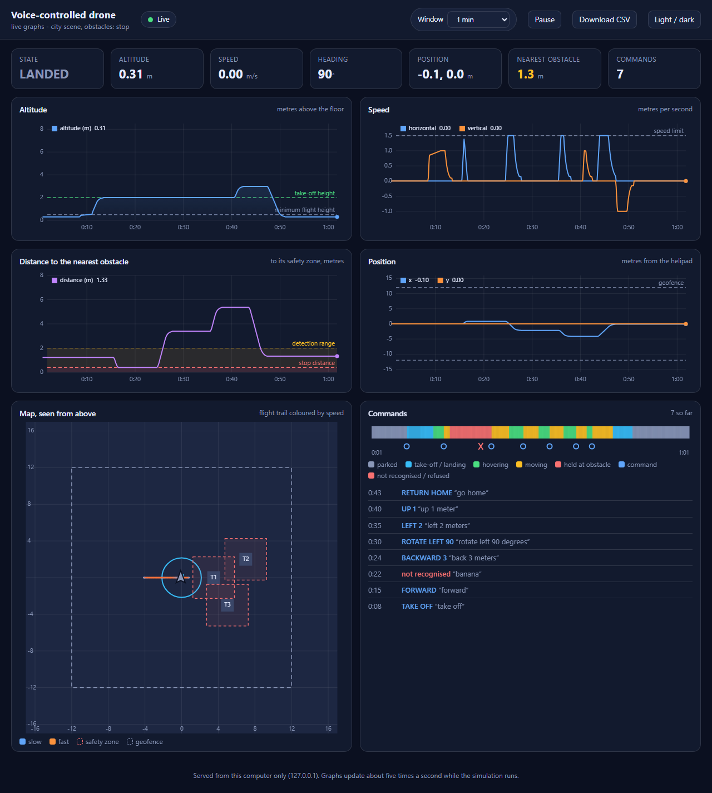

# Voice-Controlled Quadcopter Drone in PyBullet

An interactive 3D quadcopter simulation built with **PyBullet** and **SpeechRecognition**. Fly it by voice, fall back to the keyboard at any moment, let it stop itself before it hits anything, watch it all happen in a living city plaza, and get a CSV flight log of everything it did.

---

## Features

- **Voice control** – a background thread listens to the microphone (Google Web Speech API) and understands natural phrases: *"take off"*, *"go left"*, *"turn to the left"*, *"move forward"*, *"land"*. Whole words are matched, so *"island"* never lands the drone.
- **Keyboard override** – hold keys to steer; release them and the drone hovers. A voice command keeps running while you are not touching the keyboard.
- **Stops before obstacles** – the drone looks ahead along its direction of travel, brakes smoothly and holds still at a safe distance in front of any obstacle. The pillar blocking it pulses red, the rear lights flash and the status line turns red. Give it another direction (or *"back"*) to move on. `--on-obstacle steer` makes it fly around obstacles instead. A hard collision stop is the last line of defence.
- **Measured commands** – say *"forward 3 meters"*, *"up ten feet"* or *"rotate left 90 degrees"* and the drone moves exactly that far (or until an obstacle stops it), then hovers. Plain *"forward"* keeps going until you say *"stop"*.
- **Return home** – *"go home"* (or `H`) flies back over the take-off point and lands on the pad (it stops short if an obstacle is in the way).
- **Flight modes** – the drone starts on the ground and has to take off; it lands on the ground (not hovering half a metre above it); acceleration is smooth, not teleporting; the drone leans into its direction of travel and the rotors only spin while it is flying.
- **A living city plaza** – you fly over a paved plaza with a helipad (yellow ring, green lights), tree planters, benches and lamp posts, surrounded by a ring road with **moving traffic** and crosswalks, pedestrians strolling the sidewalks, and a skyline of textured buildings (taller on the side away from the sun, so none of them shades the plaza). The obstacles are kiosk towers that grow a red halo as the drone nears. Everything is built from PyBullet primitives and generated textures (`scene_assets.py`, `scene_city.py`) - no downloaded assets. `--scene simple` gives a plain floor and pillars for slow machines.
- **The drone** – landing skids, a camera gimbal, a GPS puck, red/green/white navigation lights (the white one strobes; the rear lights flash red on an obstacle stop) and translucent rotor discs that appear as the rotors spin up. Sharp sun shadows make height easy to judge.
- **Cameras & overlays** – press `C` (or say *"camera"*) to cycle four cameras: **follow** (keeps whatever angle and zoom you set with the mouse), **chase** (behind the drone, turning with it), **top** (straight down, like a mission map) and **fixed**. Labels attached to the drone show its state (red = held at an obstacle, cyan = taking off/landing, green = hovering, yellow = moving), position/speed/heading, the distance to the nearest obstacle and the last phrase heard; `[` and `]` resize them. A marker on the floor under the drone, joined to it by a thin line, shows its height; a sensor ray shows what is ahead (green clear → red close); a flight trail coloured by speed fades behind it (`P`); `Z` draws each obstacle's safety zone.
- **Smooth** – in the full city on integrated Intel graphics the simulation loop spends about 3 ms of its 8 ms budget per frame. Every call into the window was measured, and the expensive ones (rewriting text, changing colours) are rationed: see the note in `Hud`.
- **One-piece drone model** – `drone.urdf` loads as a single multibody with four counter-rotating propellers, so the whole drone moves in the same instant (no glitching parts).
- **Live graphs** – when the simulation starts, your browser opens a dashboard that follows the flight as it happens: altitude, speed, the distance to the nearest obstacle, position, a top-down map with the flight trail, and a timeline of every command (accepted, refused or not recognised). See [Live graphs](#live-graphs).
- **Telemetry** – every command and one sample per second while airborne are appended to `drone_data.csv`.

> The motion model is kinematic (commanded velocities, not simulated rotor thrust). PyBullet provides the 3D world, rendering and camera.

---

## Screenshots

| City plaza overview | Held in front of an obstacle (the tower glows) |
| :---: | :---: |
|  |  |
| **Chase camera** | **Top camera** |
|  |  |

These are frames from the window's own renderer. The labels, sensor ray, floor line and trail are drawn by the window itself and do not appear in such captures.

The screenshots of the first version are in `legacy/old_screenshots/`.

---

## Project Structure

```text
pybullet_voice_drone/
├── drone_core.py                 # Command parser, flight model, obstacle handling, drone model, cameras, HUD, voice, telemetry, main loop
├── scene_city.py                 # The city: plaza, roads, buildings, trees, kiosks, helipad, traffic, pedestrians
├── scene_assets.py               # Generates the textures and meshes the city uses (pure Python)
├── dashboard.py                  # Live graphs: records the flight and serves it to the browser (127.0.0.1 only)
├── dashboard.html                # The graphs page (charts drawn on canvases, no libraries, works offline)
├── main.py                       # Launcher: keyboard mode (voice/obstacles optional)
├── Voice_Drone_PyBullet.py       # Launcher: voice mode
├── obstacles.py                  # Launcher: voice mode + obstacles (the drone stops before them)
├── drone.urdf                    # Drone model (one multibody, 4 spinning propellers, lights, rotor discs)
├── assets/                       # Generated textures (recreated automatically if deleted); assets/mesh/ is not tracked
├── screenshots/                  # Pictures used by this README
├── output/                       # Results table, simulation screenshots, logs and the scripts that produced them (see output/README.md)
├── test_drone_core.py            # Headless unit tests
├── drone_data.csv                # Telemetry log (appended on every run)
├── drone_command_data.csv        # Old command log from an earlier version (no longer written)
├── legacy/                       # The original scripts and screenshots, kept for reference (not maintained)
└── requirements.txt
```

The three launchers only differ in their defaults – all of them accept the same options (see below).

---

## Prerequisites

- **Python 3.9 – 3.12**
- **Microphone + internet** for voice control (not needed for keyboard mode or `--console`)
- **PyAudio** (installed by `requirements.txt`)

---

## Installation

```bash
git clone --branch Drone_pybullet --single-branch https://github.com/praann07/Drones_S5_AB8_ESP32VoiceDrone.git
cd Drones_S5_AB8_ESP32VoiceDrone/pybullet_voice_drone
```

**Windows (PowerShell):**
```powershell
python -m venv venv
.\venv\Scripts\Activate.ps1
```

**Linux / macOS:**
```bash
python3 -m venv venv
source venv/bin/activate
```

```bash
pip install --upgrade pip
pip install -r requirements.txt
```

> [!TIP]
> **PyAudio won't install?** Windows has prebuilt wheels for Python 3.9–3.12, so `pip install PyAudio` normally just works. On Linux install PortAudio first (`sudo apt install portaudio19-dev`), on macOS `brew install portaudio`. Without a microphone you can still fly with the keyboard or type commands with `--console`.

---

## How to Run

| Command | Voice | Obstacles |
| :--- | :---: | :---: |
| `python Voice_Drone_PyBullet.py` | on | off |
| `python obstacles.py` | on | on |
| `python main.py` | off | off |

Options (all launchers):

| Option | Meaning |
| :--- | :--- |
| `--voice` / `--no-voice` | Turn the microphone on or off |
| `--obstacles` / `--no-obstacles` | Spawn obstacles and make the drone detect them |
| `--on-obstacle stop\|steer` | What the drone does when an obstacle is in its way: `stop` before it (default) or `steer` around it |
| `--language CODE` | Language for the speech service: `en-IN` (Indian English, default), `en-US`, `en-GB`, ... |
| `--console` | Also accept commands typed into the terminal (handy without a microphone) |
| `--scene city\|simple` | `city` (default): plaza, roads, traffic, skyline. `simple`: plain floor and pillars, lighter on slow machines |
| `--camera follow\|chase\|top\|fixed` | Starting camera (`C` cycles through them) |
| `--hud-size SCALE` / `--no-hud` | Scale of the labels above the drone (`[` and `]` change it while flying), or hide them |
| `--no-trail` / `--zones` | Start with the flight trail hidden / the obstacle safety zones drawn |
| `--telemetry-file PATH` / `--no-log` | Where to log flight data, or don't |
| `--graphs` / `--no-graphs` | Show the live graphs in the browser (default: on) or turn them off |
| `--graphs-port PORT` / `--no-browser` | Port for the graphs (8765; the next ones are tried if it is taken) / serve them without opening the browser (the address is printed) |
| `--duration SECONDS` | Exit automatically (useful for smoke tests) |

For example, keyboard flying with obstacles: `python main.py --obstacles`.

The drone **starts on the ground**: say *"take off"* (or press `T`) first.

---

## Voice Commands

Speak (or type with `--console`) one command at a time. Several wordings work for each:

| Say | Action |
| :--- | :--- |
| **take off**, takeoff, lift off, launch | Climb to 2 m and hover (never pulls a higher drone back down) |
| **forward**, go forward, move forward | Fly in the direction the red nose points |
| **backward**, back, go back, reverse | Fly backwards |
| **left**, go left, move to the left | Slide left |
| **right**, go right, move to the right | Slide right |
| **up**, rise, climb, ascend | Climb (also lifts off from the ground) |
| **down**, descend, lower | Descend (stops at 0.5 m; say *land* to go lower) |
| **rotate left**, turn left, turn to the left | Yaw counter-clockwise |
| **rotate right**, turn right, spin right | Yaw clockwise |
| **stop**, halt, freeze, hover, hold | Brake and hover (also cancels a measured move or return home) |
| **go home**, return home, go back home | Fly back over the take-off point and land |
| **land** | Descend to the ground and stop the rotors |
| **camera** | Cycle the camera: follow, chase, top, fixed |
| **trail** | Show / hide the flight trail |
| **zones**, safety zones | Show / hide the obstacle safety zones |
| **exit**, quit | Close the simulation |

**Distances and angles:** add a number to any move or rotation. Digits or words both work (`3`, `three`, `twenty five`, `2.5`), metres by default or `feet`; rotations are in degrees.

| Say | Action |
| :--- | :--- |
| *forward 3 meters*, *go left two meters*, *back 4m* | Move exactly that far along the drone's own heading, then hover |
| *up 2 meters*, *down ten feet* | Climb / descend by that amount (*up* also works on the ground as a lift-off) |
| *rotate left 90 degrees*, *turn right one hundred eighty* | Turn on the spot by that angle |

Distances are capped at 50 m and turns at 720°. A measured move gives up (and hovers) if the drone is pinned against the world limit or ceiling, or if it takes far too long to get there.

While the drone is on the ground only *take off* and *up* are accepted.

### Voice tips

- **Language.** The speech service is set to Indian English (`--language en-IN`); try `--language en-US` or `en-GB` if that suits your accent better.
- **Several guesses.** Google returns ranked guesses for each phrase. The first of the top three that is a drone command is used, so a phrase whose best guess is *"for this"* can still be understood as *"forward"*.
- **No dead time.** Listening carries on while the previous phrase is being transcribed, so commands spoken one after another are all heard.
- **See what it heard.** The console prints `YOU SAID: ...`, plus `(heard "..." - took "...")` when a lower guess was used and `(other guesses: ...)` when nothing matched. If one command keeps failing, those lines show what the recogniser hears instead.
- **Forgiving matching.** Split words are joined (*for word*, *back word*), one-letter slips are repaired (*forwad*, *takeof*), and *rotating* / *turning* count as *rotate* / *turn*. Unrelated speech is never guessed into a command; it is simply reported as not recognised.
- **Privacy.** Everything the microphone hears, background talk included, is sent to Google's speech service.

---

## Keyboard Controls

Click the PyBullet window first. PyBullet's own debug shortcuts (W = wireframe, A, C, G …) are switched off so they don't interfere.

| Key | Action |
| :---: | :--- |
| **`W` / `S`** | Forward / backward (hold) |
| **`A` / `D`** | Left / right (hold) |
| **`Q` / `E`** | Up / down (hold) |
| **`←` / `→`** | Rotate left / right (hold) |
| **`T`** | Take off |
| **`L`** | Land |
| **`H`** | Return home and land |
| **`Space`** | Stop and hover |
| **`C`** | Cycle the camera: follow, chase, top, fixed |
| **`P`** | Show / hide flight trail |
| **`Z`** | Show / hide obstacle safety zones |
| **`[` / `]`** | Make the labels above the drone smaller / bigger |
| **`X`** | Exit |
| *(release all)* | Hover in place |

Keys can be combined (e.g. `W`+`D` flies diagonally).

---

## Obstacle Handling

Every frame the drone casts a ray along its commanded direction of travel (so it works for *backward*, *left/right* and *down* too) and tests it against each obstacle grown by the drone's footprint (propeller-tip radius 1.32 m, plus the skids' height) and a 0.25 m **safety distance** – the *safety zone*, drawn with `Z`. It looks up to `DETECTION_DISTANCE = 2 m` ahead.

**`--on-obstacle stop` (default)**
1. **Brake** – the drone keeps its speed until it is close enough that a gentle $2\ \mathrm{m/s^2}$ deceleration can still stop it, then slows smoothly.
2. **Hold** – it halts `STOP_BUFFER = 0.4 m` in front of the zone and stays there. Its command is dropped, so it cannot take off again on its own (for example when you turn it to face clear space).
3. **Say what happened** – the status label turns red, the blocking tower's halo pulses, the rear lights flash, and a measured move or *"go home"* ends with *STOPPED - OBSTACLE AHEAD*.
4. **Move on** – any direction that is clear works at once; moving away from the obstacle always works, even from inside the zone.

**`--on-obstacle steer`**
1. **Choose a route** (once per obstacle) – it works out how far it would have to shift left and right to clear *everything* within a 4 m planning horizon and takes the cheaper side, provided that side is free and inside the world. If both sides are blocked it **climbs over** (when the obstacle is low enough); otherwise it stops.
2. **Go around** – forward speed fades as the obstacle gets closer while the drone strafes (or climbs).
3. **Resume** – as soon as the ray is clear (with a small margin) the drone continues with the command you gave.

**Safety net (both modes)** – motion that would put the drone inside an obstacle is cancelled one axis at a time, so it can never pass through one.

The three demo obstacles are defined by `DEFAULT_OBSTACLES` in `drone_core.py`; tuning constants (speeds, distances, colours, light position) sit at the top of the same file.

---

## Telemetry

`drone_data.csv` is appended to on every run (header written only once): one row per command, plus one per second while airborne. Velocities are world-frame m/s, positions metres, yaw degrees.

```csv
Time,Voice_Input,Command,Velocity_X,Velocity_Y,Velocity_Z,Drone_X,Drone_Y,Drone_Z,Yaw
2026-10-21 20:54:44,take off,TAKE OFF,0.000,0.000,0.000,0.000,0.000,0.310,0.0
2026-10-21 20:54:45,,TAKE OFF,0.000,0.000,1.000,0.000,0.000,1.152,0.0
2026-10-21 20:54:46,,TAKE OFF,0.000,0.000,0.275,0.000,0.000,1.867,0.0
2026-10-21 20:54:47,,HOVER,0.000,0.000,0.000,0.000,0.000,2.000,0.0
```

`Voice_Input` is the recognised (or typed) phrase and is empty on the periodic rows. Rows written by older versions of this project use the same header with other time formats.

---

## Live graphs

Starting the simulation also starts a small web page on **your own computer** and opens it in the browser. It follows the flight while you fly (`http://127.0.0.1:8765/` - the address is also printed in the console). The page uses no internet and no extra packages; the server only accepts connections from the same computer.

| Graph | What it shows |
| :--- | :--- |
| **Status tiles** | State (parked, taking off, hovering, moving, held at an obstacle, landing), altitude, speed, heading, position, distance to the nearest obstacle, number of commands |
| **Altitude** | Height over time, with the take-off height and the minimum flight height as reference lines |
| **Speed** | Horizontal and vertical speed over time, with the speed limit |
| **Distance to the nearest obstacle** | Gap to the closest safety zone. The red band is the stopping distance (0.4 m) and the amber band the detection range (2 m), so you can watch the drone brake and hold |
| **Position** | x and y over time against the geofence |
| **Map** | Top view: the geofence, the towers with their dashed safety zones, the helipad, and the flight trail coloured by speed with an arrow for the heading |
| **Timeline and command log** | A strip of the flight state over time with a marker for every command; a red cross where a phrase was not recognised or the drone refused it |

Controls at the top: the time window (30 s, 1 min, 5 min or the whole flight), **Pause**, **Download CSV** (every sample the page has received) and a light/dark switch. The page follows your system's light or dark setting; add `?theme=dark` or `?theme=light` to the address to choose. After the simulation window is closed the page keeps the last data, so a flight can still be looked at (and downloaded).

The simulation records a sample ten times a second in memory (the last ten minutes are kept) and the page asks for new data five times a second. Measured on this machine (two runs), storing a sample takes 0.03 - 0.05 ms, a frame that only checks the clock under 0.001 ms, and in total recording costs 0.4 - 0.5 ms for each second of flight, so the simulation does not slow down.



*After a scripted flight: take off, forward (held in front of the first tower), an unrecognised phrase, back 3 m, turn left 90°, left 2 m, up 1 m, go home.*

```bash
python obstacles.py                  # graphs open automatically
python obstacles.py --no-browser     # serve them, open the printed address yourself
python obstacles.py --no-graphs      # no graphs at all
```

---

## Tests

The tests run headless – no window, microphone or internet:

```bash
python -m unittest -v
```

They cover the command parser (including distances and angles), flight modes, measured moves and return-home, stopping before obstacles (braking distance, no creeping, no restart after turning, return-home and measured moves being stopped), the optional steer-around mode (including walls it must climb over and dead ends), the visuals (lean, rotor discs, navigation lights, floor marker, status colours), the generated textures and meshes, the city (traffic stays on the road, pedestrians never walk through lamp posts, no building shades the plaza, kiosks keep their exact collision boxes), the four cameras, the labels (attached to the drone, unchanged text never rewritten, rewrites rate-limited), the URDF model, keyboard handling, the voice thread (with a stubbed recogniser) and the CSV logger and the live-graph server (what a sample contains, that the page is only sent what is new, that old samples are dropped, that it only listens on this computer and serves nothing but the page and its data).

---

## Working in the team repository

This folder lives on the `Drone_pybullet` branch of the team repository. Commit and push to that branch only:

```bash
git status
git add pybullet_voice_drone
git commit -m "Describe the change"
git push origin HEAD:refs/heads/Drone_pybullet
```

---

## References

The full project report, with the mathematics, is in the [branch README](../README.md#22-references).

1. E. Coumans and Y. Bai, "PyBullet, a Python module for physics simulation for games, robotics and machine learning," 2016–2021. [Online]. Available: <https://pybullet.org>
2. A. Zhang, "SpeechRecognition: Library for performing speech recognition, with support for several engines and APIs" (Python package). [Online]. Available: <https://github.com/Uberi/speech_recognition>
3. Google, Web Speech API speech-to-text service, accessed through `SpeechRecognition.Recognizer.recognize_google` (language `en-IN`, up to three ranked alternatives).
4. J. W. Ratcliff and D. E. Metzener, "Pattern matching: The gestalt approach," *Dr. Dobb's Journal*, vol. 13, no. 7, p. 46, Jul. 1988. (The similarity ratio used by Python's `difflib`.)
5. T. L. Kay and J. T. Kajiya, "Ray tracing complex scenes," *ACM SIGGRAPH Comput. Graph.*, vol. 20, no. 4, pp. 269–278, 1986. doi: [10.1145/15886.15916](https://doi.org/10.1145/15886.15916)
6. Open Robotics, "URDF XML specification," ROS Wiki. [Online]. Available: <https://wiki.ros.org/urdf/XML>
7. Python Software Foundation, "http.server: HTTP servers," Python 3 standard library documentation. [Online]. Available: <https://docs.python.org/3/library/http.server.html>

---

## License

No license file is included yet. Add a `LICENSE` file (for example MIT) before publishing if you want others to be able to reuse the code.
